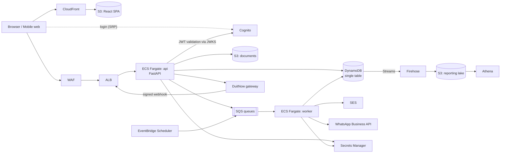

# Anjung: High-Level Design (HLD)

| | |
|---|---|
| **Product** | Anjung (rental management system) |
| **Status** | Draft v0.3 |
| **Market** | Malaysia (single country, single region) |
| **Stack** | Python (FastAPI), AWS ECS Fargate, Amazon Cognito, DynamoDB, React SPA |
| **Related** | `anjung-lld.md` (v0.3), `openapi.json` (v0.17.0), `anjung-implementation-plan.md` (v0.3) |

**Changes in v0.3** (brought in line with the implementation, contract v0.3.1 to v0.17.0)

- **Manager scope** (contract v0.4.0): a property manager sees only the properties they manage and what belongs to them, plus the tenants they created or who rent there. An org admin sees everything and can reassign a property's manager (section 3).
- **Staff access window** (v0.5.0): an org admin can deactivate a staff member, or limit their access to dates. It is checked at sign-in and on every request (sections 3 and 11).
- **Limit per manager** (v0.6.0; units since v0.13.0): an org admin sets how many units a manager may hold, shown to the manager as "used / limit" (sections 3 and 6.2).
- **Tenancy agreement signing** (v0.7.0): staff send the agreement, each tenant signs in the portal (or staff record a paper signature), and only then can the lease be activated. An org setting can switch the rule off (section 7.5).
- **Draft lease deposits** (v0.7.1) can be changed until activation (section 8.1).
- **Set-password links** (v0.8.0): a tenant can be invited with a one-time link that staff share on WhatsApp or the app sends over WhatsApp, as well as by email (section 5).
- **Deactivate and delete** (v0.9.0): one lifecycle in every module. Deactivate and reactivate are reversible; delete is previewed first and either removes a record made by mistake, erases a tenant's personal data, or explains why not. A retention purge deletes old records once counsel sets the periods (section 12).
- **Parking bays** (v0.10.0): a bay belongs to the property or to a unit. It comes with a unit let as a whole, and is otherwise let on its own lease, with an optional vehicle plate (section 6.2).
- **Company branding** (v0.11.0): each company is its own organisation and can show its own name, logo, colour and registration number: on its sign-in page at `/login/<handle>`, in the app, in emails and on receipts. The SPA now has its own sign-in page (SRP against Cognito) instead of the hosted UI (sections 5 and 10).
- **Company plan** (v0.12.0, v0.13.0): the platform admin sets each company's unit limit (whole units; rooms, bays and empty properties are free) and end date; the company's admin divides it between managers and staff. After the end date staff are read-only for 30 days while tenants carry on, then the company is closed until renewed (section 3).
- Display fields so lists show who rents which unit or room, and who reported or is assigned to a maintenance request. Tenants show their tenancy (current, upcoming, past, none) separately from their account status. `GET /v1/documents` lists an owner's documents (v0.3.1 to v0.6.0, sections 6.2 and 7.4).
- Dates are shown as DD-MM-YYYY. The API keeps ISO 8601 (section 10).
- The repository layout matches the code (section 7.1), and there is a local and home-network demo setup (section 13.2).
- New open question 11 on electronic signatures and stamp duty (section 18).

**Changes in v0.2**

- Product named **Anjung**. Monorepo `anjung`, table `anjung-main`.
- Platform admins create, suspend and close organisations through `/v1/platform/organizations` (sections 3 and 7.4).
- Invoices come from a daily sweep that runs ahead of each due date, not a monthly run (sections 4.2, 6.4 and 8.1).
- Late-fee percentages are integer basis points (section 8.5).
- The detailed key schema now lives in LLD section 4 (section 6.3).
- Delivery phases match the implementation plan (sections 16 and 17).
- Room-by-room letting: a whole unit is let either as one or by the room, never both at once. Leases can be rolling with a notice period, deposits are tracked by type, one-off charges can be billed, and maintenance can target shared areas (sections 1, 6.2, 7.4 and 8.1).
- QR codes are created on the pay screen and messages carry pay links, because acquirers may give QR codes a validity of about a minute (sections 8.1, 8.2 and 8.4). Cognito uses the Essentials plan. The vendor role is deferred, and LHDN e-invoicing is out of scope for v1. New open questions cover phone payments and the merchant model (section 18).
- READMEs, a post-deploy smoke test and a Postman collection are part of the repository and the pipeline (sections 7.1 and 13.3).

---

## 1. Purpose and Scope

Anjung is a multi-tenant web platform for landlords and property managers to manage properties, units, tenants, leases, rent invoicing and collection, and maintenance requests. Tenants self-serve through a web portal.

**In scope (v1):** organisations, properties, units (let whole or room by room), tenants, leases (fixed-term or rolling month to month), invoices and one-off charges, deposits by type, DuitNow payments, ledger, maintenance requests, documents, email and WhatsApp notifications, reporting, PDPA controls.

**Out of scope (v1):** multi-currency, multi-region, native mobile apps, FPX (online banking redirect) and card payments, accounting-system integrations, LHDN e-invoicing (MyInvois), tenant screening, the vendor role, bedspace letting, automatic splitting of shared utility bills. The online banking exclusion is under review for tenants paying on a phone (open question 9).

## 2. Decisions Summary

| Area | Decision | Notes |
|---|---|---|
| Compute | ECS Fargate: `api` and `worker` services from one image | Auto-scaling on CPU and ALB request count |
| Language and framework | Python 3.12+, FastAPI, Pydantic v2 | Modular monolith |
| Auth | Amazon Cognito (Essentials feature plan), one user pool; the SPA signs in on its own (branded) page with SRP | Custom claims via V2 Pre Token Generation Lambda, which needs Essentials or Plus |
| Database | DynamoDB, single-table design, on-demand billing | Reporting through Streams → S3 → Athena |
| Frontend | React + TypeScript SPA (Vite) on S3 + CloudFront | Responsive, installable as PWA, EN and BM |
| Payments | DuitNow QR (dynamic, per invoice) and DuitNow transfer | Via a payment aggregator behind a `PaymentProvider` interface |
| Notifications | SES (email) and WhatsApp Business Platform | Channel abstraction, per-user preferences |
| Region | Malaysia region (`ap-southeast-5`) if all services are available, else Singapore | PDPA cross-border rules apply to the alternative |
| IaC | AWS CDK (Python) | Stacks: network, data, auth, app, edge, observability |
| Compliance | PDPA 2010 as amended 2024 | DPO, breach notification, portability, security principle |

## 3. Actors and Roles

| Role | Cognito group | Capabilities |
|---|---|---|
| Platform admin | `platform_admin` | Create, suspend and close organisations, support access (all audited with a reason) |
| Org admin | `org_admin` | Full control of own organisation, users and settings. Sees every property. Assigns properties to managers, deactivates staff or limits their access to dates, and sets each manager's unit limit. Also handles unmatched payments and invoice runs, which are organisation-wide |
| Property manager | `property_manager` | Properties, units, leases, invoices, maintenance, documents and reports, limited to the properties they manage (the ones they created, or that an org admin assigned to them) and the tenants they created or who rent there. Anything else behaves as if it did not exist (404) |
| Tenant | `tenant` | View own lease, invoices, pay, raise maintenance requests, sign the tenancy agreement of a lease they are on |
| Vendor (deferred, not in v1) | `vendor` (reserved) | Later release: view and update assigned maintenance jobs |

A user with both `org_admin` and `property_manager` has the admin's view. Any org admin can invite another org admin. Above them, the platform admin sets each company's plan: a unit limit for the whole company and an end date (contract v0.12.0; units since v0.13.0); the controls below work within it. Staff controls an org admin has over each user:

| Control | Effect |
|---|---|
| Deactivate, reactivate | A deactivated user cannot sign in or call the API, from the next request. Nothing they manage is removed, and reactivating restores it |
| Access dates (`active_from`, `active_until`) | Inclusive Malaysian dates. Before the start or after the end, the user is blocked as if deactivated. The dashboard shows a manager when their access ends |
| Unit limit | The number of units a manager may hold: whole units that are on, in their properties (empty means no limit; rooms, bays and empty properties are free). Adding a unit or being assigned a property beyond it is refused. Lowering the limit never takes anything away |

## 4. Architecture

### 4.1 Logical view



### 4.2 Components

| Component | Responsibility |
|---|---|
| **CloudFront + S3** | Serves the SPA with an origin access control, and caches static assets |
| **WAF + ALB** | Rate limiting, managed rule sets, TLS termination, routing to `api` |
| **api service** | REST API, JWT validation, RBAC, tenancy enforcement, presigned URL issuance, webhook intake |
| **worker service** | SQS consumer for invoice generation, reminders, notification delivery, reconciliation, purge jobs |
| **Cognito** | Identity, MFA, invitations, token issuance |
| **DynamoDB** | System of record for all domain data |
| **S3 (documents)** | Leases, receipts, maintenance photos. Private bucket, KMS encrypted, presigned URL access |
| **SQS (+ DLQs)** | Decouples request handling from async work, with retries and dead-letter queues |
| **EventBridge Scheduler** | Daily invoice sweep, overdue checks, reminder sweeps, retention purges |
| **Streams → Firehose → S3 → Athena** | Reporting pipeline, so reports never scan the table |
| **Secrets Manager** | Gateway keys, webhook secrets, WhatsApp tokens |
| **CloudWatch / X-Ray (or OpenTelemetry)** | Logs, metrics, alarms, tracing |

### 4.3 Network layout

- VPC with two or three AZs: public subnets (ALB, NAT), private subnets (ECS tasks).
- DynamoDB and S3 via **gateway VPC endpoints** (no NAT cost for that traffic). Add interface endpoints for ECR, Secrets Manager, and CloudWatch Logs if NAT cost warrants it.
- Security groups: ALB accepts 443 from the internet, tasks accept traffic from the ALB only.

## 5. Authentication and Authorisation

### 5.1 Cognito design

- **One user pool** with groups from section 3. The `tenant` group is for renters, and staff groups are for landlord-side users.
- **App client** for the SPA: SRP sign-in from the SPA's own page (branded per company, contract v0.11.0), no client secret, short-lived access tokens (about 15 to 60 minutes), refresh and revocation. The hosted UI stays configured for tools such as Postman.
- **Pre Token Generation Lambda** injects `custom:org_id` and a role list into the ID and access tokens. The Lambda reads the user's membership from DynamoDB (or from user attributes set at invitation).
- **MFA:** required for staff, optional for tenants.
- **Invitations:** a manager invites a tenant via `AdminCreateUser`, with a one-time set-password link: in the app's welcome email (contract v0.14.0; Cognito's invitation email before), shared by staff on WhatsApp themselves, or sent by the app over WhatsApp (contract v0.8.0). Staff and a company's first admin get the same kind of welcome email and link (contract v0.15.0). No welcome email goes to an address that bounced. On first login, or when the password is set through the link, the tenant record is linked to the Cognito `sub`.
- **Organisation onboarding:** a platform admin creates an organisation together with its first org admin, who receives an invitation. Suspending an organisation blocks sign-in and API access for its users.
- **Support access:** `platform_admin` actions on a tenant org are written to the audit log with a reason.

### 5.2 Request flow

1. The SPA signs the user in on its own page (SRP with Cognito; the password never reaches the API) and receives tokens.
2. SPA calls the API with `Authorization: Bearer <access_token>`.
3. A FastAPI dependency validates signature, issuer, audience or client ID, expiry, and `token_use`, using cached JWKS.
4. The dependency builds a `RequestContext(user_id, org_id, roles)` from the token only. **`org_id` is never taken from the request body, path, or query.**
5. Route-level RBAC checks the roles. Resource-level checks verify ownership, for example a tenant can only read their own lease.

### 5.3 Tenancy enforcement (DynamoDB has no RLS)

- Every repository method requires `org_id` as an explicit argument, supplied from `RequestContext`.
- Partition keys are prefixed by org (`ORG#<id>`), so a query cannot cross organisations unless the code deliberately omits the prefix.
- Automated tests attempt cross-org reads and writes for every endpoint (see section 13).
- Optional hardening: IAM leading-key conditions if any component ever accesses the table with per-tenant credentials.

## 6. Data Design (DynamoDB)

### 6.1 Principles

- Single table (`anjung-main`), with generic attribute names `PK`, `SK`, `GSI1PK`..., plus `entity_type`, `schema_version`, `created_at`, `updated_at`.
- Money is stored as **integer minor units** (sen) plus `currency` (default `MYR`).
- Timestamps in UTC ISO-8601, displayed in Asia/Kuala_Lumpur.
- IDs are ULIDs (sortable by time).
- The ledger is **append-only**. Corrections are new entries.
- On-demand capacity to start, with PITR, deletion protection, and a customer-managed KMS key.

### 6.2 Entities

| Entity | Key attributes |
|---|---|
| Organisation | name, settings (late-fee rules, due-day defaults, branding, whether a signed tenancy agreement is required before activation), status |
| User membership | user sub, org, roles, status, access dates, unit limit |
| Property | name, address, type, manager (the creator by default) |
| Unit | property, type (whole unit, room or parking bay), parent unit (rooms: the unit they are in; bays: the unit they come with, if any), letting mode (whole units: let whole or by room), label, rent default, note, status |
| Tenant | org, Cognito sub (once linked), contact details, notification preferences, consent records, created by |
| Lease | unit or room, tenant(s), start date, end date (empty for a rolling tenancy), notice days, rent (minor units), deposits by type (security, utility, access card, other), due day, status, tenancy agreement (document sent, signatures) |
| Invoice | lease, period (`yyyy-mm`), line items, total, status, due date, QR reference |
| Payment | invoice, amount, method, gateway reference, status, received timestamp |
| Ledger entry | lease, type (charge, payment, adjustment, deposit), amount, reference |
| Maintenance request | room or unit, or a shared area of a unit or property, tenant, category, status, priority, comments, attachments |
| Document | owner entity, S3 key, type, retention class |
| Notification log | recipient, channel, template, status, provider message ID |
| Audit log | actor, action, entity, before and after summary, timestamp, IP |

### 6.3 Key schema and access patterns

| # | Access pattern | Index | Key condition |
|---|---|---|---|
| 1 | Get org profile and settings | Table | `PK=ORG#<org>`, `SK=META` |
| 2 | List properties in org | Table | `PK=ORG#<org>`, `SK begins_with PROP#` |
| 3 | List units in property | Table | `PK=ORG#<org>`, `SK begins_with PROP#<p>#UNIT#` |
| 4 | Get lease | Table | `PK=ORG#<org>`, `SK=LEASE#<id>` |
| 5 | Leases by unit | GSI1 | `GSI1PK=UNIT#<id>`, `GSI1SK=LEASE#<start>` |
| 6 | Leases by tenant | GSI1 | `GSI1PK=TENANT#<id>`, `GSI1SK=LEASE#<start>` |
| 7 | Tenant by Cognito sub | GSI2 | `GSI2PK=SUB#<sub>` |
| 8 | Invoices for a lease | Table | `PK=LEASE#<id>`, `SK begins_with INV#` |
| 9 | Open or overdue invoices by due date (per org) | GSI3 (sparse) | `GSI3PK=ORG#<org>#STATUS#open`, `GSI3SK=<due_date>#<inv>` |
| 10 | Ledger for a lease | Table | `PK=LEASE#<id>`, `SK begins_with LEDGER#` |
| 11 | Payment by gateway reference (idempotency) | Table | `PK=PAYREF#<ref>`, `SK=META` (conditional put) |
| 12 | Maintenance requests by status | GSI4 | `GSI4PK=ORG#<org>#MR#<status>`, `GSI4SK=<created_at>` |
| 13 | Maintenance requests by tenant | GSI1 | `GSI1PK=TENANT#<id>`, `GSI1SK=MR#<created_at>` |
| 14 | All data for a tenant (PDPA export/delete) | GSI5 | `GSI5PK=SUBJECT#<tenant>`, `GSI5SK=<entity>#<id>` |
| 15 | Audit log by entity or time | Table | `PK=AUDIT#<org>#<yyyy-mm>`, `SK=<ts>#<id>` |

> The GSI list is a starting point. Each GSI multiplies write cost, so add one only when an access pattern is confirmed.

> **Superseded by LLD section 4.** The table above shows the access patterns. The LLD's key schema is the one to build. There, every GSI partition key except GSI2 is prefixed with `ORG#<org>`, invoices and ledger entries sit under `ORG#<org>#LEASE#<id>`, and unpaid invoices share one sparse GSI3 partition sorted by due date.

### 6.4 Consistency and idempotency rules

- **Invoice generation:** each invoice is written in a transaction with a lock item `INVKEY#<yyyy-mm>#<kind>` (kind is rent, deposit or a late fee). The lock is a conditional put, so a repeated sweep cannot double-bill.
- **Payment recording:** a `TransactWriteItems` that (a) conditionally creates `PAYREF#<ref>`, (b) writes the payment, (c) appends the ledger entry, and (d) updates invoice status and the running balance. A duplicate webhook fails the condition and is acknowledged without changes.
- **Running balance** on the lease item is a cache. The ledger is the source of truth, and a nightly job verifies the two agree.
- **Schema evolution:** `schema_version` on every item, with additive changes and backfill scripts.

### 6.5 Reporting

- DynamoDB Streams feed Firehose, which writes partitioned Parquet (or JSON) to S3. Athena and Glue serve arrears, occupancy, income, and maintenance reports.
- The API exposes pre-built reports and CSV exports. Reports are eventually consistent (minutes). Until the pipeline is built, the reports read DynamoDB directly (LLD 12.1).

## 7. Application Design (Python)

### 7.1 Layout

One repository, `anjung`, as built:

```
anjung/
  README.md            overview, repo map, quick start (each folder below also has a README)
  docker-compose.yml   local stack: DynamoDB Local, S3 stand-in (moto), api
  docker-compose.nas.yml  home-network demo (api, web, DynamoDB Local, S3 stand-in)
  backend/
    app/
      core/            config, auth, request context, access window, dates, logging, errors, ids, money
      repositories/    DynamoDB access layer (org-scoped)
      domains/         one package per area: router, service, schemas
        platform/ organisations/ properties/ tenants/ leases/ billing/ maintenance/
        documents/ notifications/ privacy/ reports/ audit/
        scope.py       manager scope (what a property manager may see)
        places.py      display names (property, unit, room, people)
      integrations/    payments (PaymentProvider, fake), channels, storage, identity, mock sign-in
      lambdas/         pre_token_generation, post_confirmation, scan_result
      worker/          SQS consumers, scheduled job handlers
      seed.py          local demo data
    tests/             unit, integration, contract, cross_org
  frontend/            React + Vite SPA (Dockerfile and nginx config for the demo image)
  infra/               CDK (Python)
  contracts/           openapi.json, postman/ (collection generated from the contract, environments)
  smoke/               post-deploy smoke test, plus local_flow.py for the local money path
  docs/                HLD, LLD, implementation plan, runbooks, status checklist, NAS deploy guide
```

### 7.2 Libraries and tooling

FastAPI, Pydantic v2, pydantic-settings, aioboto3 (or boto3), httpx, structlog or standard logging with JSON output, uv, ruff, mypy, pytest, pytest-asyncio, testcontainers (DynamoDB Local or LocalStack).

### 7.3 Conventions

- REST with versioned prefix (`/v1`), cursor-based pagination, consistent error envelope, idempotency keys on mutating endpoints that create money-related records.
- Layering: router → service → repository. Business rules live in services, and repositories contain no business logic.
- Worker handlers are idempotent and safe to retry.

### 7.4 Indicative API surface

| Area | Endpoints |
|---|---|
| Platform | `GET/POST /v1/platform/organizations`, `GET/PATCH /v1/platform/organizations/{id}`, `PATCH …/{id}/plan` (unit limit and end date) (platform admin only) |
| Orgs and users | `GET /v1/me`, `GET/PATCH /v1/org`, `GET /v1/users`, `POST /v1/users/invite`, `PATCH/DELETE /v1/users/{id}` (roles, deactivation, access dates, unit limit) |
| Properties and units | `/v1/properties` (an org admin sets `manager_id`), `/v1/properties/{id}/units`, `POST …/{deactivate,reactivate}` for properties and units |
| Branding | `PATCH /v1/org` (`branding`), public `GET /v1/brands/{handle}` and `/logo` |
| Tenants | `/v1/tenants`, `POST /v1/tenants/{id}/invite` (email, WhatsApp or shareable link), public `GET /v1/invites/{token}` and `POST /v1/invites/{token}/accept` |
| Leases | `/v1/leases`, `POST /v1/leases/{id}/activate`, `/terminate`, `/renew`, `POST /v1/leases/{id}/charges` (one-off charge), `POST /v1/leases/{id}/agreement/{send,sign,paper}` |
| Invoices | `GET /v1/invoices`, `GET /v1/invoices/{id}`, `POST /v1/invoices/{id}/qr` |
| Payments | `POST /v1/invoices/{id}/payments/manual`, `POST /v1/webhooks/payments/{provider}` |
| Maintenance | `/v1/maintenance-requests`, `/{id}/comments` |
| Documents | `GET /v1/documents?owner_type&owner_id`, `POST /v1/documents/upload-url`, `GET /v1/documents/{id}/download-url` |
| Reports | `GET /v1/reports/{arrears,occupancy,income,maintenance}`, each also as a CSV download (`format=csv`, contract v0.15.0) |
| Privacy | `GET /v1/privacy/export` (own data), `GET /v1/tenants/{id}/privacy-export` (staff-handled requests), `POST /v1/privacy/requests` |
| Delete (every module) | `GET …/deletion` (preview) and `DELETE …?reason=` for properties, units, tenants, draft leases and closed maintenance requests |

The full contract is `openapi.json` (v0.17.0, 99 operations). Its `contracts/README.md` lists every change after v0.3.0.

### 7.5 Tenancy agreement and activation

A lease starts as a draft, which staff can still edit (rent, dates, due day, notice, charges, tenants and deposits).

1. Staff upload the agreement as a `lease_agreement` document on the lease and send it. Tenants are notified, and from then on they can see the draft lease and read the agreement.
2. Each tenant on the lease signs in the portal by typing their full name, which must match the name on the lease (case and spacing do not matter), and ticking that they agree. The signature records the time, the document, the IP address and the browser.
3. For a tenant who cannot use the portal, staff upload the signed scan and record a paper signature. It names the staff member who recorded it.
4. When everyone has signed, staff activate the lease. Activation bills the deposits (section 8.1).

Rules:

- Activation is refused until every tenant has signed, while the org setting `require_signed_agreement` is on (the default). An org admin can switch it off in Settings.
- Changing any term of a draft after sending clears the signatures, and the lease becomes internal again until it is sent again. Nobody stays bound to terms they did not see.
- Lease agreements are financial records under a retention hold, so a sent agreement cannot be deleted.
- Leases activated before this feature have no agreement record and are unaffected.

## 8. Billing and Payments (DuitNow)

### 8.1 Model

- A daily scheduled sweep (EventBridge → SQS → worker) generates one invoice per active lease per period, a set number of days before the due date (`invoice_lead_days`, an org setting). It uses the lease's due day, rent, and any recurring charges. Running daily means leases created late in the month are still invoiced, and a failed run is retried the next day.
- Each invoice is paid with a **dynamic DuitNow QR** carrying the amount and a unique reference, so a payment can be matched to the invoice automatically. Acquirers set their own QR validity, which can be about a minute, so the QR is created when the tenant opens the pay screen, never in advance.
- DuitNow transfer (proxy ID or bank account) is shown as a secondary option, with the invoice reference for matching.
- On activation, a lease's deposits (security, utility, access card, other) are billed in one deposit invoice. They are tracked per type and settled per type at termination. A draft lease's deposits can be changed until activation. After that they are fixed, and a top-up is a one-off charge.
- One-off charges (a share of a utility bill, a repair, cleaning after move-out) are billed as their own invoice, also after a lease has ended. Shared bills are split by hand in v1.

### 8.2 Payment flow

1. Invoice created by the daily sweep. Email and WhatsApp send a **pay link** to the portal's pay screen, never a QR image.
2. Tenant signs in and opens the pay screen. The API requests a QR from the gateway (`PaymentProvider.create_qr`) and the screen shows it with a countdown, refreshing it on expiry.
3. Tenant pays through their banking app. On a phone this means saving the QR image and importing it into the banking app, unless v1 adds a redirect option (open question 9).
4. Gateway sends a signed webhook to the API.
5. API verifies the signature and timestamp, then enqueues the event for the worker.
6. Worker applies the idempotent transaction from section 6.4 and sends a receipt.

### 8.3 Provider abstraction

```python
class PaymentProvider(Protocol):
    async def create_qr(self, invoice: Invoice) -> QrResult: ...
    def verify_webhook(self, headers: Mapping[str, str], body: bytes) -> PaymentEvent: ...
    async def fetch_settlements(self, day: date) -> list[SettlementRecord]: ...
```

### 8.4 Edge cases

| Case | Handling |
|---|---|
| Duplicate webhook | Conditional write on `PAYREF#`, return 200 with no changes |
| Underpayment | Record payment, invoice becomes `partially_paid`, remaining balance stays open |
| Overpayment | Record as credit on the ledger, applied to the next invoice |
| Expired QR | The pay screen requests a new one. Old references stay matchable for 30 days, so late payments and delayed webhooks still reconcile |
| Payment with no matching reference | Park in an "unmatched" queue for manual allocation |
| Cash or bank transfer | Manual "mark as paid" by a manager, audited |
| Webhook lost | Daily reconciliation against the settlement report |

### 8.5 Late fees and reminders

Late-fee rules are per-organisation configuration: none, a fixed amount, or a percentage of the overdue balance per month overdue. Percentages are stored as integer basis points (150 = 1.5%), so billing never uses floating-point numbers. Reminders are scheduled before, on, and after the due date, with a rate limit per tenant.

### 8.6 Open item

Confirm with the chosen gateway whether DuitNow AutoDebit (recurring mandates) is offered. If yes, it can be added as a later phase without changing the invoice and ledger model.

## 9. Notifications

### 9.1 Channels

| Channel | Provider | Use |
|---|---|---|
| Email | Amazon SES | Invoices, receipts, invitations, notices |
| WhatsApp | WhatsApp Business Platform (via a BSP or AWS's WhatsApp integration) | Rent due and overdue reminders, payment confirmations, maintenance updates |

### 9.2 Design

- `NotificationChannel` interface, with a `NotificationService` that picks channels from the user's preferences.
- Templates are versioned and localised (EN and BM). Business-initiated WhatsApp messages must use **pre-approved templates**, so submit them early because approval takes lead time.
- **Opt-in** is recorded per tenant and channel, and opt-out is honoured immediately.
- SES: verified domain, DKIM, SPF, DMARC. Bounces and complaints go through SNS into a suppression list.
- Every send is recorded in the notification log with status and provider message ID. Failures retry with backoff and then go to a DLQ.

## 10. Frontend

- **React + TypeScript**, built with Vite, hosted on S3 behind CloudFront.
- **Auth:** the SPA's own sign-in page (SRP with `amazon-cognito-identity-js`, new-password and MFA steps, forgot password), branded per company at `/login/<handle>`; tokens kept in session storage and refreshed silently.
- **Branding:** the company's logo or name and accent colour in the app, on the sign-in and set-password pages, in emails and on receipts. Each company is its own organisation.
- **State and data:** TanStack Query for server state, a typed API client generated from the OpenAPI schema.
- **UI:** responsive, mobile-first, accessible. Installable as a PWA.
- **i18n:** English and Bahasa Malaysia from the start, including every status label. A test checks that each status value in the contract has a label.
- **Dates:** shown as DD-MM-YYYY (times in Malaysian time). The API and storage keep ISO 8601.
- **Lists:** whole rows are clickable, and on phones tables become stacked cards. Rooms are indented under their unit. Leases and tenants show who rents which unit or room, and maintenance shows where the issue is and who reported or is assigned to it.
- **Portals:** one SPA with role-based routes (staff dashboard and tenant portal). The staff dashboard shows a manager their access end date and property usage ("1 / 5"). The tenant dashboard prompts the tenant when an agreement is waiting for their signature.
- **Security headers:** strict CSP, HSTS, and no inline scripts, set at CloudFront.

## 11. Security

| Concern | Control |
|---|---|
| Transport | TLS everywhere, HTTPS-only with HSTS |
| Data at rest | DynamoDB, S3, and Secrets Manager encrypted with KMS customer-managed keys |
| Sensitive fields | Field-level encryption for IC and passport numbers, or avoid collecting them |
| Documents | Private S3 bucket, presigned URLs with short expiry, malware scan on upload |
| Edge protection | WAF managed rules, rate limiting, bot control as needed |
| Secrets | Secrets Manager only, rotated, never in environment files or the image |
| Webhooks | Signature and timestamp verification, replay protection, source IP allow-list where supported |
| IAM | Least-privilege task roles, no long-lived keys |
| Detection | CloudTrail, GuardDuty, Security Hub, CloudWatch alarms |
| Supply chain | Dependency scanning, image scanning in ECR, pinned versions |
| Accounts | Separate AWS accounts for dev, staging, and prod where possible |
| Staff access | Deactivation and access dates are checked at sign-in and on every API request (one membership read per staff request), so removal takes effect at once. Managers see only their own properties (section 3) |

## 12. Compliance (PDPA)

The PDPA was amended in 2024, with the main new obligations effective from June 2025. Confirm applicability and details with legal counsel.

| Obligation | Design response |
|---|---|
| **Roles** | Likely a **data processor** for landlord organisations (the controllers) if you operate the platform as SaaS, with a data processing agreement per org. If one landlord operates it themselves, they are the controller |
| **DPO** | Appoint a DPO and register as required |
| **Breach notification** | Incident runbook, detection alarms, an assessment template, and a notification path to the Commissioner and affected individuals within the required time frame |
| **Data portability and access** | `GET /v1/privacy/export` returns all of a tenant's data in a structured format, using the subject index (GSI5) |
| **Correction and deletion** | Privacy request workflow with an audit trail, plus an anonymisation job covering every entity type. Staff can also delete a tenant directly: removed completely if they never had a lease, otherwise erased through the same workflow |
| **Security principle** | Controls in section 11, applying to the processor too |
| **Consent and purpose** | Consent records per tenant (purpose, version, timestamp), a privacy notice shown at onboarding |
| **Cross-border transfer** | Prefer Malaysia-region hosting. If another region is used, follow the cross-border transfer guidelines and document the basis |
| **Data minimisation** | Collect only fields needed for the lease and billing |

### Retention (to be confirmed by counsel)

Retention is configurable per document and record type:

| Class | Example | Default (to confirm) | Mechanism |
|---|---|---|---|
| Lease and financial records | Leases, invoices, payments, ledger | Around 6 years after lease end, or longer if tax rules require | Scheduled purge or anonymisation job |
| Operational data | Maintenance requests, notification logs | 1 to 2 years | Purge job |
| Transient data | Expired invitations, sessions | Days to weeks | DynamoDB TTL |
| Audit log | Admin and security actions | Per security policy | Archive to S3 (Object Lock if required) |

> TTL is used only for transient data. Financial and lease records are purged through an explicit job, never TTL.

**As built (v0.9.0).** Everyday records follow one lifecycle: **deactivate** (reversible: hidden from new leases and lists), **reactivate**, and **delete**, which is previewed first and does one of three things. A record made by mistake (nothing depends on it) is removed completely. A tenant with lease history has their personal data erased while the financial records stay. Anything with live leases, open money or lease history is refused with the reason. The screen reads the preview when it opens and offers Delete only when it would work; otherwise the reasons are shown in its place, next to Deactivate ("Kept as a record" for lease history, "cannot be deleted yet" for something the user can clear first, such as an open repair request). The retention purge job is built: it deletes ended leases with their billing trail, then anonymised tenants and inactive properties with nothing left, and closed organisations after their own period. It stays **off** until counsel confirms the periods (decision D5), and every run can be a dry run.

## 13. Infrastructure and Delivery

### 13.1 CDK stacks

| Stack | Contents |
|---|---|
| `network` | VPC, subnets, endpoints, NAT |
| `data` | DynamoDB table and GSIs, S3 buckets, KMS keys, Streams → Firehose, Glue and Athena |
| `auth` | Cognito user pool, groups, app client, Pre Token Generation Lambda |
| `app` | ECR, ECS cluster, `api` and `worker` services, ALB, SQS and DLQs, EventBridge schedules, Secrets |
| `edge` | CloudFront, SPA bucket, WAF, ACM certificates, Route 53 |
| `observability` | Dashboards, alarms, log groups, SNS alert topics |

### 13.2 Environments

`dev`, `staging`, and `prod`, ideally in separate accounts. Dev can use smaller task sizes and a single NAT. Prod uses multi-AZ tasks (minimum 2), PITR, and deletion protection.

Before any AWS environment exists, two non-AWS setups are used:

| Setup | Contents | Use |
|---|---|---|
| Local | `docker-compose.yml`: DynamoDB Local, an S3 stand-in (moto), the `api`. The SPA runs with Vite | Development, tests, the local smoke flow (`smoke/local_flow.py`) |
| Home-network demo | `docker-compose.nas.yml` with prebuilt `api` and `web` (nginx) images, deployed on a home NAS (`docs/nas-deploy.md`) | Demos on the home network only |

Both use a mock sign-in (email only, no password, only allowed with `ENV=local` or `test`) and demo data from `python -m app.cli seed-demo`. The S3 stand-in keeps files in memory, so uploads are lost when it restarts. Neither is fit for real tenant data.

### 13.3 CI/CD

1. Pull request: ruff, mypy, unit tests, integration tests (DynamoDB Local), SPA lint and test, `cdk synth`, dependency and image scan, Postman collection drift check against `openapi.json`.
2. Merge to main: build image, push to ECR, deploy to dev automatically, then run the full smoke test.
3. Promote to staging, run the full smoke test and end-to-end tests, then promote to prod with approval and run the read-only smoke test. A smoke failure stops promotion (see LLD sections 16.2 to 16.4).
4. ECS rolling deployments with the deployment circuit breaker and automatic rollback.
5. Data changes are additive, with backfill jobs run as one-off ECS tasks. Version changes are tracked with `schema_version`.

### 13.4 Observability

- Structured JSON logs with request ID, org ID, and user ID (no personal data in logs).
- Metrics: request rate, latency, 5xx, queue depth and age, DLQ count, webhook failures, invoice run results, notification failures, DynamoDB throttles.
- Alarms: DLQ not empty, webhook error spike, ALB 5xx, task restarts, reconciliation mismatch, SES bounce rate.
- Tracing with OpenTelemetry or X-Ray.

### 13.5 Backup and recovery

PITR on DynamoDB, S3 versioning on document buckets, and a documented restore drill. Initial targets (to be agreed): RPO under 1 hour, RTO under 4 hours.

## 14. Non-Functional Requirements (initial targets)

| Attribute | Target |
|---|---|
| Availability | 99.5% to 99.9% (multi-AZ, no multi-region) |
| API latency | p95 under 300 ms for standard reads and writes |
| Scale (v1) | Hundreds of organisations, tens of thousands of units |
| Security | No cross-org data access, audited admin access |
| Report freshness | Within a few minutes |

## 15. Cost Notes

- DynamoDB on-demand at this scale is likely a few dollars per month, and each GSI adds write cost.
- Cognito Essentials: 10,000 MAU free per month per AWS account or per AWS organisation (shared by dev, staging and prod in one organisation), then about USD 0.015 per MAU at the US list price. Tenants count as MAUs, so this grows with tenant sign-ins.
- WhatsApp: utility templates are charged per message. Check Meta's current rate card, because charges inside the 24-hour customer service window were reported to change.
- Fixed costs usually dominate: ALB, NAT gateway, Fargate tasks, WAF, and CloudWatch. Use VPC endpoints and right-size tasks.
- Gateway fees, WhatsApp per-message charges, and SES volume depend on usage. Get quotes before committing.
- Build a cost estimate for dev, staging, and prod with the AWS Pricing Calculator once task sizes are set.

## 16. Delivery Phases

Target weeks from the implementation plan, which holds the task breakdown and estimates. At those estimates the backend needs about 17 to 19 weeks, so the plan's decision D6 (accept a longer schedule, add capacity or cut scope) is due at the end of Phase 0.

| Phase | Target weeks | Scope | Outcome |
|---|---|---|---|
| 0 | 1 | Monorepo, CDK skeleton, VPC, Cognito, hello-world on ECS, CI/CD, access-pattern doc, DPO owner, name checks | Deployable walking skeleton |
| 1 | 2 to 4 | Auth flow, organisation onboarding, property and unit CRUD, RBAC, repository layer with tenancy tests, audit log, encryption | Platform admin onboards an org, managers can model portfolios |
| 2 | 5 to 7 | Tenants, invitations, leases, documents on S3, privacy export and requests, worker framework, gateway sandbox spike | Lease lifecycle works, gateway chosen |
| 3 | 8 to 10 | Money module, ledger, invoicing engine and daily sweep, DuitNow QR, webhooks, reconciliation, late fees, receipts | Rent collection end to end |
| 4 | 11 to 12 | Maintenance, notification service, email and WhatsApp channels, reminders, tenant portal polish, BM translation | Tenant self-service |
| 5 | 13 to 15 | Streams → Athena reporting, alarms, tracing, load and security testing, DR drill, PDPA review, production, pilot | Production ready and piloted |

## 17. Risks and Mitigations

| Risk | Impact | Mitigation |
|---|---|---|
| DynamoDB access patterns change later | Rework and backfills | Lock patterns in Phase 0, keep GSIs few, use the Athena path for new reports |
| Cross-org data leak through a missed filter | Severe | Org-scoped repository layer, mandatory cross-org tests, code review checklist |
| Gateway lacks needed DuitNow features | Delays billing design | Sandbox spike in Phase 2, fake provider so Phase 3 can start before the real adapter, provider abstraction |
| WhatsApp template approval delays | Late notifications | Submit templates early, keep email as fallback |
| PDPA gaps | Regulatory and reputational | Early DPO assignment, counsel review, privacy export and deletion built in Phase 2 |
| Region service gaps (Malaysia region) | Hosting trade-offs | Verify service availability in Phase 0, document any cross-border basis |
| Short-lived QR codes and phone payments | Tenants struggle to pay on a phone, so collection drops | QR created on demand with countdown, save-image option, redirect option evaluated in the gateway spike (open question 9) |
| Reconciliation mismatches | Wrong balances | Idempotent transactions, nightly ledger vs balance check, unmatched-payments queue |
| Schedule overrun | Late launch | Decision D6 at the end of Phase 0, descoping candidates named in the implementation plan |
| Product name unavailable | Rebranding after templates, domains and references exist | Trademark, SSM and domain checks in Phase 0 |

## 18. Open Questions

1. Who operates the platform (SaaS provider for many landlords, or a single landlord)? This decides PDPA controller or processor status.
2. Which payment aggregator, and does it offer dynamic DuitNow QR with webhooks, settlement reports, and AutoDebit?
3. Which WhatsApp route: a BSP or AWS's native integration?
4. Are all required AWS services (including Cognito) available in the Malaysia region?
5. Legal confirmation of retention periods, tenancy document requirements, and the breach-notification timeline.
6. ~~Is a vendor role needed in v1?~~ Resolved: deferred to a later release.
7. Are IC or passport numbers truly needed, or can the platform avoid collecting them?
8. Is the Anjung name clear for trademark, business registration and domains?
9. How do tenants pay on a phone? Saving and importing a short-lived QR is awkward. Should v1 add a redirect option (DuitNow Online Banking/Wallets) if the chosen gateway offers it, and should pay links work without signing in?
10. Merchant model: is each landlord organisation its own (sub-)merchant, or does Anjung collect on their behalf? This affects settlement and possible payments regulation, so it needs the gateway's answer and counsel.
11. Tenancy agreement signing (section 7.5): is a typed name with an "I agree" tick enough for Malaysian tenancy agreements, or do some landlords need a digital signature from a licensed provider? Anjung does not handle stamp duty on the agreement. Both need counsel.

The LLD (section 18) tracks resolved design items: Cognito plan, one organisation per login, invoice numbering, and domains. Its section 19 lists the questions for gateway candidates.

## 19. Next Steps

1. Confirm the open questions above, starting with the operating model and the payment gateway.
2. Clear the Anjung name and decide the schedule (implementation plan D6).
3. Review the access-pattern document against the key schema in LLD section 4.
4. Create the `anjung` monorepo and CDK skeleton, and deploy the walking skeleton.
5. Start the gateway sandbox and the WhatsApp template submission in parallel.
