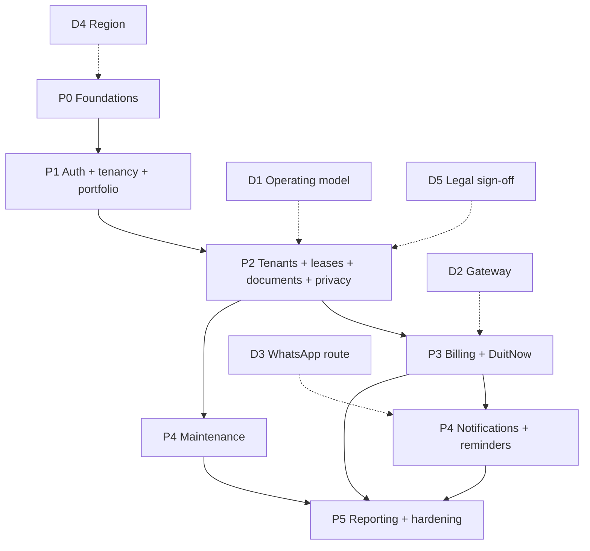

# Anjung: Detailed Implementation Plan

| | |
|---|---|
| **Product** | Anjung (rental management system) |
| **Based on** | `anjung-hld.md` (Draft v0.3), `anjung-lld.md` (Draft v0.3) |
| **API contract** | `openapi.json` v0.17.0 (99 operations) |
| **Status** | Draft v0.3 |
| **Stack** | Python (FastAPI), ECS Fargate, Cognito, DynamoDB, React SPA, AWS CDK (Python) |

**Changes in v0.3**

- New section 8.1 lists the work added after the design (tasks A-01 to A-14): manager scope, staff access window, unit limits, tenancy agreement signing, editable draft deposits, display names, UI and date-format changes, the local and home-network demo setup, set-password links for tenants over WhatsApp, and one deactivate, reactivate and delete lifecycle across modules with the retention purge (off until D5), parking bays, organisation branding with the SPA's own sign-in page, and company plans set by the platform admin. All are built and tested locally. They were not in the original estimates (section 14).
- P1-04, P1-07, P2-03, P2-04, P2-05 and P2-F2 now point to the additions that changed them.
- New decision D9 (electronic signature evidence and stamp duty) and two go-live checklist items.
- Progress against this plan is tracked in `status-checklist.md`, not here.

**Changes in v0.2**

- Product named **Anjung**. One repository (`anjung`), table `anjung-main`, payment reference prefix `ANJ`. New task P0-13 secures the name.
- P1-07 now covers how organisations are created, through the new `/v1/platform/organizations` endpoints.
- P2-05 uses presigned POST (not PUT), so S3 can enforce the size limit, matching the LLD and the contract.
- P3-03 and P3-04 follow the LLD: a daily invoice sweep, with one invoice per (lease, period, kind) guaranteed by an `INVKEY` lock.
- Late-fee percentages are integer basis points (`percent_bp`) in P3-01, P3-13 and P3-F4.
- Room-by-room letting (contract v0.3.0): rooms and letting mode (P1-08, P1-F5, P2-03), rolling leases and deposits by type (P2-04, P2-F2), one-off charges (P3-16, P3-F1), shared-area maintenance (P4-01, P4-F1). Bedspace letting and automatic bill splitting are deferred.
- Design-review answers applied: QR codes are created on the pay screen and messages carry pay links (P3-06, P3-F2, P4-07), the gateway spike uses the LLD section 19 checklist (P2-11), Cognito uses the Essentials plan (P0-08), and the vendor role is deferred (P4-02, P4-F1). New decisions D7 (phone payments) and D8 (merchant model).
- READMEs, a post-deploy smoke test and a Postman collection are part of the deliverable. They are built up in P0-14, P0-15, P1-12, P1-13 and P3-15, and gate deploys from Phase 0 (sections 9.1, 9.2 and 9.4, LLD sections 16.2 to 16.4).
- Section 14 effort totals re-added from the task tables. The corrected totals do not fit 13 to 15 weeks with the stated team (see section 14).

---

## 1. Planning Assumptions

| Item | Assumption |
|---|---|
| Team | 1 tech lead/backend, 1 backend, 1 frontend, part-time QA and DevOps support. Adjust durations if smaller |
| Duration | Target 13 to 15 weeks to a production-ready v1 (phases 0 to 5), with phase 5 continuing afterwards. At the section 14 estimates this needs about 17 to 19 weeks unless scope is cut or capacity added (decision D6) |
| Naming | Product `Anjung`, monorepo `anjung`, Python package `anjung`, DynamoDB table `anjung-main`, CDK stacks `Anjung-<Env>-<Stack>`, payment reference prefix `ANJ` (length and charset confirmed in P2-11) |
| Sprints | Two-week sprints. Estimates are in ideal days (d) per task, excluding meetings and review overhead |
| Environments | `dev`, `staging`, `prod` (separate AWS accounts if possible) |
| Region | Malaysia region if all required services exist, else Singapore (decision in P0-07) |
| Estimates | Rough (±30%). Re-estimate at the start of each phase |

**Blocking decisions (needed before the dependent tasks start):**

| ID | Decision | Needed by | Blocks |
|---|---|---|---|
| D1 | Operating model: SaaS for many landlords or single landlord (PDPA controller vs processor) | End of week 1 | DPA templates, DPO scope, org model detail |
| D2 | Payment aggregator with dynamic DuitNow QR + webhooks + settlement reports | Start of phase 3 (spike in phase 2) | P3 billing integration |
| D3 | WhatsApp route (BSP or AWS native) | Start of phase 3 | Template submission, notification channel |
| D4 | Region (Malaysia vs Singapore) | End of P0 | All CDK stacks |
| D5 | Legal sign-off on retention and breach timeline | Start of phase 2 | Purge jobs, retention config |
| D6 | Schedule: accept about 17 to 19 weeks, add capacity, or cut scope (for example the reporting UI P5-03 or the late-fee rules P3-13 and P3-F4). The vendor role is already deferred | End of P0 | Phase dates, pilot date |
| D7 | Phone payments: QR only (save and import), or add a redirect option (DuitNow Online Banking/Wallets) if the gateway offers it. Also whether pay links need sign-in (default: yes) | Start of phase 3 (spike answers in phase 2) | P3-06, P3-F2, scope of v1 |
| D8 | Merchant model: each landlord organisation as its own (sub-)merchant, or Anjung collecting on their behalf. Needs gateway answers and counsel | Start of phase 3 | P3-06, P3-11 (settlement per org), gateway onboarding |
| D9 | Tenancy agreement signing: is a typed name with "I agree" (plus time, document, IP and browser) enough, or is a licensed digital signature needed for some landlords? Who handles stamp duty? Needs counsel | Before the pilot | A-04, pilot onboarding |

---

## 2. Work Breakdown Overview

| Phase | Weeks | Theme | Exit criteria |
|---|---|---|---|
| P0 | 1 | Foundations and walking skeleton | Hello-world API on ECS behind ALB, login works, CI/CD to dev |
| P1 | 2 to 4 | Auth, tenancy, portfolio modelling | Managers can log in and model properties and units, tenancy tests green |
| P2 | 5 to 7 | Tenants, leases, documents, privacy basics | Full lease lifecycle in staging, tenant export works |
| P3 | 8 to 10 | Billing and DuitNow payments | Invoice to payment to receipt end to end in sandbox |
| P4 | 11 to 12 | Maintenance, notifications, portal polish | Tenant self-service complete, WhatsApp and email live in staging |
| P5 | 13 to 15 | Reporting, hardening, launch readiness | Load, security, DR tests passed, go-live checklist signed |

---

## 3. Phase 0: Foundations and Walking Skeleton (Week 1)

**Goal:** a deployable, observable skeleton so every later feature ships through the same pipeline.

| ID | Task | Est. | Acceptance criteria |
|---|---|---|---|
| P0-01 | Create the `anjung` monorepo (`backend/`, `frontend/`, `infra/`, `contracts/openapi.json`, `docs/`), branch protection, PR templates | 0.5d | Protected main, required checks, CODEOWNERS per folder |
| P0-02 | Backend scaffold: FastAPI app, `core/` (config, logging, errors, ids, money), health endpoint, uv, ruff, mypy, pytest | 1.5d | `/healthz` and `/readyz` respond, lint, type and test pass in CI |
| P0-03 | Dockerfile (multi-stage, non-root) and a single image used by `api` and `worker` | 0.5d | Image builds, runs locally, scan clean |
| P0-04 | CDK app skeleton with stacks: `network`, `data`, `auth`, `app`, `edge`, `observability` | 1.5d | `cdk synth` passes, stacks deploy to dev |
| P0-05 | Network stack: VPC, subnets, gateway endpoints for S3 and DynamoDB, NAT | 1d | Tasks in private subnets reach AWS APIs |
| P0-06 | App stack: ECR, ECS cluster, `api` service, ALB, task role, log group, autoscaling | 1.5d | Hello-world reachable through ALB over HTTPS |
| P0-07 | Region and service availability check (Cognito, Firehose, Athena, WhatsApp integration, etc.) and decision D4 | 0.5d | Written decision recorded |
| P0-08 | Auth stack: Cognito user pool on the Essentials feature plan, groups, app client (PKCE), hosted UI domain | 1d | Test user can log in and receive tokens |
| P0-09 | CI/CD: PR pipeline (lint, type check, tests, `cdk synth`, scans), main pipeline (build, push, deploy to dev, circuit breaker) | 1.5d | Merge to main deploys to dev automatically with rollback on failure |
| P0-10 | Observability baseline: structured logs, request ID middleware, basic dashboard, ALB 5xx alarm | 0.5d | Logs searchable by request ID |
| P0-11 | Access-pattern document and single-table key schema (LLD section 4, which supersedes HLD 6.3), reviewed | 1d | Reviewed and approved by the team |
| P0-12 | Data classification sheet, DPO owner named, decision D1 started | 0.5d | Sheet lists every personal data field and its purpose |
| P0-13 | Secure the Anjung name: trademark search (MyIPO), business name (SSM), domains, GitHub org, decision D6 | 0.5d | Name cleared or an alternative chosen, domain registered, D6 recorded |
| P0-14 | READMEs: root `README.md` (repo map, prerequisites, quick start) and per-folder READMEs for `backend/`, `frontend/`, `infra/`, `contracts/` and `smoke/` (LLD 16.4) | 0.5d | A new engineer can run the API locally and deploy to dev by following the READMEs alone |
| P0-15 | Smoke test skeleton: `smoke/smoke_test.py` with health, readiness and unauthenticated checks (LLD 16.2 checks 1 and 2), JUnit output, run by the pipeline after every dev deploy | 0.5d | A failing smoke check fails the pipeline run |

**Phase 0 definition of done:** an authenticated request from a test user reaches the API in dev through the deployed pipeline.

---

## 4. Phase 1: Auth, Tenancy, Portfolio Modelling (Weeks 2 to 4)

**Goal:** secure, org-scoped foundations plus the first real CRUD.

### 4.1 Backend

| ID | Task | Est. | Acceptance criteria | Depends on |
|---|---|---|---|---|
| P1-01 | Data stack: DynamoDB table `anjung-main` (on-demand, PITR, deletion protection, KMS CMK), GSI1 to GSI5 per LLD 4.1, Streams enabled, TTL attribute `ttl` | 1d | Table deployed in dev, GSIs match the key schema document | P0-11 |
| P1-02 | JWT validation dependency: JWKS caching, issuer, audience or client ID, `token_use`, expiry checks | 1.5d | Invalid, expired, and wrong-pool tokens rejected, covered by tests | P0-08 |
| P1-03 | `RequestContext` (user ID, org ID, roles) built from token claims only | 0.5d | No code path reads org ID from request input | P1-02 |
| P1-04 | RBAC decorators and dependencies (`require_roles`, resource ownership helpers) | 1d | Role matrix from HLD section 3 enforced and tested. Extended by A-01 (manager scope) | P1-03 |
| P1-05 | Pre Token Generation Lambda: injects `org_id` and roles from membership | 2d | Tokens contain claims, Lambda failure mode defined (deny login rather than issue unscoped token) | P1-01 |
| P1-06 | Repository base: single-table helpers, key builders, conditional writes, transactions, pagination cursor, org-scoped by construction | 2.5d | Repository methods require `org_id`, unit tests against DynamoDB Local | P1-01 |
| P1-07 | Organisation and membership domain: platform admin creates an org with its first org admin (`POST /v1/platform/organizations`), lists, suspends and reactivates orgs; org admin invites staff (`AdminCreateUser`) and assigns roles | 2.5d | Platform admin creates an org (org, `REGISTRY#ORG` entry and first membership in one transaction, audited with reason). Its org admin can invite a property manager who logs in with correct claims. A suspended org cannot sign in. Extended by A-02 and A-03 (access window, unit limit) | P1-05, P1-06 |
| P1-08 | Property and unit CRUD (list, get, create, update, archive) with validation, including rooms inside a whole unit (`type`, `parent_unit_id`) and the whole unit's `letting_mode` (LLD 5.5) | 2.5d | All endpoints documented in OpenAPI, tested including pagination; rooms list by parent; a room cannot contain rooms | P1-06 |
| P1-09 | Audit log: write on every mutating call (actor, action, entity, summary, IP), monthly-partitioned keys | 1.5d | Audit entries visible and queryable by entity and time | P1-06 |
| P1-10 | Field-level encryption helper (KMS envelope) for sensitive fields (IC and passport, if collected) | 1d | Encrypt and decrypt tested, key rotation path documented | P1-01 |
| P1-11 | Cross-org test suite: automated tests that attempt cross-org read and write on every endpoint | 2d | Suite runs in CI, any new endpoint must be registered in it | P1-08 |
| P1-12 | Smoke sign-in and read checks: `smoke` app client, smoke orgs A and B with users and TOTP seeds in Secrets Manager, pipeline IAM, checks 3 to 7 | 1d | Smoke passes in dev and staging after every deploy, and the cross-org check returns 404 | P0-15, P1-07 |
| P1-13 | Postman collection: generated from `openapi.json` in CI with a drift check, `postman` app client (dev and staging only) with PKCE, dev and staging environment files, idempotency pre-request script | 1d | A tester can sign in and call any endpoint in dev from Postman; CI fails when the collection is out of date | P1-02 |

### 4.2 Frontend

| ID | Task | Est. | Acceptance criteria |
|---|---|---|---|
| P1-F1 | SPA scaffold (Vite, React, TypeScript, routing, TanStack Query, lint, test), CDK edge stack (S3, CloudFront, OAC, security headers) | 2d | SPA served via CloudFront in dev |
| P1-F2 | Cognito login with PKCE, silent refresh, logout, route guards by role (*changed by A-13: our own branded sign-in page with SRP instead of the hosted UI*) | 2d | Staff and tenant routes protected |
| P1-F3 | Typed API client generated from OpenAPI, error handling, loading states | 1d | Client regenerated in CI |
| P1-F4 | App shell, navigation, i18n setup (EN and BM) | 1.5d | Language switch works, strings externalised |
| P1-F5 | Property and unit screens (list, create, edit, archive), with rooms shown under their whole unit and a let-whole or let-by-room switch | 4d | Matches API, accessible, responsive |

**Phase 1 definition of done:** a platform admin can create an organisation, a manager invited by its org admin can log in, create properties and units, and the cross-org test suite passes in CI. Every mutating action appears in the audit log.

---

## 5. Phase 2: Tenants, Leases, Documents, Privacy Basics (Weeks 5 to 7)

**Goal:** the complete lease lifecycle and the privacy plumbing needed for PDPA.

### 5.1 Backend

| ID | Task | Est. | Acceptance criteria | Depends on |
|---|---|---|---|---|
| P2-01 | Tenant domain: create tenant, subject index (GSI5), contact details, notification preferences, consent records | 2d | Consent captures purpose, version, timestamp | P1-06 |
| P2-02 | Tenant invitation: `AdminCreateUser`, invite email via SES, first-login linking of Cognito `sub` to tenant record (GSI2) | 2.5d | Invited tenant logs in, is linked, sees only own data | P1-05, P2-01 |
| P2-03 | Lease domain: create, activate, amend, terminate, renew, with validation (no overlapping active leases per unit) and the room-letting rules (letting-mode checks, `active_room_leases` counter, LLD 5.5) | 4d | Overlap prevented by the unit lease lock (conditional writes) and returned as `409 lease_overlap`; a whole unit and its rooms can never be let at the same time, proven by a parallel activation test; state machine documented and tested. Activation gated by A-04 (signed agreement) | P1-08, P2-01 |
| P2-04 | Lease terms: rent, deposits by type, due day, recurring charges, co-tenants, rolling tenancy (`end_date` null) with `notice_days` (LLD 5.1, 6.10) | 3.5d | Stored in minor units, validated; rolling leases never expire and termination respects notice unless waived; deposit deductions per type; draft deposits editable (A-05) | P2-03 |
| P2-05 | Documents: upload-URL endpoint (presigned POST with exact key, `Content-Type`, `content-length-range` up to 15 MiB and KMS encryption conditions, 10-minute expiry), download-URL endpoint (5-minute presigned GET, clean documents only), metadata item, retention class | 2d | Private bucket, KMS encrypted, object key includes org prefix, oversized upload rejected by S3, access checked per request. Listing by owner added (A-06) | P1-06 |
| P2-06 | Upload malware scan (S3 event → scan Lambda or service) and quarantine | 1.5d | Infected test file blocked from download | P2-05 |
| P2-07 | Privacy export: `GET /v1/privacy/export` returns all of a tenant's data as structured JSON (and CSV where useful), using GSI5 | 2d | Export covers every entity type that holds tenant data, verified by a test that fails if a new entity is not registered | P2-01 |
| P2-08 | Privacy request workflow: record requests (access, correction, deletion), status, audit trail | 1.5d | Requests visible to org admin with SLA timestamps | P2-07 |
| P2-09 | Anonymisation job skeleton (worker): anonymises a tenant across entity types, respecting retention holds | 2d | Test tenant anonymised, financial totals preserved | P2-07 |
| P2-10 | Worker service: SQS consumer framework (long polling, visibility timeout, DLQ, idempotency helper, graceful shutdown), CDK `worker` service | 2d | Poison message lands in DLQ, alarm on DLQ depth | P0-06 |
| P2-11 | **Gateway spike (start):** shortlist aggregators, request sandbox accounts, send each candidate the LLD section 19 checklist in writing (QR validity, reference field and rules, webhook signing, settlement reports, phone redirect option, merchant model), validate dynamic DuitNow QR in the sandbox (input to decisions D2, D7 and D8) | 2d | Written comparison with every checklist row answered, and a recommendation | n/a |

### 5.2 Frontend

| ID | Task | Est. | Acceptance criteria |
|---|---|---|---|
| P2-F1 | Tenant list, create, edit, invite flow, consent capture | 3d | Invitation status visible |
| P2-F2 | Lease screens: create wizard (fixed-term or rolling, deposits by type), details, amend, terminate with deposit deductions, renew | 4.5d | Validation errors surfaced clearly. Agreement section and draft deposit editing added (A-04, A-05) |
| P2-F3 | Document upload and download UI (progress, type and size validation) | 1.5d | Works with presigned URLs |
| P2-F4 | Tenant portal v0: login, my lease, my documents, my data export | 3d | Tenant sees only own data |

**Phase 2 definition of done:** a manager can onboard a tenant, create a lease with documents, the tenant can log in and view them and export their data, and the privacy request workflow is demonstrable. Gateway recommendation (D2) delivered.

---

## 6. Phase 3: Billing and DuitNow Payments (Weeks 8 to 10)

**Goal:** rent collection end to end with correct, auditable money handling.

### 6.1 Backend

| ID | Task | Est. | Acceptance criteria | Depends on |
|---|---|---|---|---|
| P3-01 | Money module: integer minor units, currency, half-up integer rounding, `times_ratio`, proration, formatting, property-based tests | 1d | No float arithmetic anywhere in billing, including percentages (basis points) | P0-02 |
| P3-02 | Ledger domain: append-only entries (charge, payment, adjustment, deposit), time-ordered keys, running balance on lease item updated transactionally | 2.5d | Balance equals ledger sum in tests, no update or delete path for ledger entries | P1-06 |
| P3-03 | Invoice domain: generation from lease terms (proration for partial months, credit applied), line items, due dates, statuses (`open`, `partially_paid`, `paid`, `overdue`, `void`), sparse GSI3 `ORG#<o>#INV#unpaid` maintenance, per-org yearly invoice number counter | 3d | Exactly one invoice per (lease, period, kind) via the `INVKEY` lock in the same transaction, status transitions tested | P3-02 |
| P3-04 | Daily invoice sweep: EventBridge Scheduler (02:00 Asia/Kuala_Lumpur) → SQS → worker, per-org fan-out from `REGISTRY#ORG`, invoices generated `invoice_lead_days` ahead, manual run via `POST /v1/invoice-runs`, run summary stored | 2.5d | Re-running a day or period creates no duplicates, partial failure resumes, a lease created late is invoiced on the next sweep | P2-10, P3-03 |
| P3-05 | `PaymentProvider` interface and fake provider for tests and local dev | 1d | Contract tests reusable for the real provider | P3-01 |
| P3-06 | Real provider adapter: declare the provider's `ReferenceRules` (field, max length, charset, QR validity), create dynamic DuitNow QR on demand with an `ANJ`-prefixed reference, store reference, regenerate on expiry, status query | 3d | Sandbox QR generated and payable within its validity window, reference matches invoice, a payment completed just after expiry still matches | D2, P3-05 |
| P3-07 | Webhook endpoint: raw-body signature verification, timestamp and replay protection, enqueue to SQS, fast 2xx | 1.5d | Tampered, replayed, and unsigned requests rejected | P3-05 |
| P3-08 | Payment processor (worker): `TransactWriteItems` with conditional `PAYREF#`, payment, ledger entry, invoice status, balance | 3d | Duplicate webhook is a no-op, underpayment, overpayment, and credit application covered by tests | P3-02, P3-07 |
| P3-09 | Unmatched payments queue and manual allocation endpoint | 1.5d | Manager can allocate an unmatched payment, audited | P3-08 |
| P3-10 | Manual "mark as paid" (cash, bank transfer) with reason and audit | 1d | Creates payment and ledger entries through the same transaction path | P3-08 |
| P3-11 | Daily reconciliation job: gateway settlement report vs recorded payments, mismatch report, alarm | 2.5d | Seeded mismatch detected and reported | P3-06 |
| P3-12 | Nightly integrity job: ledger sum vs running balance vs invoice states | 1d | Mismatch raises an alarm | P3-02 |
| P3-13 | Late-fee rules (per-org configuration: `fixed` or `percent_per_month` in integer basis points `percent_bp`) and overdue status job | 2d | Fees appended as ledger charges, idempotent per invoice and month overdue via `INVKEY#<period>#late_fee#<n>` | P3-03 |
| P3-14 | Receipt generation (PDF to S3) and ledger statement endpoint | 2d | Receipt downloadable by tenant and manager | P3-08 |
| P3-15 | Smoke and Postman flows for money: smoke write checks 8 to 13 (lease to receipt with the `fake` provider in dev, to QR in staging, document upload) and Postman `Flows` folder (onboard tenant, lease to receipt) | 1d | Full smoke run passes in dev in under 3 minutes; staging run is required before each prod promotion | P3-14, P1-12, P1-13 |
| P3-16 | One-off charges: `POST /v1/leases/{id}/charges` (LLD 6.9), invoice with a `one_off` line and category, ledger `charge_other`, allowed after move-out, idempotency key | 1d | Charge billed exactly once per idempotency key, payable through the pay screen, audited | P3-03, P3-08 |

### 6.2 Frontend

| ID | Task | Est. | Acceptance criteria |
|---|---|---|---|
| P3-F1 | Invoice list and detail (manager view): filters, status, payments, ledger, add a one-off charge to a lease | 3.5d | Matches API, pagination |
| P3-F2 | Tenant pay screen (`/pay/<invoice_id>`, the target of pay links): QR created on open, countdown and refresh on expiry, "Save QR image" with import instructions on phones, payment status polling, receipt download | 3d | QR scannable on desktop; on a phone, a saved QR can be imported into a banking app within the provider's validity window; expired QR refreshes without a page reload |
| P3-F3 | Unmatched payments and manual allocation screen, manual mark-as-paid | 2d | Role restricted |
| P3-F4 | Billing settings (late-fee rules, due-day defaults) | 1.5d | Percent entered as a percentage and sent as integer basis points, validated, audited |

**Phase 3 definition of done:** in the gateway sandbox, an invoice generated by the daily sweep can be paid through DuitNow QR, the webhook updates invoice, payment, ledger, and balance exactly once, a receipt is produced, and reconciliation and integrity jobs run clean. All edge cases in HLD section 8.4 have automated tests.

---

## 7. Phase 4: Maintenance, Notifications, Portal Polish (Weeks 11 to 12)

**Goal:** tenant self-service and reliable multi-channel communication.

### 7.1 Backend

| ID | Task | Est. | Acceptance criteria | Depends on |
|---|---|---|---|---|
| P4-01 | Maintenance domain: create request for a room, unit or shared area (whole unit or property), comments, attachments (reuse documents), status workflow, assignment, GSI4 | 3.5d | Tenant can raise and track, including a shared-area request for the unit or property they lease in; manager can triage and assign | P2-05 |
| P4-02 | ~~Vendor role~~: deferred to a later release (LLD 5.3). `vendor` stays reserved in the contract and cannot be granted | — | n/a | n/a |
| P4-03 | `NotificationChannel` interface and `NotificationService` (channel choice from preferences, templates, localisation, rate limits) | 2d | Fake channel for tests | P2-10 |
| P4-04 | Email channel (SES): verified domain, DKIM, SPF, DMARC, HTML and text templates, bounce and complaint handling through SNS to suppression list | 3d | Bounced address is suppressed, templates render in EN and BM | P4-03 |
| P4-05 | WhatsApp channel: provider adapter, template mapping, opt-in and opt-out handling, delivery status callbacks | 3d | Template message delivered in sandbox, opt-out honoured immediately | D3, P4-03 |
| P4-06 | Notification log and retry policy (backoff, DLQ), delivery status visible to managers | 1.5d | Failed sends retried then dead-lettered with alarm | P4-03 |
| P4-07 | Reminder scheduler: before, on, after due date, per-tenant rate limits, quiet hours. Reminders carry a pay link, never a QR image | 2d | No duplicate reminders per invoice and offset, pay link opens the pay screen | P4-03, P3-03 |
| P4-08 | Event-driven notifications: payment received, invoice issued, maintenance status changes, lease events | 1.5d | Each event produces a notification according to preferences | P4-03 |

### 7.2 Frontend

| ID | Task | Est. | Acceptance criteria |
|---|---|---|---|
| P4-F1 | Maintenance screens (tenant raise and track, including shared areas; manager triage and assignment to staff) | 4d | Attachments, comments, status history |
| P4-F2 | Notification preferences and consent (opt-in and opt-out per channel) | 1.5d | Changes take effect immediately |
| P4-F3 | Tenant portal polish: dashboard (balance, next due date, open requests), empty states, error states | 2d | Mobile-first review passed |
| P4-F4 | BM translation pass, accessibility audit (keyboard, contrast, screen reader labels), PWA install | 2d | Audit findings resolved |

**Non-engineering (start in week 8, finish in this phase):** WhatsApp business display name "Anjung" approved, templates submitted early (approval lead time), DMARC policy ramp-up, BM copy review. Estimated at 2 days.

**Phase 4 definition of done:** tenants can raise and track maintenance, receive due, overdue, and receipt messages by email and WhatsApp according to preferences, and every send is logged.

---

## 8. Phase 5: Reporting, Hardening, Launch Readiness (Weeks 13 to 15)

| ID | Task | Est. | Acceptance criteria |
|---|---|---|---|
| P5-01 | Reporting pipeline: Streams → Firehose → S3 (partitioned Parquet), Glue catalog, Athena workgroup with query limits | 3d | Data lands within minutes, partitioned by org and date |
| P5-02 | Report endpoints: arrears, occupancy, income, maintenance summary, with CSV export | 3d | Verified against ledger totals on seeded data |
| P5-03 | Reporting UI (filters, tables, charts, export) | 3d | Matches endpoints |
| P5-04 | Alarms and dashboards: DLQ depth and age, webhook failures, 5xx, task restarts, reconciliation mismatch, SES bounce rate, DynamoDB throttles, invoice run failures | 2d | Alerts routed to the on-call channel, runbook link on each alarm |
| P5-05 | Tracing (OpenTelemetry or X-Ray) across API, queue, worker | 1.5d | A payment can be traced from webhook to ledger |
| P5-06 | Load test (API, webhook bursts, invoice run for the target number of units) | 3d | Meets NFR targets (HLD section 14), results documented |
| P5-07 | Security review: threat model walkthrough, dependency and image scan gating, WAF tuning, IAM least-privilege review, external penetration test or equivalent | 4d | No open high or critical findings |
| P5-08 | Backup and DR drill: restore from PITR to a new table, restore documents from versions, document RPO and RTO achieved | 2d | Drill report signed off |
| P5-09 | Breach response runbook and tabletop exercise, notification templates for the regulator and individuals | 2d | Exercise completed, gaps tracked |
| P5-10 | PDPA review with counsel: DPA template, privacy notice, retention configuration (D5), cross-border basis if applicable | 3d | Written sign-off or tracked actions |
| P5-11 | Retention purge jobs enabled and tested per record class (TTL only for transient data). *Built in A-11 and off; enabling waits on D5* | 2d | Dry-run reports reviewed before enabling deletes |
| P5-12 | Production environment: accounts, CDK deploy, domain and certificates, secrets, WAF, monitoring, access controls | 3d | Prod stack deployed, read-only smoke test (checks 1 to 7) passes |
| P5-13 | Pilot with one friendly organisation, bug triage, feedback loop | 5d | Pilot exit report |
| P5-14 | Go-live checklist and rollback plan | 1d | Checklist signed by tech lead, DPO owner, and product owner |

### 8.1 Additions after the design (built)

Work requested while building, after this plan was drafted. Each one changed the contract (versions in brackets, notes in `contracts/README.md`), and each is built and tested on a developer machine with backend, frontend and browser checks. They have no estimates because they were not planned. Like the rest, nothing here is deployed to AWS.

| ID | Addition | Acceptance criteria (met locally) | Touches |
|---|---|---|---|
| A-01 | **Manager scope** (v0.4.0): a property manager sees only the properties they manage (`manager_id`: the creator, reassigned by an org admin) and what hangs off them, plus the tenants they created or who rent there. Unmatched payments and invoice runs become org admin only (LLD 3.8) | Out-of-scope records return 404 on every scoped endpoint, lists are filtered, admins see everything, reassignment moves visibility at once | P1-04, P1-11, all domain services |
| A-02 | **Staff access window** (v0.5.0): deactivate or reactivate a user, and set `active_from` / `active_until`. Checked at sign-in and on every request (LLD 3.9). "Staff" is called "Users" in the SPA | A disabled or expired user is refused on the next request with the reason, reactivation restores access, nothing is unassigned. The dashboard shows the access end date and days left | P1-05, P1-07 |
| A-03 | **Limit per manager** (v0.6.0; counted in units since v0.13.0): `unit_quota`, shown as "used / limit" on the Properties page and the dashboard | The next unit beyond the limit is refused (`409 quota_exceeded`) for the manager, and so is a property an admin moves to them. Rooms, bays, empty and inactive properties do not count. Admins are never limited by their own | P1-07, P1-08 |
| A-04 | **Tenancy agreement signing** (v0.7.0): staff send the uploaded agreement, each tenant signs in the portal by typing their name, or staff record a paper signature. Activation waits for all signatures while the org setting is on (default). Term changes clear signatures. New `lease_agreement_sent` email (LLD 5.6) | Activation blocked until every co-tenant has signed, the name must match, sign once, staff cannot sign for a tenant, the setting can be switched off, and the tenant dashboard prompts the tenant to sign | P2-03, P2-F2, P2-F4, P4-08 |
| A-05 | **Draft deposits editable** (v0.7.1): change a draft lease's deposits until activation (LLD 6.10) | The deposit invoice charges the amended amounts. An active lease refuses with 422. A change clears signatures | P2-04, P2-F2 |
| A-06 | **Listing and display fields** (v0.3.1, v0.3.2, v0.6.0): `GET /v1/documents` by owner. Leases and tenants show who rents which unit or room. Maintenance shows where the issue is and who reported or is assigned to it. Tenants show their tenancy (current, upcoming, past, none) apart from their account status (LLD 3.10) | Names resolve on read, and the privacy export never lists co-tenants | P2-01, P2-05, P4-01 |
| A-07 | **SPA usability**: whole rows clickable with no underlined links, rooms indented under their unit, a phone layout (menu toggle, tables as stacked cards), every status label translated (EN and BM) and checked by a test, dates as DD-MM-YYYY | Checked in a desktop and phone-sized browser. i18n and status-label tests pass | P1-F4, P1-F5, P4-F3, P4-F4 |
| A-08 | **Local stack and demo data**: Docker Compose (DynamoDB Local, S3 stand-in, api), mock sign-in with plain refusal messages, `seed-demo` (`--email-domain` for another set), `smoke/local_flow.py` (LLD 16.5) | A fresh clone reaches a seeded, working app with Docker Compose, the Vite dev server and one seed command. The local flow passes all 20 checks | P0-14, P3-15 |
| A-09 | **Home-network demo**: production SPA image (nginx), `docker-compose.nas.yml` and an image bundle for a home NAS (`docs/nas-deploy.md`) | Runs on a home NAS and is usable from a phone on the same network. Updating means importing the new images and redeploying | none (demo only, not a deploy target) |
| A-10 | **Set-password links for tenants** (v0.8.0): besides the email invitation (since v0.14.0 the app's own welcome email with the same link, see P2-02; since v0.15.0 for staff too, with a resend), staff can share a one-time link from their own WhatsApp, or have the app send it over WhatsApp. Public set-password page `/invite/<token>` (LLD 11.2) | The link works once, only the newest works, it expires with the invitation, weak passwords are refused without using it up, only a hash is stored and the link never reaches the queue or the notification log. Sending by WhatsApp needs a number and consent. Tested locally; the app's own WhatsApp sending waits on D3 | P1-06, P4-05, P4-F3 |
| A-11 | **Deactivate, reactivate, delete** (v0.9.0, improvement plan phase C): one lifecycle in every module. Properties and units deactivate and reactivate (cascading only what they switched off), `archived` becomes `inactive`. Every delete is previewed (`remove`, `erase` or `blocked`), needs a reason and is audited: properties, units and rooms, tenants (removed if they never had a lease, otherwise erased through a privacy request, admin only), draft leases, closed maintenance requests. Retention purge for ended leases, anonymised tenants, inactive properties and closed organisations, off until D5 (LLD 3.11, 13.3). Shared "Deactivate or delete" card in the SPA | Lease history, open money and live leases block with a reason; nothing is left behind by a removal (subject index, files, login, invitation); the purge dry-runs, is idempotent and does nothing until the periods are set. Backend, SPA and Postman flows tested locally | P1-08, P1-F5, P2-01, P4-01, P5-08, P5-11 |
| A-12 | **Parking bays** (v0.10.0, improvement plan phase B): unit type `parking`, allocated to a whole unit or the property, own label namespace. A bay comes with a unit let as a whole (`included_bays`) and is otherwise let on its own lease, with an optional vehicle plate (personal data, erased with the tenant). Occupancy counts bays separately. SPA: bays section, add and edit (allocation, note), bays in the lease form with the plate, "Bay X" labels (LLD 5.7) | A bay of a unit let whole cannot be let on its own, a unit cannot go back to letting whole while a bay is let separately, a let bay cannot be re-allocated, the plate is only on bay leases. Backend, SPA, smoke flow and Postman tested locally | P1-08, P1-F5, P2-01, P2-F2, P4-09 |
| A-13 | **Organisation branding** (v0.11.0, improvement plan phase A): each company is its own organisation with a brand (handle, names, registration number, colour, contacts, welcome text, logo). Public `/v1/brands/{handle}` and its logo; branded `/login/<handle>`, app, set-password page, emails (sender name, reply-to, footer), WhatsApp invitation and receipts. The SPA's own sign-in page with SRP (new password, MFA code, forgot password) replaces the hosted UI. Settings → Branding, branding at organisation creation (LLD 11.5) | Handles unique with a 30-day grace, reserved words refused, nothing private public, the logo a scanned image served safely, branding off changes nothing. Backend, SPA, smoke flow and Postman tested locally; Cognito sign-in tested with a mocked library until there is an AWS dev pool | P1-06, P1-F1, P1-F2, P4-03, P4-08, P1-F5 |
| A-14 | **Company plan** (v0.12.0, v0.13.0): the platform admin sets each organisation's unit limit (whole units that are on; rooms, bays and empty properties free; the manager limits of A-03 count units too since v0.13.0) and end date (at creation or `PATCH /v1/platform/organizations/{id}/plan`, audited); the org admin's manager limits must fit within it and staff dates end by it. After the end date: read-only for staff for 30 days (money received and privacy requests still work, tenants unaffected), then closed to everyone until renewed. Reminder emails to org admins 30, 7 and 1 day before. Dashboard tiles, read-only banner, plan editing on the Organisations page (LLD 3.12) | Limit enforced on create and reactivate for everyone, the managers' limits and staff dates checked, read-only and closed states with the right exceptions, renewal lifts them, reminders once. Backend, SPA, smoke flow and Postman tested locally | P1-05, P1-07, P1-08, P4-07 |

**Direction.** The additions make Anjung usable by a landlord with several managers before any AWS work. The next steps are unchanged: the blocked decisions (D1, D2, D5 to D9), deploying to dev (Phase 0 and P1 deploy criteria), then the gateway, SES and WhatsApp. The home-network demo is a stopgap for showing the product and must not hold real tenant data.

---

## 9. Cross-Cutting Workstreams

### 9.1 Testing strategy

| Level | Scope | Tooling | Gate |
|---|---|---|---|
| Unit | Services, money, state machines, key builders | pytest, property-based tests for money and ledger | Every PR |
| Repository integration | Real DynamoDB behaviour (conditions, transactions, GSIs) | DynamoDB Local or LocalStack via testcontainers | Every PR |
| API tests | Endpoints, auth, RBAC, validation | FastAPI test client with fake JWTs | Every PR |
| Cross-org suite | Every endpoint attempted across orgs | Registry-driven parametrised tests | Every PR, new endpoints must be registered |
| Provider contract | Fake vs real gateway adapter | Shared contract tests, sandbox runs nightly | Nightly |
| Frontend | Components and flows | Vitest, Testing Library, Playwright for critical journeys | Every PR (unit), nightly (e2e) |
| End to end (staging) | Login, lease, invoice, pay (sandbox), receipt, notification | Playwright plus API checks | Before each prod release |
| Smoke | Deployed environment: health, sign-in, reads, cross-org, critical money flow (dev and staging), read-only in prod | `smoke/smoke_test.py` (LLD 16.2) | After every deploy, a failure blocks promotion |
| Manual exploration | Any endpoint, hand-written flows | Postman collection generated from the contract (LLD 16.3) | Kept in step with the contract by a CI drift check |
| Non-functional | Load, security, DR | k6 or Locust, scanners, drill | Phase 5 and before major releases |

### 9.2 Definition of done (every task)

- Code reviewed and merged with passing CI.
- Unit and relevant integration tests added, new endpoints registered in the cross-org suite.
- Audit logging added for mutating actions, and no personal data in logs.
- OpenAPI updated, docs or runbook updated where operations change.
- Infra changes in CDK, deployed to dev and verified.
- README updated in the same pull request when a command, setting or setup step changes.
- New endpoints appear in the regenerated Postman collection. Endpoints on a critical path (sign-in, leases, billing, payments) get a smoke check.
- Metrics and alarms added for new async flows.

### 9.3 Security and privacy checkpoints

| When | Check |
|---|---|
| Each PR | Dependency and image scan, secrets scan, lint for banned patterns (float money, org ID from input) |
| End of P1 | Tenancy and RBAC review |
| End of P2 | Privacy export and anonymisation completeness review |
| End of P3 | Payments threat model: webhook spoofing, replay, double-credit, reconciliation |
| P5 | Penetration test, IAM review, PDPA review, breach tabletop |

### 9.4 Environments and release

- Trunk-based development with short-lived branches and feature flags for unfinished features.
- Dev deploys on merge. Staging deploys on tagged release candidates. Prod requires manual approval.
- The smoke test runs after every deploy: full in dev and staging, read-only in prod. A failure stops promotion and, in prod, triggers redeploy of the previous image tag.
- Data changes are additive with versioned items. Backfills run as one-off ECS tasks with dry-run mode.
- Rollback: ECS circuit breaker for failed deployments, and redeploy of the previous image tag for regressions. Schema changes are backward-compatible for at least one release.

---

## 10. Dependency Overview

**Critical path:** P0 → P1 (auth, repository layer, tenancy tests) → P2 (leases) → P3 (payments) → P5 (hardening, pilot). The gateway decision (D2) and WhatsApp template approval (D3) are the main external risks to that path.

---

## 11. Risk-Driven Sequencing Notes

| Risk | How the plan addresses it |
|---|---|
| Access patterns wrong or incomplete | Reviewed in P0-11 and re-checked at the start of P2 and P3, because new patterns are cheapest to add before data exists |
| Cross-org leaks | Repository layer in P1, cross-org suite gating every PR from P1-11 |
| Gateway limitations discovered late | Spike in P2 (P2-11), fake provider lets P3 start before the real adapter is ready |
| Money bugs | Money module and ledger first in P3, property-based tests, nightly integrity job |
| WhatsApp approval lead time | Templates submitted by week 8, email works as fallback |
| PDPA gaps found late | Privacy export and anonymisation built in P2, legal review scheduled in P5 with early input at D5 |
| Underestimated frontend effort | Frontend tasks run in parallel with backend from P1, and screens are scoped to the API surface per phase |
| Backend capacity below the target schedule | Decision D6 at the end of P0, descoping candidates named in section 14 |
| Short-lived QR codes make paying on a phone awkward | QR created on the pay screen with refresh and save-image (P3-F2), redirect option and merchant model asked in the spike (LLD section 19), decisions D7 and D8 before phase 3 |
| Product name unavailable or contested | Name checks in P0-13 before branding reaches WhatsApp, SES, domains and payment references |

---

## 12. Roles and Responsibilities (suggested)

| Role | Responsibilities |
|---|---|
| Tech lead | Architecture decisions, key schema, code review, security review, release approval |
| Backend engineers | Domains, repository layer, worker, integrations |
| Frontend engineer | SPA, portals, i18n, accessibility |
| DevOps (part-time) | CDK, pipelines, observability, production readiness |
| QA (part-time) | Test strategy, e2e suite, UAT, pilot support |
| DPO owner | PDPA process, DPA, breach runbook, privacy requests |
| Product owner | Priorities, acceptance, pilot customer liaison |

---

## 13. Go-Live Checklist

- [ ] All phase exit criteria met and signed off
- [ ] Cross-org suite and full regression green on the release candidate
- [ ] Load, security, and DR results reviewed, no open high or critical findings
- [ ] Production gateway credentials, webhook secrets, and WhatsApp tokens in Secrets Manager, sandbox values removed
- [ ] Production DuitNow QR and webhook verified with a small real transaction and refund or reversal procedure documented
- [ ] SES out of sandbox, DKIM, SPF, DMARC passing, WhatsApp display name "Anjung" and templates approved
- [ ] Anjung domain, certificates and trademark filing in place, production API and app URLs final in `openapi.json`
- [ ] Alarms routed to on-call, runbooks linked, on-call schedule agreed
- [ ] DPO appointed and registered as required, DPA and privacy notice published, retention configuration confirmed with counsel
- [ ] Agreement signing method confirmed by counsel (D9), and stamp duty handling agreed with pilot landlords
- [ ] Mock sign-in and `/dev` routes confirmed absent in staging and prod (`AUTH_MODE=cognito`), and no demo data or NAS images used outside local
- [ ] Breach response runbook tested
- [ ] Backups and PITR verified, restore drill documented
- [ ] Rollback plan reviewed, support process and contact channel ready
- [ ] Read-only smoke test green in prod, full smoke test green in staging on the release candidate
- [ ] READMEs current, Postman collection matches the release's `openapi.json`
- [ ] Pilot exit report accepted

---

## 14. Estimated Effort Summary

Totals are the sums of the task tables above. Frontend is every `-F` task plus the reporting UI (P5-03). Infra / other is CDK and pipeline set-up (P0, P1-01), the gateway spike (P2-11), non-engineering work in P4 (estimated at 2 days), and the operations, security, legal, production and pilot tasks in P5. Everything else is backend.

| Phase | Backend (d) | Frontend (d) | Infra / other (d) | Total (d) |
|---|---|---|---|---|
| P0 | 4 | 0 | 9 | 13 |
| P1 | 19 | 10.5 | 1 | 30.5 |
| P2 | 23 | 12 | 2 | 37 |
| P3 | 29.5 | 10 | 0 | 39.5 |
| P4 | 16.5 | 9.5 | 2 | 28 |
| P5 | 9.5 | 3 | 25 | 37.5 |
| **Total** | **101.5** | **45** | **39** | **185.5** |

These are ideal days before contingency. They exclude the additions in section 8.1 (A-01 to A-14), which were built without estimates on top of this plan. Adding 20 to 30% for integration surprises, review cycles and rework gives about 220 to 240 person-days in total, of which engineering (backend and frontend) is about 175 to 190. Deferring the vendor role removed 2.5 days (P4-02 and the vendor view in P4-F1). Room-by-room letting added 7.5 days (5 backend, 2.5 frontend). The READMEs (P0-14) count as infra / other. The smoke test and Postman tasks (P0-15, P1-12, P1-13, P3-15) count as backend.

**Schedule check.** The backend is the constraint. Two backend engineers at about 70% productive capacity deliver about 7 ideal days a week, so 101.5 days plus contingency takes about 17 to 19 weeks. The frontend (45 days plus contingency, one engineer) takes about 15 to 17 weeks. The infra / other work is assumed to be covered by the part-time DevOps, QA, DPO owner and counsel. The 13 to 15 week target therefore does not hold at these estimates. Options (decision D6):

- Accept about 17 to 19 weeks.
- Add a third backend engineer for P2 and P3.
- Cut or defer more scope, for example the reporting UI (P5-03, 3d) and the late-fee rules (P3-13, P3-F4, 3.5d). The vendor role is already deferred (2.5d saved).

A two-person team should plan on about 25 to 27 weeks.

---

## 15. Immediate Next Actions (This Week)

1. Decide D1 (operating model) and name the DPO owner.
2. Run the Anjung name checks and register the domain and GitHub org (P0-13). Decide D6 (schedule versus scope).
3. Create the `anjung` monorepo, scaffold the backend, and stand up CI (P0-01 to P0-03, P0-09).
4. Start the CDK skeleton and deploy the network and app stacks to dev (P0-04 to P0-06).
5. Review the access-pattern document and key schema against LLD section 4 (P0-11).
6. Request gateway sandbox accounts, send each candidate the LLD section 19 checklist, and start the WhatsApp route evaluation so D2 and D3 are ready early.
