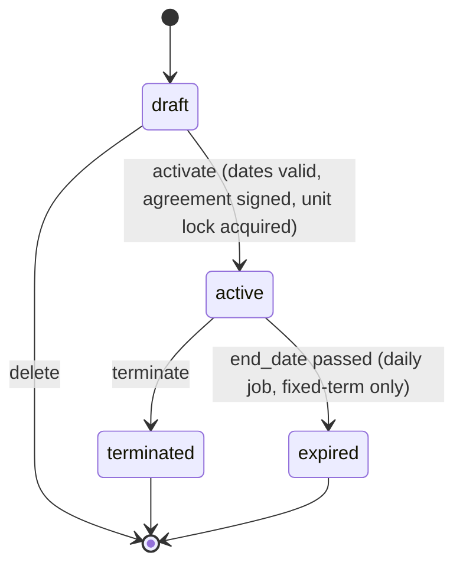
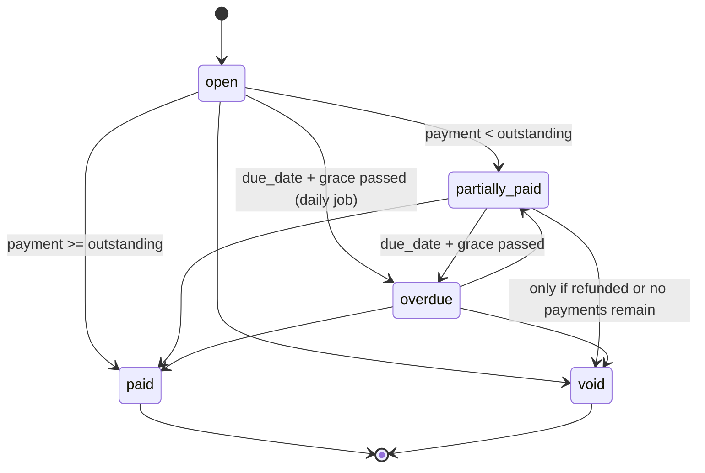
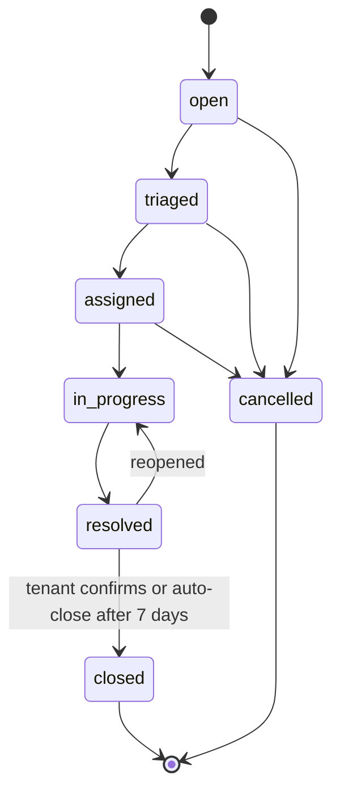
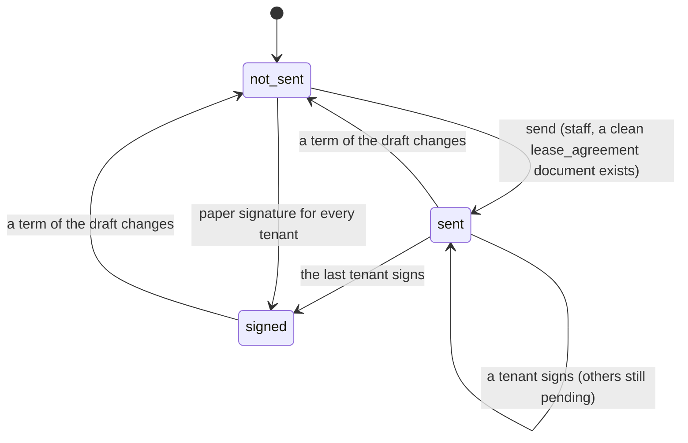

# Anjung: Low-Level Design (LLD)

| | |
|---|---|
| **Product** | Anjung (rental management system) |
| **Based on** | `anjung-hld.md` (v0.3), `anjung-implementation-plan.md` (v0.3) |
| **API contract** | `openapi.json` v0.17.0 (OpenAPI 3.1, 99 operations) |
| **Status** | Draft v0.3 |

**Changes in v0.3** (brought in line with the implementation; the contract changes are listed in `contracts/README.md`)

- **v0.3.1:** `GET /v1/documents?owner_type&owner_id` lists an owner's documents (section 10.1).
- **v0.3.2 and v0.6.0:** read-only display fields resolved when read: lease property, unit and room labels and tenant names, `Tenant.rentals` and `Tenant.tenancy`, and maintenance place and people names (section 3.10).
- **v0.4.0:** manager scope. A property manager sees only the properties they manage and what hangs off them (section 3.8). Unmatched payments and invoice runs become org admin only.
- **v0.5.0:** staff access window, checked at sign-in and on every request (sections 3.9, 11.1 and 11.3).
- **v0.6.0:** property limit per manager (section 3.8).
- **v0.7.0:** tenancy agreement signing before activation (sections 5.1 and 5.6), with a new notification template (9.3). Dates in messages are DD-MM-YYYY (section 1).
- **v0.7.1:** a draft lease's deposits can be changed (section 6.10).
- **v0.8.0:** set-password links for tenants, shared by staff or sent by the app over WhatsApp (section 11.2).
- **v0.9.0:** one lifecycle in every module: deactivate, reactivate and delete with a preview (section 3.11); properties and units say `inactive` instead of `archived`; the retention purge is built and off until D5 (section 13.3).
- **v0.10.0:** parking bays: a unit type of their own, included with a unit let as a whole, otherwise let on their own lease with an optional vehicle plate (section 5.7).
- **v0.11.0:** organisation branding: a company's own sign-in page at `/login/<handle>`, its name, logo and colour in the app, emails and receipts, and our own Cognito sign-in page (section 11.5).
- **v0.12.0:** a company's plan set by the platform admin: a property limit for the whole organisation and an end date, read-only for staff for 30 days after it, then closed; the org admin divides it up between staff (section 3.12).
- **v0.13.0:** both limits count units, not properties (whole units that are on; rooms, bays and empty properties are free) (sections 3.8 and 3.12).
- **v0.13.1:** errors may carry `params`, the values in their message, so the SPA shows the message in the user's language (section 15.1).
- **v0.13.2:** a property shows `units_active`, the whole units that are on (what the limits count), next to `unit_count`, which also includes units that are off (section 3.12).
- **v0.14.0:** inviting a tenant by email sends the app's own welcome email with a set-password link, branded, instead of Cognito's invitation with a temporary password (section 11.2).
- **v0.17.0:** the platform admin can correct a company's name and branding, with a reason (section 11.4).
- **v0.16.0:** field issues and delete blockers carry a `code` and `params`, so the SPA shows them in the user's language (section 15.1).
- **v0.15.0:** staff get the same welcome email and set-password link (`invite_staff`), with a resend for staff who have not signed in and for a company's first admin (sections 11.3, 11.4); no welcome email goes to an address on the bounce list (`409 address_suppressed`); a maintenance report and CSV downloads of every report (section 12.1).
- New error codes `account_inactive`, `quota_exceeded` and, for the local mock sign-in, `sign_in_denied` (section 15.1).
- Sections 2, 14.6 and 16 describe the repository as built, the local and home-network demo setups, and the new tests.

**Changes in v0.2**

- Product named **Anjung**. Table `anjung-main`, payment reference prefix `ANJ`, Glue database `anjung`.
- New section 11.4 covers organisation creation, suspension and closure, and the platform organisation. Related changes are in sections 2, 3.2, 3.3, 6.4, 11.1, 14.2, 14.6, 16, 17 and 18.
- Contract v0.2.0 adds four platform endpoints, uses `percent_bp` for late fees, returns `409 lease_overlap`, adds a shared `422` response and adds the non-prod `fake` provider key. All of these match this LLD.
- Room-by-room letting (contract v0.3.0). Rooms are units inside a whole unit, and a letting mode makes double letting impossible (sections 4.2, 4.3 and 5.5). Leases can be rolling with a notice period (5.1). Deposits are tracked by type (6.10) and excluded from the balance (6.1). One-off charges have their own endpoint (6.9). Maintenance can target shared areas (5.3), and occupancy counts lettable spaces (12). Bedspace letting and automatic bill splitting are deferred (section 18).
- Gateway and design-review answers applied. Each payment provider declares its own reference rules and QR validity. QR codes are created when the payer opens the pay screen, and messages carry a pay link instead of a QR (section 7). Open items 2, 3, 4, 7 and 8 are resolved (section 18). New section 19 is the gateway spike checklist. The vendor role is deferred (section 5.3), and contract v0.2.1 no longer grants it.
- Section 2 now shows the full repository layout, including READMEs, `smoke/` and `contracts/postman/`. New sections 16.2 to 16.4 describe the post-deploy smoke test, the Postman collection and the READMEs.

This document refines the HLD into implementable detail: package structure, core primitives, the exact DynamoDB key schema, transaction recipes, state machines, algorithms, worker design, integrations, infrastructure parameters, and test design. Where the LLD refines or corrects the HLD, it is called out in section 17.

---

## 1. Conventions

| Topic | Convention |
|---|---|
| Python | 3.12+, type-annotated, `mypy --strict` on `app/`, `ruff` for lint and format |
| IDs | ULID strings (26 chars), generated server-side, time-sortable, never reused |
| Money | `Money(amount_minor: int, currency: Currency)`, frozen dataclass. No floats anywhere in billing. Rounding: half-up on integer arithmetic only |
| Time | UTC `datetime` (timezone-aware) in storage and API. Business dates (`due_date`, `start_date`) are `date` in `Asia/Kuala_Lumpur` |
| JSON | `snake_case` fields, RFC 3339 timestamps, ISO dates |
| Display dates | Human-readable text (error messages, receipts, emails, the SPA) shows dates as DD-MM-YYYY and times in Malaysian time (`core/dates.py` `display_date`, `frontend/src/lib/dates.ts`). API fields stay ISO 8601 |
| Errors | One `AppError` hierarchy, mapped to the `Error` envelope in the OpenAPI contract |
| Tenancy | `org_id` comes from the validated token only. It is a required constructor argument of every repository |
| Concurrency | Optimistic: `version` attribute on mutable aggregates, conditional writes |
| Logging | JSON, one line per event, fields in section 15. No personal data values |

---

## 2. Package Layout

### 2.1 Repository layout

```
anjung/
  README.md                    What Anjung is, repo map, prerequisites, quick start, links to docs (section 16.4)
  docker-compose.yml           Local stack: DynamoDB Local, S3 stand-in (moto), api (section 16.5)
  docker-compose.nas.yml       Home-network demo: api, web, DynamoDB Local, S3 stand-in (section 16.5)
  backend/
    README.md                  Local setup, running api and worker, tests, environment variables
    pyproject.toml             uv project, ruff, mypy, pytest config
    Dockerfile                 One image for api and worker
    app/                       Application package (section 2.2)
    tests/                     unit, integration, contract, cross-org, e2e
  frontend/
    README.md                  Local setup, API client generation, build and test
    Dockerfile  nginx.conf     Production build served by nginx (demo image)
    src/  package.json         api/ auth/ components/ i18n/ lib/ pages/
  infra/
    README.md                  CDK bootstrap, deploy per environment, account and region map
    app.py  anjung_infra/      stacks_network, stacks_data, stacks_auth, stacks_app, stacks_edge, stacks_observability, table_spec
    tests/
  contracts/
    README.md                  How to change the contract and regenerate clients and the collection
    openapi.json               API contract (source of truth)
    postman/                   Postman collection and environments (section 16.3)
      anjung.postman_collection.json
      dev.postman_environment.json
      staging.postman_environment.json
      build.mjs  flows.mjs  run-flows.mjs   Collection generator and Postman Flows
  smoke/                       Post-deploy smoke test (section 16.2)
    README.md                  How to run locally and in CI, required secrets, adding checks
    smoke_test.py              CLI entry point (the checks live in this one file for now)
    local_flow.py              The money path against the local stack, plus links, bays and deletes
  docs/                        HLD, LLD, implementation plan, runbooks, status checklist, data
                               classification, counsel brief, NAS deploy guide
```

### 2.2 Backend package

Paths are relative to `backend/`. The package keeps the short name `app`. The tree below is the design. As built, the differences are:

- `core/` also has `access.py` (staff access window, section 3.9), `dates.py` (Malaysian dates and `display_date`), `concurrency.py` (version-conflict retry), `ratelimit.py` and `tracing.py`.
- `repositories/` is `dynamo.py` (table wrapper), `keys.py`, `store.py` (per-org repository factory), `schema.py` (the table definition shared with tests) and one module per area (`members.py`, `organisations.py`, `platform.py`, `properties.py`, `tenants.py`, `leases.py`, `billing.py`, `maintenance.py`, `documents.py`, `notifications.py`, `audit.py`, `privacy.py`).
- `domains/` adds `audit/`, `scope.py` (manager scope, section 3.8), `places.py` (display names, section 3.10) and `dev_auth.py` (the local-only `/dev/*` routes). Reporting is `domains/reports/`.
- `integrations/` is `payments/` (`base.py`, `fake.py`; no real gateway yet), `channels.py` (email and WhatsApp channels), `storage.py` (S3), `identity.py` (Cognito admin calls) and `mock_auth.py` (local sign-in, section 16.5).
- `worker/handlers/` is `billing.py`, `notifications.py` and `housekeeping.py`. `lambdas/` has `pre_token_generation`, `post_confirmation` and `scan_result`. The Streams transformer is not built (plan P5-01).
- `seed.py` creates the local demo organisation, and `cli.py` runs `create-table`, `bootstrap-platform` and `seed-demo`.

```
app/
  main.py                      FastAPI app factory, middleware, router mounting
  core/
    config.py                  pydantic-settings (env vars, Secrets Manager refs)
    ids.py                     new_id() -> ULID
    money.py                   Money, Currency, allocate(), format helpers
    clock.py                   Clock protocol (system clock, fixed clock in tests)
    errors.py                  AppError subclasses + exception handlers
    context.py                 RequestContext, contextvars for logging
    auth.py                    JWT validation, get_context dependency, require_roles
    pagination.py              signed cursor encode/decode
    idempotency.py             Idempotency-Key handling
    crypto.py                  KMS envelope field encryption
    logging.py                 structlog setup, redaction
    aws.py                     aioboto3 session, clients (DynamoDB, S3, SQS, KMS, SES)
  repositories/
    base.py                    OrgRepository, key builders, transact helpers
    keys.py                    All PK/SK/GSI builders (single source of truth)
    org.py  users.py  properties.py  tenants.py  leases.py
    billing.py  maintenance.py  documents.py  audit.py  privacy.py
  domains/
    platform/  organisations/  properties/  tenants/  leases/  billing/
    maintenance/  documents/  notifications/  privacy/  reporting/
      router.py  service.py  schemas.py  rules.py
  integrations/
    payments/
      base.py                  PaymentProvider protocol, PaymentEvent
      fake.py                  Deterministic fake for tests and local dev
      gateway_a.py             Real adapter (name TBD after spike)
    whatsapp.py  ses.py  scanner.py
  worker/
    main.py                    Consumer entrypoint (selects queue by env)
    runner.py                  Poll loop, backoff, graceful shutdown
    envelope.py                Message envelope
    handlers/                  invoicing.py payments.py notifications.py housekeeping.py
  lambdas/
    pre_token_generation/      Cognito trigger
    stream_to_firehose/        DynamoDB Streams transformer
    scan_result/               S3 scan callback
```

**Layering rule:** `router → service → repository`. Routers parse and authorise. Services hold business rules and orchestrate repositories and integrations. Repositories know only DynamoDB. Nothing below `router` imports FastAPI.

---

## 3. Core Primitives

### 3.1 RequestContext

```python
@dataclass(frozen=True, slots=True)
class RequestContext:
    user_id: str               # Cognito sub
    org_id: str                # from claim `org_id`
    roles: frozenset[Role]     # from claim `roles`
    tenant_id: str | None      # from claim `tenant_id` (tenants only)
    email: str | None
    request_id: str
    ip: str | None
```

### 3.2 JWT validation dependency

Cognito access tokens carry `client_id` (not `aud`), `token_use=access`, `iss`, `kid`.

```python
JWKS_URL = f"https://cognito-idp.{REGION}.amazonaws.com/{POOL_ID}/.well-known/jwks.json"
_jwks = PyJWKClient(JWKS_URL, cache_keys=True, lifespan=3600)   # refreshes on unknown kid

async def get_context(request: Request, creds=Depends(HTTPBearer(auto_error=False))) -> RequestContext:
    if creds is None:
        raise Unauthorized()
    token = creds.credentials
    try:
        key = _jwks.get_signing_key_from_jwt(token).key
        claims = jwt.decode(
            token, key, algorithms=["RS256"], issuer=ISSUER,
            options={"require": ["exp", "iat", "iss", "sub", "client_id", "token_use"], "verify_aud": False},
            leeway=30,
        )
    except jwt.PyJWTError:
        raise Unauthorized()
    if claims["token_use"] != "access" or claims["client_id"] not in ALLOWED_CLIENT_IDS:
        raise Unauthorized()
    org_id, roles = claims.get("org_id"), claims.get("roles")
    if not org_id or not roles:
        raise Forbidden()                      # token without tenancy claims is never valid for the API
    return RequestContext(user_id=claims["sub"], org_id=org_id,
                          roles=frozenset(Role(r) for r in roles),
                          tenant_id=claims.get("tenant_id"), email=claims.get("email"),
                          request_id=request.state.request_id, ip=request.client.host if request.client else None)

def require_roles(*allowed: Role):
    async def dep(ctx: RequestContext = Depends(get_context)) -> RequestContext:
        if not (ctx.roles & set(allowed)):
            raise Forbidden()
        return ctx
    return dep
```

Notes:
- `roles` is a JSON array claim. Cognito `cognito:groups` is a fallback only if the custom claim is absent in dev.
- JWKS fetch happens off the event loop (thread executor) to avoid blocking.
- After building the context, `get_context` rejects calls from suspended or closed organisations, using a per-task org status cache with a 60-second TTL (section 11.4).
- Role checks come from `x-required-roles` in the OpenAPI contract. A contract test asserts every route's dependency matches it.

### 3.3 Repository base and tenancy by construction

```python
class OrgRepository:
    def __init__(self, ddb: DynamoTable, org_id: str):
        self._t, self.org_id = ddb, org_id

    # every key builder takes org_id first, so a missing org is a TypeError, not a data leak
    def pk(self) -> str: return f"ORG#{self.org_id}"
```

Rules:
1. All GSI partition keys include `ORG#<org_id>` except GSI2 (login resolution by `sub`, used only by the Pre Token Lambda and the tenant-linking flow).
2. Any lookup by a global ID (for example `QRREF#`, `PAYREF#`) returns an item that carries `org_id`. The caller must compare it to `ctx.org_id` before use. A helper `assert_same_org(item, ctx)` is mandatory.
3. Cursors embed the PK they were issued for. Decoding rejects a cursor whose PK prefix does not match the current org (section 3.5).
4. Items store `org_id` as an attribute for defence in depth and for the Streams transformer.
5. Services build their repositories from `ctx.org_id` only (a tenancy test checks this), and apply the manager scope (section 3.8) on top.
5. Only routers in `domains/platform/` may build a repository with an org ID that does not come from `ctx.org_id` (the target org from the path), and only after `require_roles(Role.PLATFORM_ADMIN)`. A lint rule and a test enforce this.

### 3.4 Money module

```python
@dataclass(frozen=True, slots=True)
class Money:
    amount_minor: int
    currency: Currency = Currency.MYR
    def __add__(self, o): self._check(o); return Money(self.amount_minor + o.amount_minor, self.currency)
    def __sub__(self, o): ...
    def __neg__(self): ...
    def times_ratio(self, num: int, den: int) -> "Money":     # half-up integer rounding
        q, r = divmod(self.amount_minor * num * 2 + den, den * 2)
        return Money(q, self.currency)

def prorate(rent: Money, days_used: int, days_in_month: int) -> Money:
    return rent.times_ratio(days_used, days_in_month)
```

Property tests: `a + b - b == a`, `prorate(x, n, n) == x`, sum of split allocations equals the original.

### 3.5 Signed pagination cursors

`cursor = base64url(json({"k": LastEvaluatedKey, "i": index_name, "p": pk_prefix}) + "." + hmac_sha256(secret, payload))`. On decode: verify HMAC, then verify `p` equals the PK prefix of the current query. This blocks cursor tampering and cross-org cursor reuse. The HMAC secret is in Secrets Manager and rotated with a two-key overlap.

### 3.6 Idempotency

For endpoints marked with `Idempotency-Key`:

```
PK=IDEMP#<org_id>#<key>   SK=META
attrs: request_hash (sha256 of method+path+body), status_code, response_body, created_at, ttl (now+24h)
```

Flow: conditional put of an in-flight record (`attribute_not_exists(PK)`). If it exists with the same `request_hash` and a stored response, return it. If the hash differs, return `409 idempotency_conflict`. If still in flight, return `409 conflict` with `Retry-After: 1`. On completion, update the record with the response. Business-level idempotency (section 6) is still enforced separately, so this header is a client convenience, not the only protection.

### 3.7 Field-level encryption

Used for `identity_document.number`. KMS envelope encryption: `GenerateDataKey` once per item (AES-256-GCM), store `{ct, nonce, wrapped_key, key_id}`, encryption context `{org_id, tenant_id, field}`. Decrypt only in the `reveal` path (explicit role check and audit entry). API returns the masked form by default (last 4 characters).

### 3.8 Manager scope and unit limit (contract v0.4.0, v0.6.0, v0.13.0)

`domains/scope.py` defines `Scope(container, ctx)`. `restricted` is true for a `property_manager` without `org_admin`. For anyone else every check passes.

| Check | A restricted manager passes when |
|---|---|
| `property_ok(pid)` | `Property.manager_id` is the caller |
| `lease_ok(lease)` | the lease's property passes |
| `invoice_ok(invoice)` | the invoice's lease is on one of their properties |
| `tenant_ok(tenant)` | the caller created the tenant (`created_by`), or the tenant is on a lease (any status) in one of their properties |

- Units, ledgers, statements, one-off charges, maintenance requests, documents, report rows and notification log entries follow their property, lease or tenant.
- A failed check raises `NotFound`, exactly like a foreign organisation's ID (section 15.1). Lists are filtered the same way.
- Unmatched payments, their allocation and invoice runs span the organisation, so they require `org_admin`.
- `manager_id` is set to the creator on `POST /v1/properties`. Only an org admin can change it, and only to a member with `org_admin` or `property_manager` whose access is not disabled or expired.
- **Cost:** the first check in a request reads the org's properties once, and lease, invoice or tenant checks read the org's leases once, cached for the request. A manager GSI is the next step if an organisation reaches thousands of properties.

**Unit limit** (since v0.13.0; it counted properties before, so one property with many units got round it). `unit_quota` on the membership (null = no limit; items written earlier say `property_quota` and are read the same way). The count is the **whole units that are on, in the active properties the manager manages** (`plan.unit_usage`). Rooms, parking bays and empty properties are free. It is checked when a whole unit is added or reactivated, when a property comes back with its units, and when an admin moves a property to the manager (its units count for them); `409 quota_exceeded` names the numbers. Lowering a limit below the count never removes anything. Org admins are never limited by their own. `PropertyPage.quota` returns `{used, limit}` in units to a restricted manager and is null for admins. The managers' limits together cannot exceed the organisation's plan (section 3.12).

### 3.9 Staff access window (contract v0.5.0)

`core/access.py`. A membership has `status` (`invited`, `active`, `disabled`) and optional `active_from` and `active_until`, inclusive Malaysian calendar dates (ISO strings).

```python
def staff_access(member, today) -> Literal["invited", "active", "scheduled", "expired", "disabled"]:
    if member.status == "disabled": return "disabled"
    if member.active_from and today < member.active_from: return "scheduled"
    if member.active_until and today > member.active_until: return "expired"
    return "invited" if member.status == "invited" else "active"
```

`blocked_reason(member, today)` turns `disabled`, `scheduled` and `expired` (or a missing membership) into a sentence for the user, with dates as DD-MM-YYYY. It is checked in three places:

1. The Pre Token Lambda and the mock sign-in, which refuse to issue a token (section 11.1).
2. `get_context` on every request from a staff token: one `GetItem` of `ORG#o / MEMBER#<sub>`, then `403 account_inactive` with the reason. The SPA signs the user out and shows the reason.
3. Assigning a property (section 3.8).

`User.access` returns the computed value to admins. `Me.active_from` and `active_until` let the staff dashboard show "Your access is valid until ..." with the days left. Nothing is deleted on deactivation: the user's properties stay assigned (an admin can reassign them) and come back on reactivation.

### 3.10 Display names (contract v0.3.2, v0.6.0)

`domains/places.py` `PlaceNames(container, ctx)` batch-loads properties, units, tenants and members for a page of results and resolves:

- on leases: `property_name`, `unit_label`, `parent_unit_label` (rooms) and `tenants` (id and full name);
- on tenants: `rentals` (active and draft leases with their place) and `tenancy` (`current`, `upcoming`, `past`, `none`), which is separate from the account `status`. A past tenant keeps their login until staff mark them former;
- on maintenance requests: `property_name`, `unit_label`, `parent_unit_label`, `reported_by_name`, `assigned_to_name`.

Names are resolved when read, so a rename shows at once, and they are never stored on the record. The privacy export leaves them null, so one tenant's export never lists co-tenants.

---

### 3.12 A company's plan (contract v0.12.0)

The platform admin sets each organisation's plan; inside it, the org admin divides it up (`app/domains/organisations/plan.py`).

| Level | Who | Setting | Effect |
|---|---|---|---|
| Organisation | platform admin (`PATCH /v1/platform/organizations/{id}/plan`, or `plan` when creating it) | `plan.unit_limit` | Units of the whole organisation: whole units that are on, in properties that are on, whoever manages them (rooms, bays and empty properties are free; contract v0.13.0, it counted properties in v0.12.0). Adding or reactivating a unit, or reactivating a property with units, beyond it is `409 quota_exceeded` ("Your plan allows N units…"), for admins too. Lowering it below what is in use removes nothing |
| Organisation | platform admin | `plan.active_until` | Last day of the plan (Malaysian date). See below |
| Manager | org admin | `unit_quota` (section 3.8) | The managers' unit limits (disabled members excluded) cannot add up to more than the organisation's limit: `422` on invite or update, naming how much is left |
| Staff member | org admin | `active_until` (section 3.9) | Cannot be later than the organisation's `active_until`: `422` |

The plan is stored on the organisation item (`plan`) and shown as `Organization.plan` (also to the platform admin's list) and, for staff, `Me.plan`: limit, end date, `units_used` (counted on read), `status` and `read_only_until`. Each property also shows `units_active`, its whole units that are on, so the Properties list adds up to `units_used` for active properties; `unit_count` also includes units that are off, and the list shows "1 (1 inactive)" when they differ (v0.13.2). Every change is audited as `org.plan` in both organisations with the reason. An org admin cannot change it (`PATCH /v1/org` has no `plan`).

**After the end date** (`status`):

- `active`: no end date, or today is on or before it.
- `read_only`: the 30 days after it (`GRACE_DAYS`). `get_context` refuses staff writes (any method but GET, HEAD and OPTIONS) with `403 plan_read_only` and a plain message, except recording money received (`POST /v1/invoices/{id}/payments/manual`, `POST /v1/payments/{id}/allocate`) and privacy requests (`/v1/privacy/…`), which must keep working. Staff can still read and export. Tenants are unaffected: they see and pay their bills, report repairs and sign. Scheduled jobs keep running, so rent is still invoiced and reminders still go out. The SPA shows staff a banner with both dates.
- `ended`: after the grace period. Sign-in is refused (`resolve_claims` raises `plan_ended`; the mock sign-in shows it as a plain sentence) and every request from the organisation, tenants included, gets `403 plan_ended`, which signs the SPA out with the reason. Fan-out jobs skip the organisation. The platform admin renews by moving `active_until`; nothing is lost.

The organisation status cache (60 seconds, section 11.4) is cleared when the platform changes the plan, so the change applies at once on that task.

**Reminders.** `plan_reminders_all` (daily 08:00) emails each org admin 30, 7 and 1 day before `active_until` (template `plan_ending`, en and ms), once per admin and day through the notification dedupe item. Managers are not emailed. These go straight to the email channel, not the tenant notification log.

### 3.11 Lifecycle: deactivate, reactivate, delete (contract v0.9.0)

Every module uses the same three actions, built on `app/domains/lifecycle.py`.

**Deactivate and reactivate** (reversible; properties and units):

- `POST /v1/properties/{id}/deactivate` sets the property `inactive` and every unit and room that was still on, marking each with `deactivated_with: <property id>`. `POST …/reactivate` turns the property back on and only the units carrying that mark, so a unit switched off on its own stays off. Reactivating applies the manager's property limit again (`409 quota_exceeded`).
- `POST /v1/units/{id}/deactivate` and `/reactivate` do the same for a whole unit and its rooms (`deactivated_with: <unit id>`). A room cannot come back while its unit or the property is inactive.
- Deactivation is refused (409) while any affected unit is `occupied`, has room leases, has periods in its `UNITLOCK#` (active or upcoming leases) or has a draft lease. The message names the units.
- `PATCH /v1/units/{id}` with `status: inactive` (or the old `archived`) deactivates; `vacant` from `inactive` reactivates.
- **The old status name.** Items written before v0.9.0 say `archived`. The property and unit repositories read them as `inactive` (`_norm`), and every write stores `inactive`, so no migration is needed. `archived` is accepted as an input alias until v0.11, and the room parent check treats both names as off.

**Delete.** Every delete has a preview, `GET …/deletion` → `DeletionPreview {mode, blockers, affects, note}`, and the `DELETE` itself needs a `reason` query parameter (3 to 500 characters), which goes into the audit entry. The service works out the plan once and both endpoints use it:

| Record | `remove` (deleted completely) | `erase` | `blocked` |
|---|---|---|---|
| Property | No unit ever had a lease, no maintenance requests. Deletes the property, units, rooms, label locks, unit locks, and documents of the property and units (files too) | — | `lease_history` (deactivate instead; the retention purge deletes it later), `maintenance_history` |
| Unit or room | Same rule for the unit and its rooms. Decrements the property's `unit_count` for a whole unit | — | Same |
| Tenant | Never had a lease. Deletes every item under their GSI5 subject index (tenant record, consents, documents, notification log, maintenance requests and their comments, privacy requests), the email lock, `INVITE#`, `INVITETOKEN#`, the files and the Cognito user | Has lease history. Org admin only: opens a `deletion` privacy request for the tenant and completes it, which runs the anonymisation job (section 13.2). Returns `erasure_started` and the request id | `lease_open` (draft or active lease), `unpaid`, `credit`, `deposits_held` (ended leases), `already_erased` |
| Lease | A draft. Deletes the lease, its tenant links and its documents (even an uploaded agreement: the lease never took effect) | — | `not_draft` |
| Maintenance request | Closed or cancelled. Org admin only. Deletes the request, its comments and photos | — | `not_closed` |

- An identity document of a tenant who never had a lease is removed too: the financial retention hold applies to records tied to a tenancy.
- Deletes run in transactions of up to 100 operations (`write_all`), with the audit entry in the first one. Repeated keys are dropped. A delete interrupted between chunks is finished by running it again. Files are removed after the commit; a file left behind has no document pointing at it.
- **Who may delete.** Staff within their scope (manager scope applies, so a manager deletes only what they can see). Erasing a tenant and deleting maintenance requests are org admin only. Users (staff) keep their own `DELETE /v1/users/{id}`; documents keep `DELETE /v1/documents/{id}` with the retention hold.
- Audit actions: `property.deactivate`, `property.reactivate`, `property.delete`, `unit.deactivate`, `unit.reactivate`, `unit.delete`, `tenant.delete`, `lease.delete`, `maintenance.delete`. Summaries hold the reason and counts, never personal data.

## 4. DynamoDB Design

### 4.1 Table and indexes

Table `anjung-main`: partition key `PK` (S), sort key `SK` (S). On-demand, PITR, deletion protection, KMS CMK, Streams `NEW_AND_OLD_IMAGES`, TTL attribute `ttl`.

| Index | Keys | Projection | Purpose |
|---|---|---|---|
| GSI1 | `GSI1PK`, `GSI1SK` | ALL | Entity relationships: lookups by global ID, unit→leases, tenant→maintenance, owner→documents, entity→audit |
| GSI2 | `GSI2PK`, `GSI2SK` | KEYS_ONLY + `org_id`, `roles` | Login resolution by Cognito `sub` |
| GSI3 | `GSI3PK`, `GSI3SK` | ALL | Unpaid invoices by due date (sparse) |
| GSI4 | `GSI4PK`, `GSI4SK` | ALL | Maintenance by status, active leases (sparse) |
| GSI5 | `GSI5PK`, `GSI5SK` | KEYS_ONLY | Data-subject index for PDPA export, correction and deletion |

### 4.2 Entity key reference

`o`=org id, `p`=property, `u`=unit, `t`=tenant, `l`=lease, `i`=invoice, `m`=maintenance request.

| Entity | PK | SK | Other keys |
|---|---|---|---|
| Org registry | `REGISTRY#ORG` | `<o>` | enumerates orgs for scheduled jobs |
| Org | `ORG#o` | `META` | |
| Membership (staff; vendor reserved for later) | `ORG#o` | `MEMBER#<sub>` | GSI2: `SUB#<sub>` / `MEMBER#o`; attrs: `status`, `active_from`, `active_until`, `property_quota` (section 3.9). GSI2 does not project the access dates, so sign-in reads the item itself |
| Property | `ORG#o` | `PROP#p` | GSI1: `ORG#o#PROP#p` / `META`; attrs: `manager_id` (section 3.8) |
| Unit (whole unit) | `ORG#o` | `PROP#p#UNIT#u` | GSI1: `ORG#o#UNIT#u` / `META`; attrs: `type=whole_unit`, `letting_mode`, `active_room_leases` |
| Unit (room) | `ORG#o` | `PROP#p#UNIT#<parent>#ROOM#r` | GSI1: `ORG#o#UNIT#r` / `META`; attrs: `type=room`, `parent_unit_id`. A room is a unit everywhere else (leases, invoices, maintenance) |
| Unit lease lock | `ORG#o` | `UNITLOCK#u` | attrs: `lease_version`, `active_lease_id`. One per whole unit and one per room |
| Tenant | `ORG#o` | `TENANT#t` | GSI2: `SUB#<sub>` / `TENANT#o#t` (once linked); GSI5: `ORG#o#SUBJECT#t` / `TENANT#t`; attrs: `created_by` (staff sub) |
| Tenant consent | `ORG#o` | `TENANT#t#CONSENT#<ts>#<id>` | GSI5: `ORG#o#SUBJECT#t` / `CONSENT#<id>` |
| Lease | `ORG#o` | `LEASE#l` | GSI1: `ORG#o#UNIT#u` / `LEASE#<start_date>#l`; GSI4 (active only): `ORG#o#LEASE#active` / `<l>`; GSI5 per tenant; attrs: `agreement` map (section 5.6) |
| Tenant→lease link | `ORG#o` | `TL#t#l` | GSI5: `ORG#o#SUBJECT#t` / `LEASELINK#l` |
| Invoice | `ORG#o#LEASE#l` | `INV#<period>#<i>` | GSI1: `ORG#o#INV#i` / `META`; GSI3 (unpaid only): `ORG#o#INV#unpaid` / `<due_date>#<l>#<i>`; GSI5 per tenant |
| Invoice key lock | `ORG#o#LEASE#l` | `INVKEY#<period>#<kind>` | `kind` in `rent`, `deposit`, `late_fee#<n>`, `charge#<ulid>`; guarantees one per (lease, period, kind) |
| Ledger entry | `ORG#o#LEASE#l` | `LEDGER#<ulid>` | GSI5 per tenant |
| Payment | `ORG#o#INV#i` (or `ORG#o#UNMATCHED` if none) | `PAY#<ulid>` | GSI1: `ORG#o#PAY#<id>` / `META`; GSI5 per tenant |
| Allocation | `ORG#o#INV#i` | `ALLOC#<ulid>` | credit or payment applied to an invoice |
| Payment reference lock | `PAYREF#<provider>#<ref>` | `META` | global idempotency, carries `org_id`, `payment_id` |
| QR reference | `QRREF#<reference>` | `META` | resolves a gateway reference to `org_id`, `lease_id`, `invoice_id`, `expires_at` |
| Invoice run | `ORG#o` | `INVRUN#<period>#<ulid>` | |
| Maintenance request | `ORG#o` | `MR#m` | GSI1: `ORG#o#TENANT#t` / `MR#<created>#m`; GSI4: `ORG#o#MR#<status>` / `<created>#m`; GSI5 per tenant |
| MR comment | `ORG#o#MR#m` | `CMT#<ulid>` | |
| Document | `ORG#o` | `DOC#d` | GSI1: `ORG#o#OWNER#<type>#<id>` / `DOC#d`; GSI5 per tenant when tenant-owned |
| Audit entry | `ORG#o#AUDIT#<yyyy-mm>` | `<ts>#<ulid>` | GSI1: `ORG#o#ENT#<type>#<id>` / `<ts>#<ulid>` |
| Notification log | `ORG#o#NOTIF#<yyyy-mm>` | `<ts>#<ulid>` | GSI5 per tenant |
| Privacy request | `ORG#o` | `PRIVREQ#<ulid>` | GSI5 per tenant |
| Idempotency | `IDEMP#o#<key>` | `META` | `ttl` |
| Webhook dedupe | `WHEVT#<provider>#<event_id>` | `META` | `ttl` 30 days |

### 4.3 Access pattern to index map

| # | Pattern | Operation |
|---|---|---|
| 1 | Org settings | `GetItem ORG#o / META` |
| 2 | Properties in org | `Query PK=ORG#o, SK begins_with PROP#` (excludes unit items because unit SK starts `PROP#p#UNIT#`. The repository filters by `entity_type` to separate them) |
| 3 | Units in property | `Query PK=ORG#o, SK begins_with PROP#p#UNIT#` |
| 4 | Get unit/property/invoice/payment by ID | `Query GSI1 GSI1PK=ORG#o#<KIND>#<id>, GSI1SK=META` |
| 5 | Leases of a unit | `Query GSI1 GSI1PK=ORG#o#UNIT#u, GSI1SK begins_with LEASE#` |
| 6 | Leases of a tenant | `Query PK=ORG#o, SK begins_with TL#t#` then `BatchGetItem` leases |
| 7 | Tenant by `sub` (login) | `Query GSI2 GSI2PK=SUB#<sub>` |
| 8 | Invoices of a lease | `Query PK=ORG#o#LEASE#l, SK begins_with INV#` |
| 9 | Unpaid/overdue invoices due on or before a date | `Query GSI3 GSI3PK=ORG#o#INV#unpaid, GSI3SK <= <date>~` |
| 10 | Ledger of a lease | `Query PK=ORG#o#LEASE#l, SK begins_with LEDGER#` (ULIDs sort by time) |
| 11 | Payment dedupe | `PutItem PAYREF#... condition attribute_not_exists(PK)` |
| 12 | Active leases of an org | `Query GSI4 GSI4PK=ORG#o#LEASE#active` |
| 13 | Maintenance by status | `Query GSI4 GSI4PK=ORG#o#MR#<status>` |
| 14 | Maintenance of a tenant | `Query GSI1 GSI1PK=ORG#o#TENANT#t, GSI1SK begins_with MR#` |
| 15 | All items for a data subject | `Query GSI5 GSI5PK=ORG#o#SUBJECT#t` (paginated) then batch get as needed |
| 16 | Audit by month / entity | `Query PK=ORG#o#AUDIT#<yyyy-mm>` or `GSI1 ORG#o#ENT#<type>#<id>` |
| 17 | Unmatched payments | `Query PK=ORG#o#UNMATCHED, SK begins_with PAY#` |
| 18 | Rooms of a whole unit | `Query PK=ORG#o, SK begins_with PROP#p#UNIT#u#ROOM#` (pattern 3 returns whole units and rooms together, separated by `type`) |

### 4.4 Example items

```json
// Lease
{
  "PK": "ORG#01JD...", "SK": "LEASE#01JE...",
  "GSI1PK": "ORG#01JD...#UNIT#01JC...", "GSI1SK": "LEASE#2025-01-01#01JE...",
  "GSI4PK": "ORG#01JD...#LEASE#active", "GSI4SK": "01JE...",
  "entity_type": "lease", "schema_version": 1, "org_id": "01JD...",
  "unit_id": "01JC...", "property_id": "01JB...", "tenant_ids": ["01JF..."],
  "status": "active", "start_date": "2025-01-01", "end_date": "2025-12-31",
  "monthly_rent_minor": 150000, "currency": "MYR", "due_day": 5, "notice_days": 30,
  "deposits": [{"type": "security", "amount_minor": 300000}, {"type": "utility", "amount_minor": 75000}],
  "deposits_held": [{"type": "security", "amount_minor": 300000}, {"type": "utility", "amount_minor": 75000}],
  "recurring_charges": [{"name": "Parking", "amount_minor": 10000, "active": true}],
  "balance_minor": 0, "credit_minor": 0, "version": 3,
  "agreement": {"status": "signed", "document_id": "01JH...", "sent_at": "2024-12-18T02:00:00Z",
                "signed_at": "2024-12-19T09:30:00Z",
                "signatures": [{"tenant_id": "01JF...", "full_name": "Siti Aminah", "method": "portal",
                                "signed_at": "2024-12-19T09:30:00Z", "document_id": "01JH...",
                                "ip": "203.0.113.7", "user_agent": "Mozilla/5.0 ..."}]},
  "created_at": "2024-12-20T03:00:00Z", "updated_at": "2024-12-20T03:00:00Z"
}

// Invoice
{
  "PK": "ORG#01JD...#LEASE#01JE...", "SK": "INV#2025-01#01JG...",
  "GSI1PK": "ORG#01JD...#INV#01JG...", "GSI1SK": "META",
  "GSI3PK": "ORG#01JD...#INV#unpaid", "GSI3SK": "2025-01-05#01JE...#01JG...",
  "entity_type": "invoice", "number": "INV-2025-000123", "period": "2025-01", "kind": "rent",
  "status": "open", "issue_date": "2024-12-29", "due_date": "2025-01-05",
  "line_items": [{"type":"rent","description":"Rent Jan 2025","amount_minor":150000}],
  "total_minor": 160000, "paid_minor": 0, "currency": "MYR", "version": 1
}
```

### 4.5 Sparse index maintenance

- GSI3 attributes (`GSI3PK`, `GSI3SK`) exist while `status in (open, partially_paid, overdue)`. The transaction that moves an invoice to `paid` or `void` removes them (`REMOVE GSI3PK, GSI3SK`).
- GSI4 lease attributes exist only while the lease is `active`. Activation sets them. Termination or expiry removes them.
- GSI4 maintenance attributes are rewritten on every status change (the status is part of the partition key).

### 4.6 Item size and hot partitions

- `ORG#o` partition holds properties, units, tenants, leases. Expected size per org is well under 10 GB. If a very large org appears, shard by entity type (`ORG#o#TENANTS#<shard>`) behind the repository. Callers never see keys.
- Ledger and invoices are partitioned per lease, so growth is bounded by lease lifetime.
- Audit and notification logs are partitioned per month to bound partition size.

---

## 5. State Machines

### 5.1 Lease



Rules:
- Activation requires `start_date <= today + 31d`, at least one tenant, no overlapping active or future lease on the unit, and a letting mode that allows it (section 5.5). While the org setting `require_signed_agreement` is on (the default), it also requires every tenant to have signed the agreement (section 5.6), otherwise `409 invalid_state`.
- A draft can be amended with `PATCH`: end date, notice days, rent, due day, recurring charges, tenants and deposits. Deposits can be changed only while the lease is a draft (section 6.10).
- A lease is **fixed-term** when `end_date` is set and **rolling** when it is null. Rolling leases never expire. They run until terminated, and invoices continue every period.
- Termination date must be on or after `start_date`, and on or before `end_date` for fixed-term leases. For a rolling lease it must be at least `notice_days` after the day termination is recorded, unless `waive_notice` is true, which needs a reason and is audited. Unbilled periods after the termination date are voided (section 6.6).
- Renewal applies to fixed-term leases only. It creates a new `draft` lease starting at `end_date + 1`, copying terms with overrides, and optionally activates it. A fixed-term lease can also become rolling through `PATCH` (`end_date: null`).

### 5.2 Invoice



`void` is blocked when `paid_minor > 0` unless the payment is first reversed. Status is derived: `outstanding = total - paid`; `paid` if `outstanding <= 0`; `partially_paid` if `0 < paid < total`; otherwise `open` or `overdue` by date.

### 5.3 Maintenance request



Permissions: tenants create and may cancel while `open`; staff perform all transitions, and `assigned_to` is a staff user in v1.

Location: a request has `area = unit` (the room or unit itself) or `area = shared_area`. A shared area names either the whole unit (the shared kitchen or bathroom of a unit let by rooms) or the property (building common areas), never both. Every request stores `property_id` so it can be listed per property. A tenant may name only a room or unit they currently lease, its parent whole unit, or its property. A shared-area request from one tenant is visible to that tenant and to staff, not to the other room tenants in v1.

The vendor role is deferred to a later release. When it is added, vendors may only move `assigned → in_progress → resolved` on requests assigned to them, and the cross-org suite must cover that narrow scope. The `vendor` value stays reserved in the `Role` enum, but no API grants it in v1.

### 5.4 Payment

`succeeded` (applied), `unmatched` (received, no invoice resolved), `reversed` (refund or chargeback), `failed` (gateway reported failure, kept for audit, no ledger effect).

### 5.5 Whole-unit and room letting

A whole unit is let either as one (`letting_mode = whole`) or by the room (`letting_mode = rooms`). Rooms are units with `type = room` and a `parent_unit_id`. Rooms cannot contain rooms, and a room's property is its parent's property.

The rules below are enforced in the same transaction as the change, so a whole unit and its rooms can never be let at the same time:

| Action | Extra items in the transaction |
|---|---|
| Activate a lease on a whole unit | `ConditionCheck` the unit: `letting_mode = whole` |
| Activate a lease on a room | `Update` the parent unit: condition `letting_mode = rooms`, `ADD active_room_leases 1` |
| Terminate or expire a room lease | `Update` the parent unit: `ADD active_room_leases -1` |
| Change `letting_mode` | `Update` the unit: condition `active_room_leases = 0`, and `ConditionCheck` its own `UNITLOCK`: no active lease. Otherwise `409 invalid_state` |
| Create a room | `ConditionCheck` the parent: `type = whole_unit` |

`active_room_leases` counts activated room leases, including those with a future start date. Only leases in one house touch the counter, so contention is negligible. The nightly integrity job (section 6.8) also checks the counter against the room leases.

Unit status: a room or a whole unit let as one is `occupied` when it has an active lease. A whole unit let by rooms is `occupied` when any of its rooms is.

### 5.7 Parking bays (contract v0.10.0)

A bay is a unit with `type = parking`. It is stored at property level (`PROP#p#UNIT#u`, like a whole unit), so it appears in the unit list (`?type=parking` filters it) and in every property-wide read, but never among a unit's rooms. It has no letting mode, no bedrooms or bathrooms, an optional `note`, and does not count in the property's `unit_count`.

- **Allocation.** `parent_unit_id` optionally names the whole unit the bay belongs to. A property bay has none. Allocation is set on create (`ConditionCheck` that the unit is a live whole unit in the same property) and changed with `PATCH /v1/units/{id}` (`parent_unit_id`, null for a property bay), refused while the bay has an active, upcoming or draft lease.
- **Labels** are unique per property in their own namespace (`UNITLBL#BAY#<property>#…`), so a unit and a bay may both be called A-1 (`label_scope`).
- **Letting rule.** While its unit is let as a whole, a bay comes with that unit: it cannot have a lease of its own (422 on create, 409 on activation) and the unit's lease shows it in `included_bays`. When the unit is let by the room, and for property bays, the bay is let on its own lease, which activates like a whole unit's (unit lock, `occupied`). Switching the unit back to letting as a whole is refused while one of its bays is let separately. This check reads the bays and their locks before the change rather than in the same transaction; the window is a concurrent bay activation during the switch, which the next integrity run would show.
- **Vehicle plate.** `vehicle_plate` on bay leases only (422 otherwise), stored upper case with single spaces. It is not a term, so changing it never clears agreement signatures and never creates a rent amendment. It is personal data: it is in the tenant's export (the lease) and set to null on anonymisation (section 13.2).
- **Deletes and deactivation.** A bay is deleted or deactivated like any unit (section 3.11). Deleting a whole unit keeps its bays as property bays. Deactivating a unit does not switch its bays off, but a bay whose unit is inactive cannot be let.
- **Display.** `Lease.unit_type` and `TenantRental.unit_type` tell the SPA to show "Bay B2-115". `parent_unit_label` is set for rooms only.
- **Reports.** Occupancy leaves bays out of `units_total` and the rate. Bays let on their own are counted in `bays_total` and `bays_occupied`; bays that come with a unit let whole are not counted.

### 5.6 Tenancy agreement (contract v0.7.0)

The lease item holds an `agreement` map. A lease without one reads as `not_sent`.



| Operation | Who | Rules |
|---|---|---|
| `POST /v1/leases/{id}/agreement/send` | staff | Draft only. Uses `document_id` or, by default, the newest clean `lease_agreement` document on the lease, else `409 invalid_state`. Sending again restarts signing. Enqueues the `lease_agreement_sent` notification to each tenant |
| `POST /v1/leases/{id}/agreement/sign` | tenant on the lease | Status `sent`, not yet signed by this tenant (`409` otherwise), document still clean. `full_name` must equal the tenant's name after collapsing spaces and case-folding, else `422`. `agree` must be `true` |
| `POST /v1/leases/{id}/agreement/paper` | staff | Draft only, a clean agreement document exists (the signed scan). `tenant_ids` must be on the lease and not yet signed. Records `method=paper`, the staff member and an optional `note` |

- A signature stores `tenant_id`, `full_name` (as typed, or the name on record for paper), `method`, `signed_at`, `document_id`, and for the portal `ip` and `user_agent` (truncated to 300 characters). The API returns only the first four. The rest stays for evidence and the audit log (`lease.agreement_send`, `lease.agreement_sign`, `lease.agreement_paper`).
- `status` becomes `signed`, with `signed_at`, when no tenant is pending. `pending_tenant_ids` is computed from the lease's tenants on read.
- Any `PATCH` that changes `end_date`, `notice_days`, rent, `due_day`, recurring charges, tenants or deposits resets the map to `not_sent`.
- **Visibility:** a tenant cannot see a draft lease until its agreement is sent. From then on they can read the lease and its documents (read only).
- Each change is a conditional write on the lease `version`, retried on conflict, so two tenants signing at once both count.

---

## 6. Billing Algorithms

### 6.1 Ledger sign convention

`amount_minor > 0` increases what the tenant owes (charges). `amount_minor < 0` decreases it (payments, credits). `lease.balance_minor = sum(amount_minor)` over the ledger, excluding `deposit_received` and `deposit_returned` entries, which only record deposits held for the tenant (section 6.10). Ledger entries are never updated or deleted. Corrections are new entries of type `adjustment` or `payment_reversal`.

### 6.2 Invoice generation (idempotent)

Triggered by the daily sweep (section 8) or `POST /v1/invoice-runs`.

```
for each active lease L in org (GSI4):
    for each period P due within [today, today + invoice_lead_days]:   # normally one
        key = INVKEY#<P>#rent
        lines = rent line (prorated if first or last partial month) + active recurring charges
        total = sum(lines)
        credit_applied = min(L.credit, total)
        TransactWriteItems:
          1. Put INVKEY (condition attribute_not_exists)     # duplicate run -> cancelled -> skip
          2. Put Invoice (status open, GSI3 attrs, version 1)
          3. Put Ledger entry (charge_rent / charge_recurring per line group)    # +total
          4. Update Lease: balance_minor += total, credit_minor -= credit_applied, version += 1
             condition: version = :expected
          5. if credit_applied > 0: Put Allocation (source=credit) and set invoice.paid_minor
          6. Put Audit entry
        enqueue notification "invoice_issued" (after commit)
```

- A cancelled transaction due to step 1's condition is a normal skip (counted as `invoices_skipped`).
- A version conflict on the lease is retried up to 3 times with a re-read.
- Proration: `days_used / days_in_month` using the lease start or end date within the month, via `prorate()`.
- Invoice number: `INV-<yyyy>-<seq>`, with the sequence zero-padded to 6 digits (for example `INV-2025-000123`), per organisation per year. The sequence comes from a counter item `ORG#o / COUNTER#invoice#<yyyy>`. DynamoDB transactions cannot return the updated value, so the worker reads the counter, uses `seq = value + 1`, and includes `Update COUNTER set value = :seq` conditioned on `value = :value` in the transaction. A conflict triggers a re-read and retry. Numbers are unique and increasing, but a rolled-back transaction never consumes one, so they are gap-free per org and year. Voided invoices keep their numbers. Because every invoice in an org updates the same counter, invoice creation is effectively one at a time per org. The invoice sweep therefore processes leases sequentially within an org, and in parallel across orgs. At v1 volumes (hundreds of leases per org) this finishes well within the sweep window (open item 4, resolved).

### 6.3 Payment application

Input: normalised `PaymentEvent(provider, event_id, reference, gateway_txn_id, amount_minor, currency, status, paid_at)`.

```
1. Dedupe event:   Put WHEVT#<provider>#<event_id> (attribute_not_exists). If exists -> ack, stop.
2. Resolve:        Get QRREF#<reference> -> (org_id, lease_id, invoice_id). Missing -> unmatched path (6.4).
3. Load invoice, lease.
4. Compute:        outstanding = invoice.total - invoice.paid
                   applied = min(amount, outstanding)          # status succeeded only
                   excess  = amount - applied
5. TransactWriteItems (max 100 items, here about 8):
     a. Put PAYREF#<provider>#<gateway_txn_id>   (attribute_not_exists)      # global money idempotency
     b. Put Payment (status succeeded, method duitnow_qr)
     c. Put Ledger entry (type payment, amount = -amount)
     d. Update Invoice: paid_minor += applied, status = derive(...), version += 1
        condition: version = :v ; REMOVE GSI3PK, GSI3SK if now paid
     e. Update Lease: balance_minor -= amount, credit_minor += excess, version += 1
     f. Put Allocation (source=payment, amount=applied)
     g. Put Audit entry (actor 'gateway')
6. Outcomes:
     - Cancelled by (a)            -> duplicate -> ack
     - Cancelled by (d) or (e)     -> version conflict -> reload and retry (max 5), else leave on queue
     - Success                     -> enqueue "payment_received" notification and receipt generation
```

Currency mismatch or failed status: write a `failed` payment record and an audit entry, no ledger effect, raise an alarm metric.

### 6.4 Unmatched payments

If `QRREF` is missing or expired and unresolved: store `Payment(status=unmatched)` under `ORG#o#UNMATCHED` if the org is known, otherwise under `ORG#<platform_org_id>#UNMATCHED` (platform admin queue, see section 11.4). Add a ledger entry only upon allocation (`POST /v1/payments/{id}/allocate`), which runs the same transaction as 6.3 steps 5b to 5g with `actor = user_id` and a mandatory reason.

### 6.5 Manual payments

`POST /v1/invoices/{id}/payments/manual` runs the same transaction as 6.3 with a synthetic `PAYREF#manual#<idempotency_key>` lock, `method` from the request and `recorded_by = user_id`. The mandatory `reason` is written to the audit entry.

### 6.6 Termination effects

On termination at date `D`: void unissued periods after `D`, prorate the final period if already invoiced (credit note as `adjustment`), process `deposit_deduction` per deposit type (section 6.10), remove GSI4 attributes, release the unit lock (`active_lease_id = null`, `lease_version += 1`), set unit `status = vacant`, and enqueue a `lease_terminated` notification. For a room, the same transaction decrements the parent's `active_room_leases` (section 5.5). All lease and unit changes happen in one transaction. Remaining balance stays collectible, and final bills can still be raised as one-off charges (section 6.9).

### 6.7 Overdue and late fees (daily job, per org)

```
Query GSI3 ORG#o#INV#unpaid with GSI3SK <= today - grace_days
for each invoice: set status=overdue (conditional on status in open, partially_paid)
late fee (rule type fixed): once, key INVKEY#<period>#late_fee#1
late fee (percent_per_month): key INVKEY#<period>#late_fee#<n> where n = whole months overdue
   amount = outstanding.times_ratio(percent_bp, 10000)
Transaction: Put INVKEY, Put Ledger (charge_late_fee), Update Invoice total/outstanding + line item, Update Lease balance
```

### 6.8 Integrity and reconciliation jobs

- **Nightly integrity:** per lease, recompute `sum(ledger)` (excluding deposit records, section 6.1) and compare with `balance_minor`; per invoice compare `paid_minor` with the sum of allocations; per whole unit compare `active_room_leases` with the number of activated room leases. Mismatch emits `integrity.mismatch` metric and a log with IDs. No auto-correct.
- **Daily reconciliation:** fetch provider settlement report for yesterday, compare provider transaction IDs and amounts against `PAYREF#` items. Differences go to a report stored in S3 and an alarm if non-empty.

### 6.9 One-off charges

`POST /v1/leases/{id}/charges` bills a single amount outside the rent cycle, for example a share of an electricity bill, a repair, or cleaning after move-out. It is allowed on `active`, `terminated` and `expired` leases, and requires an `Idempotency-Key`.

```
TransactWriteItems:
  1. Put INVKEY#<period of due_date>#charge#<ulid>   (attribute_not_exists)
  2. Put Invoice: one line, type one_off, category from the request, status open, GSI3 attrs, next invoice number
  3. Put Ledger entry (charge_other, +amount, memo = description)
  4. Update Lease: balance_minor += amount, version += 1 (condition version = :expected)
  5. Update invoice-number COUNTER (section 6.2)
  6. Put Audit entry (lease.charge, with category and amount)
enqueue notification "invoice_issued" (pay link) after commit
```

The invoice is paid like any other, through the pay screen or a manual payment. In v1 a shared bill is split by hand, with one charge per room. Automatic splitting by room or by sub-meter reading is a later feature.

### 6.10 Deposits

A lease holds a list of deposits by type: `security`, `utility`, `access_card` and `other`.

- **Activation** creates one deposit invoice (`INVKEY#<start period>#deposit`) with a `deposit` line per type. The invoice and its payment go through the ledger like rent. When it is paid, a `deposit_received` entry per type records the amount and `deposits_held` on the lease is increased.
- **Termination** takes `deposit_deduction` per type. For each type, the kept amount is applied to what the tenant still owes as a negative `adjustment`. The remainder is recorded as `deposit_returned` for the refund paid outside Anjung, and `deposits_held` drops to zero. A deduction above the amount held for that type returns `422 validation_error`.
- **Balance rule:** `deposit_received` and `deposit_returned` entries are excluded from `balance_minor` and from the integrity sum, because a held deposit belongs to the tenant rather than being owed by them (section 6.1).
- **Before activation** (contract v0.7.1), `PATCH /v1/leases/{id}` with `deposits` replaces the list: one entry per type, positive amounts, at most 10. It resets the agreement like any other term (section 5.6). The SPA sends deposits only when they changed, so an unrelated edit does not clear signatures.
- **Amendments** to deposits on an active lease are not supported in v1: `deposits` on an active lease returns `422 validation_error` (field `deposits`). Raise a one-off charge for a top-up instead.

---

## 7. Payment Provider Integration

### 7.1 Interface

```python
@dataclass(frozen=True)
class ReferenceRules:
    field: Literal["bill_number", "reference_label"]   # where the reference sits in the QR (EMVCo tag 62)
    max_length: int                                     # DuitNow scheme maximum is 25; a gateway may set less
    charset: str                                        # regex, for example r"^[A-Z0-9]+$"
    qr_validity: timedelta                              # set by the acquirer, can be about a minute

class PaymentProvider(Protocol):
    key: str
    reference_rules: ReferenceRules
    async def create_qr(self, *, reference: str, amount: Money, expires_at: datetime, description: str) -> QrResult: ...
    def verify_webhook(self, headers: Mapping[str, str], body: bytes, now: datetime) -> PaymentEvent: ...
    async def fetch_settlements(self, day: date) -> list[SettlementRecord]: ...

@dataclass(frozen=True)
class PaymentEvent:
    provider: str; event_id: str; gateway_txn_id: str; reference: str
    amount: Money; status: Literal["succeeded", "failed", "reversed"]; paid_at: datetime
```

### 7.2 QR creation (on demand)

**Assumption: QR codes may be valid for only about a minute.** PayNet's DuitNow QR standard has no field for validity. Each acquirer sets its own window and checks it when the payer scans. The design therefore works with any window, including a very short one.

- QR codes are created only when the payer opens the pay screen, or when staff show one in person. They are never created by the invoice sweep, and never sent as images in email or WhatsApp.
- Notifications (`invoice_issued`, `payment_reminder`, `invoice_overdue`) carry a pay link to `https://<app domain>/pay/<invoice_id>`. The link opens the tenant portal's pay screen after normal sign-in. A sign-in-free link is not in v1 (section 18, item 9).
- The pay screen shows the QR with a countdown and requests a new one when it expires.
- On a phone, the pay screen also offers "Save QR image" with short instructions for importing it into a banking app. Whether v1 adds a redirect payment option for phones is open (section 18, item 9).

`POST /v1/invoices/{id}/qr`:
1. Load invoice, require status in `open, partially_paid, overdue`.
2. If an unexpired QR exists for the current outstanding amount, return it.
3. Build the reference from the provider's `reference_rules`: `"ANJ" + base32(sha256(invoice_id + nonce))`, cut to `min(23, max_length)` characters (two below the scheme's 25), then checked against `charset`. A reference that does not pass is a configuration error and is never sent to the gateway. Put `QRREF#reference` with `expires_at = now + reference_rules.qr_validity`, conditional on the key not existing, and retry with a new nonce on the rare collision.
4. Call `provider.create_qr`. On failure, delete the `QRREF` item and return `502` mapped to `internal_error` with a retryable hint.
5. Store `qr` summary on the invoice (`qr_reference`, `qr_expires_at`) with an optimistic version bump.

- **Late payments.** An expired reference stays resolvable for 30 days (the `QRREF` TTL is `expires_at + 30d`), so a payment that completes just after expiry, or a delayed webhook, still matches its invoice.
- **Volume.** Short validity means several references per invoice. Each one is a small item that expires through TTL, and QR creation is rate limited per tenant (section 15.2).

### 7.3 Webhook endpoint

```python
@router.post("/v1/webhooks/payments/{provider}")
async def payment_webhook(provider: str, request: Request):
    body = await request.body()                      # raw bytes, before any JSON parsing
    prov = registry.get(provider)                    # 404 if unknown
    event = prov.verify_webhook(request.headers, body, clock.now())   # raises WebhookSignatureInvalid
    await queue.send(envelope("payment_event", event), group_id=event.reference, dedup_id=event.event_id)
    return {"received": True}                        # target p99 < 300 ms; no DB writes except nothing
```

Verification: HMAC-SHA256 over `timestamp + "." + raw_body` with the secret from Secrets Manager (cached 5 min, refreshed on failure to support rotation), constant-time compare, timestamp tolerance 5 minutes, optional source IP allow-list. Rate limit by WAF. The endpoint has no Cognito auth by design (`security: webhookSignature`).

### 7.4 Fake provider

Deterministic references, programmable events (`pay(reference, amount)`, `duplicate()`, `underpay()`, `bad_signature()`), used by the unit, integration, and e2e tests and by local development.

---

## 8. Worker Design

### 8.1 Queues

| Queue | Type | Producers | Consumer handlers | Visibility timeout | maxReceiveCount |
|---|---|---|---|---|---|
| `payment-events.fifo` | FIFO, `MessageGroupId=reference`, dedup by event ID | API webhook | `payments.apply_event` | 60 s | 5 |
| `invoicing` | Standard | Scheduler, API (`invoice-runs`) | `invoicing.run_for_org`, `invoicing.run_for_lease` | 300 s | 3 |
| `notifications` | Standard | Services, handlers | `notifications.send` | 60 s | 5 |
| `housekeeping` | Standard | Scheduler, privacy workflow | overdue, late fees, expiry, reconcile, integrity, purge, anonymise, receipts | 900 s | 3 |

Each has a DLQ (14-day retention) with a CloudWatch alarm on `ApproximateNumberOfMessagesVisible > 0` and on oldest message age.

### 8.2 Envelope

```json
{
  "type": "payment_event", "version": 1,
  "message_id": "01JH...", "org_id": "01JD...",
  "occurred_at": "2025-01-05T02:11:03Z", "trace_id": "...",
  "payload": { "...": "..." }
}
```

Unknown `type` or `version` goes to the DLQ immediately (poison), with an error log.

### 8.3 Runner

- Long polling (20 s), batch of 10, up to 10 concurrent handlers per task (`asyncio.Semaphore`).
- Per-message heartbeat: extend visibility every `timeout/2` for long jobs.
- Retries: rely on SQS redelivery. Handlers raise `Retryable` (transient) or `Fatal` (poison, delete after logging and metric). Exponential backoff via `ChangeMessageVisibility` (`min(2^n * 5s, 15 min)`).
- Graceful shutdown: on SIGTERM stop polling, finish in-flight, exit before ECS `stopTimeout` (120 s).
- Every handler is idempotent by construction (conditional writes, `INVKEY`, `PAYREF`, `WHEVT`, notification dedupe key).

### 8.4 Schedules (EventBridge Scheduler, timezone `Asia/Kuala_Lumpur`)

| Schedule | Cron | Action |
|---|---|---|
| `invoice-sweep` | daily 02:00 | enqueue `invoicing.run_for_org` per org from `REGISTRY#ORG` |
| `overdue-sweep` | daily 03:00 | mark overdue, apply late fees |
| `reminder-sweep` | daily 09:00 | enqueue reminders for invoices at configured offsets, respecting quiet hours |
| `lease-expiry` | daily 03:30 | expire fixed-term leases past `end_date` (rolling leases are skipped), release unit lock, decrement the parent's `active_room_leases` for rooms |
| `reconcile-payments` | daily 05:00 | settlement reconciliation |
| `integrity-check` | daily 04:00 | ledger and balance verification |
| `retention-purge` | weekly Sun 04:30 | `retention_purge_all`; does nothing until `RETENTION_FINANCIAL_DAYS` is set (D5) |
| `closed-org-purge` | weekly Sun 05:00 | `closed_org_purge`; does nothing until `RETENTION_CLOSED_ORG_DAYS` is set |
| `plan-reminders` | daily 08:00 | `plan_reminders_all`: emails org admins before their plan ends |
| `maintenance-autoclose` | daily 06:00 | close `resolved` requests older than 7 days |

---

## 9. Notifications

### 9.1 Flow

```
service/handler -> NotificationService.notify(event, tenant, params)
   -> choose channels from preferences + consent + opt-in
   -> render template (locale)  -> dedupe key = event_type#entity_id#channel#offset
   -> Put NotificationLog (status queued) conditional on dedupe key  -> enqueue 'notifications'
worker: send via channel adapter -> update log (sent / failed + provider id)
callbacks: SES SNS (bounce, complaint), WhatsApp status webhooks -> update log, update suppression list
```

### 9.2 Rules

- No send without a matching consent record (`email_messaging` or `whatsapp_messaging`) and `enabled=true`.
- WhatsApp business-initiated messages use approved templates only; free-form replies are allowed only inside the 24-hour customer-service window (not used in v1).
- Opt-out keywords on inbound WhatsApp messages set `whatsapp.enabled=false` immediately and write a consent record (`granted=false`).
- Quiet hours (org setting) defer non-urgent messages to the next allowed time (SQS `DelaySeconds` up to 15 min, or re-enqueue by scheduler for longer).
- Per-tenant rate limit: max 3 reminder messages per invoice per day, enforced by the dedupe key.
- SES: bounce (permanent) or complaint adds the address to the suppression list (item `ORG#o / SUPPRESS#email#<hash>`), subsequent sends are logged as `suppressed`. Every send names the configuration set (`anjung-<env>`), whose event destination publishes bounces and complaints to the SNS topic `anjung-<env>-email-feedback` (encrypted with the data key). The topic delivers them to the `notifications` queue as they are (raw delivery); the worker recognises an SES event there and runs one `ses_feedback` job per recipient (`app/worker/ses_events.py`). The `NOTIFMSG#<provider id>` lookup finds the organisation: it is written for queued notifications, for the tenant welcome email, and, without a log entry, for staff welcome and plan-ending emails, which also skip suppressed addresses. Transient and undetermined bounces change nothing; a message the app does not know is dropped.

### 9.3 Templates

| Template ID | Channels | Trigger |
|---|---|---|
| `tenant_invite` | email, whatsapp | welcome message with the set-password link, sent by the app when staff invite a tenant (section 11.2; email since v0.14.0) |
| `invite_staff` | email | welcome message with the set-password link for a new staff member or a company's first admin (section 11.3; since v0.15.0). Sent at once, never queued; audited (`user.invite`), not in the tenant notification log |
| `plan_ending` | email (org admins) | 30, 7 and 1 day before the plan ends (section 3.12) |
| `invoice_issued` | email, whatsapp | invoice created |
| `payment_reminder` | email, whatsapp | offset relative to due date |
| `payment_received` | email, whatsapp | payment applied (includes receipt link) |
| `invoice_overdue` | email, whatsapp | marked overdue |
| `lease_activated`, `lease_terminated`, `lease_expiring` | email | lease events |
| `lease_agreement_sent` | email | agreement sent for signing (section 5.6), links to the lease in the portal |
| `maintenance_update` | email, whatsapp | status change, new comment |
| `privacy_request_update` | email | privacy request progress |

Templates live in `app/domains/notifications/templates/<id>/<locale>.{subject,html,txt,whatsapp.json}`, versioned in git. Template parameters are typed (Pydantic) per template. Messages contain links, not sensitive details (no identity numbers, no full ledger). Payment messages carry the pay link from section 7.2, never a QR image. WhatsApp payment templates are submitted as utility templates with no promotional content, because any marketing content moves a template into the marketing category.

---

## 10. Documents

### 10.1 Upload

1. `POST /v1/documents/upload-url`: validate owner exists in the org and the caller may attach to it (tenants only to own entities), validate content type and size.
2. Create `Document(status=pending_upload)`; key `org/<org_id>/<owner_type>/<owner_id>/<document_id>/<sanitised_filename>`.
3. Presigned POST with conditions: exact `key`, `Content-Type`, `content-length-range [1, size]`, `x-amz-server-side-encryption: aws:kms`, expiry 10 minutes.
4. S3 `ObjectCreated` → scan service (container or third-party) → `scan_result` Lambda sets tag `scan=clean|infected` and updates the document status. Infected objects are moved to a quarantine prefix and an alarm fires.
5. `download-url` issues a 5-minute presigned GET with `ResponseContentDisposition`, only when `status=clean` and the caller passes the same ownership checks.
6. `GET /v1/documents?owner_type&owner_id` (contract v0.3.1) lists one owner's documents, newest first, through GSI1 `ORG#o#OWNER#<type>#<id>`, with the same ownership checks. A tenant may list the documents of a draft lease only once its agreement has been sent.
7. `DELETE /v1/documents/{id}` refuses documents in the `lease_financial` class (`409`, retention hold until decision D5), which includes every lease agreement.

### 10.2 Retention classes

`lease_financial` (leases, receipts, identity docs tied to a lease), `operational` (maintenance photos, inspection reports), `transient`. The class drives S3 lifecycle tags and the purge job (section 13.3).

---

## 11. Cognito and Auth Flows

### 11.1 Pre Token Generation Lambda (trigger version V2_0)

Access-token customisation requires the V2 trigger event and a Cognito feature plan that supports it (confirm the plan tier during P0-08).

```python
def handler(event, context):
    sub = event["request"]["userAttributes"]["sub"]
    items = ddb.query(IndexName="GSI2", KeyConditionExpression=Key("GSI2PK").eq(f"SUB#{sub}"))["Items"]
    memberships = [i for i in items if i["entity_type"] == "membership"]
    tenant      = [i for i in items if i["entity_type"] == "tenant"]
    if len(memberships) + len(tenant) != 1:
        raise Exception("no_unique_membership")        # login denied, never issue unscoped tokens
    m = (memberships or tenant)[0]
    if memberships:                                    # staff access window (section 3.9)
        full = ddb.get_item(Key={"PK": f"ORG#{m['org_id']}", "SK": f"MEMBER#{sub}"})["Item"]
        if reason := blocked_reason(full, today_kl()):  # GSI2 does not project the dates
            raise Exception(f"user_inactive: {reason}")
    elif m.get("status") in ("disabled", "former", "anonymised"):
        raise Exception("user_disabled")
    org = ddb.get_item(Key={"PK": f"ORG#{m['org_id']}", "SK": "META"}).get("Item")
    if not org or org["status"] != "active":
        raise Exception("org_not_active")              # suspended or closed orgs cannot sign in
    claims = {"org_id": m["org_id"], "roles": json.dumps(m["roles"])}
    if tenant: claims["tenant_id"] = tenant[0]["tenant_id"]
    event["response"]["claimsAndScopeOverrideDetails"] = {
        "idTokenGeneration":     {"claimsToAddOrOverride": claims},
        "accessTokenGeneration": {"claimsToAddOrOverride": claims},
    }
    return event
```

The mock sign-in used locally (`integrations/mock_auth.py`, section 16.5) calls the same `resolve_claims` function, so local and Cognito sign-in refuse the same people. It turns `user_inactive` into `403 account_inactive` with the reason, and the other codes into `403 sign_in_denied` with the code in `details[0].issue` and a plain sentence that the SPA translates.

Constraints: one organisation per identity in v1. The Lambda must complete in well under 5 s (one indexed query and one `GetItem`). A failure denies sign-in (fail closed). `roles` is emitted as a JSON string by Cognito for access-token claims, so `get_context` parses either a list or a JSON string.

### 11.2 Tenant first-login linking

Tenant items are created before the Cognito user exists, so the first token has no tenancy claims. Staff choose how the tenant gets in (`POST /v1/tenants/{id}/invite`, body `{channel}`, contract v0.8.0):

| Channel | What happens |
|---|---|
| `email` (default) | `AdminCreateUser` with `MessageAction=SUPPRESS`, then the app emails the tenant its own welcome email (`tenant_invite`) with a one-time set-password link, branded like the other emails (contract v0.14.0; before, Cognito's invitation email with a temporary password). Sent at once, not queued, like `whatsapp`; 409 when email sending is not set up or the send fails, and `409 address_suppressed` (no link made) when the address is on the bounce/complaint list (contract v0.15.0). Inviting again sends a new link |
| `link` | `AdminCreateUser` with `MessageAction=SUPPRESS`, then a one-time set-password link is returned to staff, who send it themselves (the SPA opens `wa.me` with the message filled in) |
| `whatsapp` | As `link`, but the app sends it through the WhatsApp channel to the tenant's number. Needs a number and recorded `whatsapp_messaging` consent (422 otherwise), and a WhatsApp route (409 until decision D3). Sent at once, not queued, so the link never sits in a queue; the notification log records the send with the link removed. The SPA hides this option until the WhatsApp integration is live (`VITE_WHATSAPP_SENDING=true`) |

Every channel writes (or refreshes) `INVITE#<sub>` with the org, tenant, email and expiry (`invite_ttl_days`, 7), stores `pending_sub` on the tenant and audits `tenant.invite` with the channel. Every channel also writes `INVITETOKEN#<sha256(token)>` (org, tenant, sub, email, expiry, TTL) and keep its key on the tenant as `invite_token_pk`; a new link deletes the previous one, so only the newest works. The token is 32 random bytes (URL-safe base64), and only its hash is stored.

Linking, whichever way the tenant arrives:
1. **Email, WhatsApp or a shared link** all arrive at the same public page `/invite/<token>` calls `GET /v1/invites/{token}` (`kind`, name, email, organisation, expiry), then `POST /v1/invites/{token}/accept` with a password meeting the pool rules (checked in the API and by `AdminSetUserPassword(Permanent=true)`; a weak password is 422 and the link stays valid). The tenant then signs in normally.
2. It calls `link_tenant`: a conditional transaction that sets `GSI2PK=SUB#<sub>`, `linked=true`, status `active` and removes `pending_sub`, only while the tenant is `invited` and unlinked, the email matches `INVITE#<sub>` and it has not expired. It deletes `INVITE#<sub>`, so an invitation links once. Accepting a link also deletes its token and audits `tenant.invite_accept` (actor: the tenant, with the IP address).
3. Pre Token Generation then finds the item via GSI2 and emits claims.

Unknown, used, replaced and expired links, and links of an organisation that is not active, all answer the same 404. The public endpoints are rate-limited per client IP (30 a minute). Whoever holds a link can set the password, so staff are told to send it only to the tenant; the `email` and `whatsapp` channels avoid staff seeing it at all. Tenants invited before v0.14.0 with a temporary password still sign in with it and set a new one (`NEW_PASSWORD_REQUIRED`, section 11.5); inviting them again sends a link instead.

In the local stack and the NAS demo no message leaves the machine: the fake email and WhatsApp channels write each message, link included, to the API's log (`docker compose logs api | grep "fake email"`).

### 11.3 Staff invitation

`POST /v1/users/invite` → `AdminCreateUser` → membership item `MEMBER#<sub>` (status `invited`) with GSI2 keys → Cognito group assignment (`AdminAddUserToGroup`) kept in sync with `roles` for console visibility. Only an org admin invites, and may grant `org_admin` or `property_manager`. The invite can set `active_from`, `active_until` and `unit_quota`. `PATCH /v1/users/{id}` changes roles, status (`active` or `disabled`), the access dates and the limit, all audited. The first sign-in moves the membership from `invited` to `active`.

**Welcome email** (contract v0.15.0, `app/domains/organisations/staff_invite.py`). When email sending is set up, `AdminCreateUser` uses `MessageAction=SUPPRESS` and the app sends its own `invite_staff` email: the person's name, the organisation (brand name when branding is on), the role, the email they sign in with, and a one-time set-password link, branded like the other emails, in the organisation's default language. The link is the tenant mechanism of section 11.2: `INVITETOKEN#<sha256(token)>` with `kind: staff`, `org_id`, `sub`, `email`, expiry (`invite_ttl_days`) and TTL, written in the same transaction as the membership, whose `invite_token_pk` points at it. The email is sent after the transaction; if it fails, the user still exists and the answer is 409 telling the admin to resend. An address on the bounce/complaint list gets `409 address_suppressed`. Without an email channel, Cognito's own invitation (temporary password) is used as before.

`/invite/<token>` serves staff too: `GET /v1/invites/{token}` answers `kind: staff`, and `POST /v1/invites/{token}/accept` sets the password (`AdminSetUserPassword`, permanent), deletes the token and removes `invite_token_pk` from the membership in one transaction, and audits `user.invite_accept` (actor: the staff member, with the IP address). A staff link answers 404 once used, replaced, expired, or when the member is no longer `invited` (signed in, disabled or removed), or the organisation is not active.

**Resending.** `POST /v1/users/{id}/invite` (org admin) gives a member still `invited` a fresh link (the previous one stops working) and sends it, or resends Cognito's invitation without an email channel; audited `user.invite_resend`; 409 once they have signed in. A company's first admin cannot be resent by anyone in their organisation, so the platform admin has `POST /v1/platform/organizations/{org_id}/admin-invite` with a reason (section 11.4).

### 11.5 Organisation branding and the SPA sign-in (contract v0.11.0)

Each company is its own organisation (decision B1), so branding lives on the organisation item as `branding`: `enabled`, `handle`, `display_name`, `company_name`, `company_reg_no`, `accent_colour`, `contact_email`, `contact_phone`, `welcome_text {en, ms}`, `login_page` and `logo_document_id`. Code: `app/domains/organisations/branding.py` and `brands.py`.

- **Setting it.** `PATCH /v1/org` with `branding` (org admin) is a partial update: fields left out stay, null clears. Switching it on needs a handle. The platform admin may pass `branding` when creating the organisation. Audited as `org.update` with `branding_changed` (field names only).
- **Handles.** 3 to 30 lowercase letters, digits and hyphens, unique across the platform through `BRANDHANDLE#<handle> / META` (`org_id`, `retired_until`), written in the same transaction as the organisation (a conditional put: free, ours, or retired and past its grace). Reserved words (`admin`, `api`, `login`, `invite`, `www` and others) are refused. When the handle changes, the old item gets `retired_until = now + 30 days`: it still resolves to the organisation until then, so links already sent keep working, and anyone may take it afterwards.
- **Logo.** A document with owner type `organization` and type `logo` (org admin only, PNG, JPEG or WebP, at most 512 KB), uploaded and malware-scanned like any document, then set as `logo_document_id` (422 unless it is the organisation's own clean logo). SVG is not accepted, so a logo can never carry script.
- **Public endpoints.** `GET /v1/brands/{handle}` returns `PublicBrand` (name, company details, colour, contacts, welcome text, logo path; never the document id or the switch). `GET /v1/brands/{handle}/logo` streams the image from S3 with `Cache-Control: public, max-age=86400` (the URL carries the document id, so a new logo is a new URL), `X-Content-Type-Options: nosniff` and `Content-Security-Policy: default-src 'none'`. Unknown, disabled, unfinished, past-grace and inactive-organisation brands answer the same 404. Both are rate-limited per client IP (shared with the set-password endpoints).
- **Where it shows.** `Me.branding` (every signed-in user of the organisation), `InviteInfo.brand` (the set-password page), emails (a header with the logo or name in the accent colour, a footer with the company name, registration number and contacts; From `"<brand> via Anjung" <our address>`, Reply-To the contact email; the template body is unchanged), the WhatsApp invitation text (the brand name), and receipts (company name, registration number, contacts, and a PNG or JPEG logo; a WebP logo is left out because the PDF library cannot draw it). Logo images in emails use `PUBLIC_API_URL`, falling back to `APP_BASE_URL` (which serves `/v1` on the same origin locally and on the NAS).
- **The SPA sign-in page** (decision B3). `/login/<handle>` shows the company's logo or name, welcome text (by language), company details and accent colour; a plain `/login` is always the Anjung page. The browser remembers the last company page (`localStorage`, cleared when that brand is gone), and sign-out or an expired session sends the person to `/login/<that handle>`. After sign-in the brand comes from `Me.branding`. The accent colour is applied only when white text on it passes WCAG AA (4.5:1). With Cognito, the page signs in with SRP through `amazon-cognito-identity-js` (the password never reaches our API), handles `NEW_PASSWORD_REQUIRED` (email invitations with a temporary password), `SOFTWARE_TOKEN_MFA`, and forgot password (`ForgotPassword`, `ConfirmForgotPassword`). Refresh uses `InitiateAuth REFRESH_TOKEN_AUTH`, sign-out `RevokeToken`. The SPA no longer uses the hosted UI (the `postman` client still does). Setting up MFA from the app is not built; MFA stays optional in the pool.
- **Later.** A subdomain alias `<handle>.anjung.my` and the company's own domain (decision B4).

### 11.4 Organisation lifecycle (platform admin)

**Platform organisation.** Platform admins are members of a reserved organisation whose ULID is set in configuration (`PLATFORM_ORG_ID`). Their tokens carry that `org_id` like any other user. Payments that cannot be tied to any org are parked under `ORG#<platform_org_id>#UNMATCHED`.

**Create** (`POST /v1/platform/organizations`):

1. Validate the request, including the mandatory `reason`, and generate the org ID.
2. `AdminCreateUser` for the first org admin's email with `MessageAction=SUPPRESS`. If the email already exists in the pool, return `409 conflict` (one organisation per identity in v1).
3. `TransactWriteItems`: put `ORG#o / META` (status `active`, default settings), put `REGISTRY#ORG / <o>`, put `ORG#o / MEMBER#<sub>` with GSI2 keys and roles `["org_admin"]`, and put audit entries in both the platform org and the new org (`org.create`, with the reason).
4. If the transaction fails, call `AdminDeleteUser` to roll back step 2, then return the error. The handler is safe to retry with the same idempotency key.
5. `AdminAddUserToGroup(org_admin)`, then send the `invite_staff` welcome email with a set-password link (section 11.3; the token is written in the transaction of step 3). If the email cannot be sent the organisation is still created; `POST /v1/platform/organizations/{org_id}/admin-invite` (with a reason, audited in both organisations as `user.invite_resend`) sends a fresh link to each org admin still `invited`, and answers 409 when all have signed in.

**Correct the details** (`PATCH /v1/platform/organizations/{org_id}/details`, contract v0.17.0): the name and the branding (handle, names, registration number, colour, contacts, welcome text, sign-in page), with a mandatory reason. It shares `details_change` with the org admin's `PATCH /v1/org`, so the rules are the same: a handle taken by another company is `409`, a reserved one or branding switched on without a handle `422`, and a changed handle keeps working for the grace period. One transaction writes the organisation item, the handle registry, the organisation registry's name and the `org.update` audit entries in both organisations (which fields changed, plus the reason). Not for the platform organisation (404) or a closed one (409). The logo (`branding.logo_document_id`, 422 here) and the settings stay with the org admin, who uploads the file into their own organisation.

**Suspend, reactivate, close** (`PATCH /v1/platform/organizations/{org_id}`):

| From | To | Allowed |
|---|---|---|
| `active` | `suspended`, `closed` | Yes |
| `suspended` | `active`, `closed` | Yes |
| `closed` | anything | No, returns `409 invalid_state` |

- The update is conditional on the current status and writes audit entries in both orgs with the reason.
- Suspension takes effect at sign-in through the Pre Token Lambda (section 11.1). For existing tokens, `get_context` checks the org status through a per-task cache with a 60-second TTL, so suspension blocks API calls within about a minute without waiting for tokens to expire. A blocked call returns `403 forbidden`.
- Scheduled jobs skip orgs that are not `active`. Webhook payments for a suspended org are still applied, so money is never lost.
- Closing an org leaves its data in place under the retention rules (section 13.3). Closure is final.

### 11.5 MFA and session

Staff: TOTP required. Tenants: optional. Access token 30 minutes, refresh token 7 days with rotation, `GlobalSignOut` on role change or user disable.

---

## 12. Reporting Pipeline

```
DynamoDB Streams -> Lambda stream_to_firehose -> Firehose (dynamic partitioning) -> S3 (Parquet) -> Glue table -> Athena
```

- The Lambda filters to reportable `entity_type`s (`lease`, `invoice`, `payment`, `ledger`, `unit`, `property`, `maintenance_request`, `tenant_ref`) and projects a reduced schema. **No names, emails, phone numbers or identity data**: tenant references are IDs only. Reports that need names join in the API layer from DynamoDB for the final page of results.
- Partitioning: `org_id=<o>/entity=<type>/dt=<yyyy-mm-dd>/`.
- Records are append-style change events (`event_time`, `op`, `sequence_number`, `item`). Athena views select the latest record per item using `row_number() over (partition by item_id order by sequence_number desc)`.
- Athena workgroup: results bucket with lifecycle, per-query bytes-scanned limit, enforced `org_id` partition predicate in every API-issued query (parameterised, never string-built from user input).
- Report endpoints cache results for 60 seconds per (org, report, params).
- Occupancy counts lettable spaces: whole units let as one, plus rooms. A whole unit let by rooms is not counted itself, so nothing is counted twice. Rows also report `rooms_total` and `rooms_occupied`.

### 12.1 Reports as built (v1, before the pipeline)

Until volumes need the pipeline, `app/domains/reports/service.py` reads DynamoDB directly behind the same methods, with the 60-second cache and manager scope (a property manager's reports cover only their properties):

| Report | Endpoint | Rows |
|---|---|---|
| Arrears | `GET /v1/reports/arrears` | per lease owing: outstanding, oldest due date, days overdue, age bucket |
| Occupancy | `GET /v1/reports/occupancy` | per property: lettable spaces, occupied, vacant, rate, rooms, separately let parking bays |
| Income | `GET /v1/reports/income` | per month: invoiced, collected, outstanding (void invoices and deposits excluded) |
| Maintenance (v0.15.0) | `GET /v1/reports/maintenance` | per property: open now (open, triaged, assigned, in progress), of those high or urgent, age of the oldest open; resolved in the period (`from`/`to` months, by `resolved_at`, including ones since closed) with the average days from report to resolution, and cancelled in the period |

**CSV downloads** (contract v0.15.0). `format=csv` on any report returns the same rows as `text/csv` with `Content-Disposition: attachment; filename="anjung-<report>-<date>.csv"`: UTF-8 with a BOM (so Excel shows Malay names), CRLF line ends, a header row, money as plain decimals with the currency in the column name, and property names, unit labels and tenant names looked up in place of ids (the lease id stays as a column in arrears). Text cells that start with `=`, `+`, `-`, `@`, tab or carriage return (and are not numbers) get a leading `'`, so a name can never run as a spreadsheet formula. The SPA fetches the file with the user's token and saves it (`Download CSV` on each report).

Example (arrears aging):

```sql
WITH inv AS (
  SELECT * FROM (
    SELECT *, row_number() OVER (PARTITION BY invoice_id ORDER BY sequence_number DESC) rn
    FROM anjung.invoices WHERE org_id = ?
  ) WHERE rn = 1 AND status IN ('open','partially_paid','overdue')
)
SELECT lease_id, sum(total_minor - paid_minor) AS outstanding_minor, min(due_date) AS oldest_due,
       date_diff('day', min(due_date), current_date) AS days_overdue
FROM inv WHERE due_date < current_date
GROUP BY lease_id;
```

---

## 13. Privacy Implementation

### 13.1 Export (`GET /v1/privacy/export`, `GET /v1/tenants/{id}/privacy-export`)

Query GSI5 `ORG#o#SUBJECT#t` page by page, group keys by entity type, `BatchGetItem` the items, map through each entity's `export_schema()`, assemble `PrivacyExport`. Registry-based: every repository registers the entity types that hold personal data. A unit test fails the build if an entity with a subject index is not registered in the export mapper. The identity document number is excluded from the export unless the subject is requesting their own data (then returned decrypted over TLS).

Leases in the export keep only this tenant's own agreement signature, so co-tenants appear by id only, and display names are not resolved (section 3.10). The tenant's signing evidence, including the IP address and browser that the lease API never returns, is added as `profile.agreement_signatures` (lease, document, method, name, time, IP, browser).

### 13.2 Anonymisation (`housekeeping.anonymise_tenant`)

1. Check retention holds: lease and financial records stay, but personal fields are overwritten.
2. For each GSI5 item by type:
   - `tenant`: `full_name -> "Anonymised tenant <6-char hash>"`, delete `email`, `phone`, `identity_document`, `notification_preferences`, set `status=anonymised`, `anonymised_at`.
   - `lease`, `invoice`, `payment`, `ledger`: keep amounts, dates, and IDs; remove free-text memos containing personal data. A bay lease's `vehicle_plate` is set to null.
   - `lease` agreement signatures (section 5.6) of this tenant: `full_name` replaced by the anonymised name, `ip`, `user_agent` and `note` removed. The time and document stay as proof the lease was accepted. Co-tenants' signatures are untouched.
   - `maintenance_request` and comments: replace body with `[removed]` when the retention window has passed or on a deletion request that overrides the operational class.
   - `document`: delete S3 objects not under a financial hold, keep metadata with `status=deleted`.
   - `notification_log`: delete.
   - `audit`: redact `summary` values for the subject, keep action and timestamps.
3. Disable and delete the Cognito user, remove GSI2 keys.
4. Write an audit entry and complete the privacy request. The job is resumable (checkpoint item) and dry-run capable.

### 13.3 Retention purge

Built in `app/domains/privacy/retention.py` (contract v0.9.0) and **off until counsel sets D5**: both periods default to none.

- `RETENTION_FINANCIAL_DAYS` (job `retention_purge`, per organisation; `retention_purge_all` fans out). A `terminated` or `expired` lease whose end (`terminated_at`, else `end_date`) is older than the period, with no balance or credit left, is deleted with its whole billing trail: the lease partition (invoices, invoice keys, ledger), each invoice's partition (payments, allocations), the matching `PAYREF#` items, documents of the lease and its invoices (receipts) and their files, the lease item and tenant links. Leases with money still open are reported (`kept_owing`) and left for a person. Then anonymised tenants with no lease left are deleted (their subject-index items), and inactive properties whose units have no lease and no maintenance requests are deleted like a property delete.
- `RETENTION_CLOSED_ORG_DAYS` (job `closed_org_purge`, platform). An organisation `closed` for longer than the period is deleted entirely: every item carrying its `org_id` (`scan_org`, a filtered table scan, acceptable for a rare platform job), its registry entry, its files and its users' logins.
- Every run accepts `dry_run`, which reports what would go and changes nothing. A run is idempotent. A real run writes one `retention.purge` audit entry (actor `system:retention`) with counts.
- Not yet purged by period: the audit log, notification log and consent history of people who are still tenants. They follow D5 when it is set.

TTL is used only for transient items (`IDEMP#`, `WHEVT#`, expired invitations and set-password links).

### 13.4 Breach support

Structured security logs, CloudTrail data events for the document bucket and table, GuardDuty and Security Hub findings routed to the incident channel. A runbook defines the assessment checklist and notification templates (HLD section 12).

---

## 14. Infrastructure Parameters

### 14.1 ECS

| Setting | `api` | `worker` (one service per queue group) |
|---|---|---|
| CPU / memory (prod start) | 0.5 vCPU / 1 GB | 0.5 vCPU / 1 GB |
| Desired / min / max | 2 / 2 / 6 | 1 / 1 / 4 |
| Scaling | CPU 60%, ALB requests per target 200 | `ApproximateNumberOfMessagesVisible` per task |
| Health check | `/readyz`, 15 s interval, 3 failures | container health command |
| Deployment | rolling, min healthy 100%, max 200%, circuit breaker with rollback | same |
| Stop timeout | 30 s | 120 s |
| Logging | awslogs JSON, 30-day retention (prod 90) | same |
| Server | `uvicorn` with `--workers 1` per task (scale by tasks), `uvloop`, graceful shutdown | n/a |

Dev uses 0.25 vCPU / 0.5 GB and desired count 1.

### 14.2 IAM (task roles, least privilege)

`api` role: `dynamodb:GetItem, Query, PutItem, UpdateItem, TransactWriteItems, BatchGetItem` on table and indexes; `s3:PutObject` (presign) on document prefix, `s3:GetObject` on document prefix; `sqs:SendMessage` on queues; `kms:GenerateDataKey, Decrypt` on the data key; `cognito-idp:AdminCreateUser, AdminDeleteUser, AdminAddUserToGroup, AdminDisableUser, AdminUserGlobalSignOut` on the pool (`AdminDeleteUser` only to roll back a failed organisation creation, section 11.4); `secretsmanager:GetSecretValue` on named secrets; `ses:SendEmail` and `SendRawEmail` with the same from-address condition as the worker, for the welcome emails with a set-password link, which are sent at once rather than queued (sections 11.2, 11.3). All other email goes through the worker.

`worker` role: the above DynamoDB and KMS permissions, `sqs:ReceiveMessage, DeleteMessage, ChangeMessageVisibility, SendMessage`, `ses:SendEmail` and `SendRawEmail` with a from-address condition (`anjung.my` or a subdomain), `s3` read and delete on documents, `athena:*` limited to the workgroup (reporting handlers), WhatsApp secret.

Neither role can `dynamodb:Scan` or `DeleteTable`. Delete operations on items are granted only to the housekeeping worker role.

### 14.3 Security groups and network

ALB SG: 443 from `0.0.0.0/0` (WAF in front). Task SG: inbound only from ALB SG on the container port. Egress: HTTPS only. VPC endpoints: gateway (S3, DynamoDB) and interface (ECR API and DKR, CloudWatch Logs, Secrets Manager, SQS, KMS, STS) so most traffic bypasses NAT.

### 14.4 Alarms (initial)

| Alarm | Condition |
|---|---|
| API 5xx | ALB 5xx rate > 1% for 5 min |
| API latency | p95 target response time > 1 s for 10 min |
| Webhook failures | signature failures > 5 per 5 min, or webhook p99 > 2 s |
| DLQ not empty | any DLQ visible messages > 0 |
| Queue age | oldest message age > 10 min (`payment-events`), 60 min (others) |
| Integrity | `integrity.mismatch` metric > 0 |
| Reconciliation | non-empty difference report |
| DynamoDB throttles | `ThrottledRequests` > 0 for 5 min |
| Invoice run | run `completed_with_errors` or no run completed by 04:00 |
| SES | bounce rate > 5%, complaint rate > 0.1% |
| Task health | running tasks < desired for 5 min |

### 14.5 CDK construct outline

```python
class DataStack(Stack):      # table, GSIs, KMS key, buckets, Firehose, Glue, Athena workgroup
class AuthStack(Stack):      # user pool, groups, app clients (spa, smoke; postman in dev and staging), pre-token + post-confirmation lambdas
class AppStack(Stack):       # ECR, cluster, api + worker services, ALB, queues + DLQs, schedules, secrets
class EdgeStack(Stack):      # SPA bucket, CloudFront, WAF, certificates, DNS
class ObservabilityStack(Stack):  # dashboards, alarms, SNS topics
```

Cross-stack references are exported as typed props (not CloudFormation exports) to keep stacks independently deployable.

### 14.6 Configuration

Environment variables (non-secret): `ENV`, `AWS_REGION`, `TABLE_NAME` (`anjung-main`), `DOCS_BUCKET`, `QUEUE_URLS_JSON`, `COGNITO_POOL_ID`, `COGNITO_CLIENT_IDS` (SPA and `smoke` clients in every environment, plus the `postman` client in dev and staging), `PAYMENT_PROVIDER`, `PLATFORM_ORG_ID`, `LOG_LEVEL`. Secrets (Secrets Manager, fetched at start and cached): payment API key and webhook secret, WhatsApp token, cursor HMAC key. Settings object is validated at startup. The service refuses to start on missing or malformed values.

---

## 15. Cross-Cutting Behaviour

### 15.1 Error mapping

| Exception | HTTP | `code` |
|---|---|---|
| `Unauthorized` | 401 | `unauthorized` |
| `Forbidden` (role or ownership failure within the org) | 403 | `forbidden` |
| `NotFound` | 404 | `not_found` |
| `AccountInactive` (staff disabled or outside their access dates, section 3.9) | 403 | `account_inactive` (message gives the reason) |
| `SignInDenied` (local mock sign-in only, section 11.1) | 403 | `sign_in_denied` (reason code in `details`) |
| `ValidationError` (Pydantic) | 422 | `validation_error` (with `details`) |
| `BadRequest` (malformed JSON, bad cursor) | 400 | `bad_request` |
| `InvalidState` | 409 | `invalid_state` |
| `Conflict` (version, duplicate) | 409 | `conflict` / domain code (`lease_overlap`, `invoice_already_exists`) |
| `QuotaExceeded` (manager's unit limit, section 3.8, or the organisation's plan, section 3.12) | 409 | `quota_exceeded` (`params`: `scope`, `limit`, `used`, `name`) |
| `PlanReadOnly` (plan ended, within its grace period: staff writes, section 3.12) | 403 | `plan_read_only` (`params`: `date`, `until`) |
| `PlanEnded` (plan ended past its grace period: everyone, section 3.12) | 403 | `plan_ended` |
| `Conflict` with code `address_suppressed` (a welcome email to an address on the bounce/complaint list, sections 11.2, 11.3; v0.15.0) | 409 | `address_suppressed` |
| `IdempotencyConflict` | 409 | `idempotency_conflict` |
| `PayloadTooLarge` | 413 | `payload_too_large` |
| `RateLimited` | 429 | `rate_limited` |
| unhandled | 500 | `internal_error` (message generic, details only in logs) |

**Messages in the user's language** (contract v0.14.0). `message` is English. An error may also carry `params`, the values in its message (`quota_exceeded`: `scope` `plan`, `own` or `manager`, `limit`, `used`, `name`; `plan_read_only`: `date`, `until`; `address_suppressed` (v0.15.0): `scope` `tenant` or `staff`). The SPA looks up `errors.<code>.<scope>` or `errors.<code>` in its translations and fills in the values (dates as DD-MM-YYYY); without a translation it shows `message`. Sign-in refusals use `details[0].issue` the same way (`login.denied.*`).

**Field issues and delete blockers** (contract v0.16.0). Each `details` item has a `code`: for request validation, the validator's error type (`missing`, `string_too_short`, `greater_than_equal`, ...) with its limits in `params` (`min_length`, `max_length`, `ge`, ...), except `invalid_email` and `weak_password`, whose messages vary; a validator's own message (`value_error`) and every fixed issue raised by the services get a code made from the English text (`issue_code`: lower case, non-alphanumerics to `_`, e.g. `must_not_be_before_from`), set by `ValidationFailed`. An issue with values in it passes its own code and `params` (`within_plan_limit` `max`, `within_plan_end` `date`, `owner_type_not_available`, `deduction_exceeds_held` `type`, `notice_too_short` `days`, `date`). Delete blockers carry `params` the same way (`amount_minor` for `unpaid`, `credit`, `deposits_held`; `what` and `count` for `maintenance_history`; `what`, and for a property `units`, `more` and `count`, for `lease_history`). The SPA looks up `fieldErrors.<code>` and `blockers.<code>` and falls back to the English. A new fixed issue therefore needs a translation added, or it shows in English.

Cross-organisation access never reveals that another organisation's ID exists. The same applies to a property manager asking for a record outside their scope (section 3.8). Because every query is org-scoped, a foreign ID yields no item and the service returns `404 not_found`. `403 forbidden` is reserved for role or ownership failures inside the caller's own organisation (for example, a tenant requesting another tenant's lease). The cross-org test suite asserts "no data returned and no mutation" (`404`, or `403` where a role check fires first, never `200`).

### 15.2 Rate limiting

WAF rate-based rules per IP at the edge. Application-level token bucket per `(org_id, user_id)` for expensive endpoints (reports, exports, QR creation), state in DynamoDB with TTL or in-memory per task as a first cut (documented limitation: per-task, not global).

### 15.3 Audit

Services call `audit.record(ctx, action, entity_type, entity_id, changes)` inside the same transaction as the change where one exists, otherwise immediately after. `changes` lists field names and a before/after only for non-personal fields. Naming: `<entity>.<verb>` (for example `lease.terminate`, `payment.manual_record`, `privacy.anonymise`).

### 15.4 Logging fields

`ts, level, msg, env, service, request_id, trace_id, org_id, user_id, role, route, status, latency_ms, entity_type, entity_id, error_code`. A redaction processor drops or masks keys named `email, phone, name, identity*, token, authorization, secret`. Webhook bodies are never logged in full.

### 15.5 Security headers (API)

`Strict-Transport-Security`, `X-Content-Type-Options: nosniff`, `Cache-Control: no-store` on authenticated responses, CORS allow-list limited to the SPA origin with `Authorization` and `Idempotency-Key` headers.

---

## 16. Testing and Developer Tooling

### 16.1 Test techniques

| Area | Technique |
|---|---|
| Keys | Property tests: key builders are injective per entity, always start with the expected org prefix, round-trip parse |
| Repositories | DynamoDB Local (or LocalStack) in testcontainers, created from the same CDK-derived table definition, so GSIs match production |
| Transactions | Concurrency tests (parallel `apply_event` with the same event, and with different events on one invoice) assert exactly-once effects and no balance drift |
| Money | Hypothesis tests on `Money`, proration, split allocation |
| Auth | Fake JWKS server issuing signed tokens: expired, wrong issuer, wrong `client_id`, `token_use=id`, missing claims, tampered claims |
| Contract | `schemathesis` or generated tests against `openapi.json`; a test that every route is present in the contract with matching `x-required-roles`, and that every contract operation is implemented |
| Cross-org | Registry-driven: for every operation with an ID parameter, create resources in org A, call as org B, assert no data and no mutation. Adding an endpoint without registering it fails CI |
| Platform | Every `/v1/platform` operation returns `403` for all non-platform roles. Organisation creation rolls back the Cognito user when the transaction fails. A suspended org is denied at sign-in and, within the cache TTL, on API calls |
| Manager scope | Two managers in one org: each sees only their own properties and what hangs off them, every scoped endpoint returns 404 for the other's records, admins see both, reassignment moves visibility at once, unmatched payments and invoice runs refuse managers |
| Staff access and limits | Disabled, not-yet-started and expired staff are refused at sign-in and on the next request, and reactivation restores access. The unit limit refuses the next unit for the manager and a property an admin moves to them, rooms, bays and empty properties are free, deactivated units free a place, the old `property_quota` still applies, admins are never limited (`test_unit_quota.py`) |
| Lifecycle | Deactivate and reactivate cascade only what they switched off; a live, upcoming or draft lease blocks; `archived` items read as `inactive`; each delete kind (remove, erase, blocked) per module with its preview; the reason is required and audited; a removed tenant leaves nothing under their subject index and loses their login; the retention purge is off by default, dry-runs, deletes old leases with their billing, and deletes closed organisations (`tests/integration/test_lifecycle.py`) |
| Parking bays | Bay type rules, label namespace, allocation and re-allocation, a bay included with a unit let whole (refused on its own, shown in `included_bays`), a bay let separately when the unit is let by the room, switching back refused, plate only on bay leases and erased with the tenant, occupancy counts, deleting a unit keeps its bays (`tests/integration/test_parking.py`) |
| Branding | Partial updates, a handle needed to switch on, reserved and malformed handles refused, unique across organisations, a changed handle kept for 30 days then free, disabled and inactive brands 404, the logo only an own clean image and served with safe headers, `Me.branding`, branded emails (sender name, reply-to, footer) and none without branding, the branded WhatsApp invitation and set-password page, branding at organisation creation, receipt header (`tests/integration/test_branding.py`; SPA: `branding.test.tsx`) |
| Company plan | The platform sets it (and at creation), partial updates, audited, org admins cannot; the organisation-wide unit limit for admins and managers, rooms, bays and empty properties free, inactive properties not counted, reactivation checked; managers' limits within it and staff dates before its end; read-only for staff after the end date with money and privacy still working and tenants unaffected; closed to everyone after the grace period, sign-in refused, renewing lifts it; reminders once per admin and day (`tests/integration/test_plan.py`; SPA: `plan.test.tsx`) |
| Agreement signing | Activation blocked until every co-tenant signs, name must match, sign once, staff cannot sign for a tenant, term changes (including deposits) clear signatures, paper signatures, setting switched off, tenant sees a draft only after sending |
| Display | Every status value in the contract has an English and Malay label, i18n keys match in both languages, DD-MM-YYYY formatting |
| Room letting | Activating a whole-unit lease and a room lease on the same unit in parallel: exactly one succeeds. Changing letting mode with an active or future room lease returns `409`. `active_room_leases` matches the room leases after activate, terminate and expire. Occupancy never counts a unit and its rooms twice |
| Rolling leases and deposits | Rolling lease never expires and keeps invoicing; termination respects `notice_days` unless waived. Deposit deductions per type, and deposit entries excluded from the balance |
| Webhook | Signature, replay, duplicate, reordering, malformed body, oversized body |
| Worker | Poison messages, visibility timeout behaviour, graceful shutdown mid-batch |
| State machines | Table-driven transition tests, illegal transitions raise `InvalidState` |
| Privacy | Export completeness registry test, anonymisation leaves no personal fields (scan items for seeded canary strings) |
| E2E (staging) | Playwright plus API: login, create lease, run invoicing, pay via fake or sandbox provider, receipt, notifications recorded |

Canary data: tests seed tenants with unique canary strings (for example `CANARY-7f3a`) and assert they never appear in logs, report lake records, or post-anonymisation items.

### 16.2 Post-deploy smoke test (`smoke/`)

A short check that a deployed environment works end to end. It runs automatically after every deploy and on demand, and a failure blocks promotion to the next environment.

**Running it**

```
uv run smoke/smoke_test.py --env dev            # full run (read and write checks)
uv run smoke/smoke_test.py --env prod --read-only
```

- **Language and libraries:** Python with `httpx`. The script reads the base URL and Cognito settings from `--env`, and secrets from Secrets Manager.
- **Output:** one line per check with name, result and latency, plus a JUnit XML report for the pipeline. It exits non-zero on any failure.
- **Time limit:** a full run must finish within 3 minutes. Each check has its own timeout.

**Authentication.** Hosted UI sign-in is interactive, so the smoke test uses a dedicated `smoke` app client with the `ALLOW_ADMIN_USER_PASSWORD_AUTH` flow. That flow is server-side only and needs IAM permission.

- Each environment has two smoke organisations (A and B) with an org admin and a tenant in each, created once by a bootstrap step.
- Smoke staff users have TOTP like all staff. The script answers the MFA challenge from a TOTP seed stored in Secrets Manager (`anjung/<env>/smoke`), so MFA policy needs no exception.
- `COGNITO_CLIENT_IDS` includes the smoke client in every environment.
- The pipeline role gets `cognito-idp:AdminInitiateAuth` and `AdminRespondToAuthChallenge` on the pool, and read access to the smoke secret only.

**Checks**

| # | Check | Expected | Environments |
|---|---|---|---|
| 1 | `GET /healthz`, `GET /readyz` | 200, readiness `ok` | all |
| 2 | `GET /v1/me` without a token | 401 | all |
| 3 | Sign in as org A admin, `GET /v1/me` | 200, `org_id` is org A, roles include `org_admin` | all |
| 4 | `GET /v1/org`, `GET /v1/properties?limit=1`, `GET /v1/invoices?limit=1` | 200 | all |
| 5 | As org A, `GET` a known org B property and lease by ID | 404 for both | all |
| 6 | Webhook with an invalid signature | 401 `webhook_signature_invalid`. One request, below the alarm threshold | all |
| 7 | As the org A tenant, `GET /v1/leases` | 200, only the tenant's own leases | all |
| 8 | Create property, unit and tenant, then create and activate a lease | 201 and 200, unit `occupied` | dev, staging |
| 9 | `POST /v1/invoice-runs` for that lease, then poll the invoice | Invoice `open` within 60 s | dev, staging |
| 10 | `POST /v1/invoices/{id}/qr` | 201 with an `ANJ` reference | dev, staging |
| 11 | Send a correctly signed `fake` provider webhook for the full amount, then poll | Invoice `paid`, ledger balance 0, receipt URL returned | dev only |
| 12 | Upload `fixtures/smoke.pdf`, poll status, get download URL | `clean`, then 200 | dev, staging |
| 13 | Terminate the lease and deactivate the property | 200 and 200 | dev, staging |

**Design rules**

- **Prod is read-only** (checks 1 to 7). Write checks would create real financial records, so prod payment is verified once at go-live with a small real transaction instead.
- **Staging stops at QR creation** (check 10) until the gateway sandbox's way of simulating a payment is confirmed in the spike. Dev covers the full payment path with the fake provider.
- **Write checks stay inside smoke org A.** Every name includes a run ID such as `SMOKE-<ulid>`. Ledger entries are append-only, so smoke data stays in the smoke org and is removed by the normal retention purge.
- **No messages go out.** Smoke tenants use `smoke+<run>@<team domain>` addresses and have no messaging consent, so no email or WhatsApp is sent.
- **The `fake` provider is non-prod only.** It is registered under the key `fake` only when `ENV != prod`. In prod, `/v1/webhooks/payments/fake` returns 404.

### 16.3 Postman collection (`contracts/postman/`)

A ready-to-use collection for developers, QA and pilot support to explore and test the API by hand.

- **Generated from the contract.** `anjung.postman_collection.json` is generated from `openapi.json` with `openapi-to-postmanv2`, one folder per tag. CI regenerates it on every pull request and fails if the committed copy differs, so the collection never falls behind the contract.
- **Hand-written flows.** A `Flows` folder holds request chains with test scripts that assert status codes and save IDs into variables:
  - Onboard tenant: create tenant, invite, record consent, the duplicate email refused, a shareable set-password link (public look-up, weak password refused), then delete the tenant and see the link stop working.
  - Lease to receipt: the same path as smoke checks 8 to 11 (it switches agreement signing off in the flow's own organisation).
  - Maintenance: raise, triage, assign, resolve, close, then delete the closed request.
  - Deactivate and delete: deactivate a property and see its unit follow, reactivate both, preview the delete, the reason required, delete, gone.
  - Parking bays: a bay with a unit and a property bay, the unique label, the unit's bay refused on its own, a property bay let with a plate, listing by type, clean-up.
  - Company branding: set it, the public page, `/v1/me`, a reserved handle refused, switch off, gone.
  - Company plan: the organisation's plan in `/v1/org` and `/v1/me`, and an org admin cannot change it.
  - `npm run postman:flows` runs them with Newman against the local stack (130 assertions).
- **Authentication.** The collection uses OAuth 2.0 Authorization Code with PKCE against the Cognito Hosted UI, through a `postman` app client whose callback is `https://oauth.pstmn.io/v1/callback`. That client exists in dev and staging only, so prod has no Postman access by default.
- **Idempotency keys.** A pre-request script sets `Idempotency-Key` to `{{$guid}}` on requests that need it.
- **Environments.** `dev` and `staging` files hold `base_url`, `cognito_domain` and `client_id` only. No secrets or tokens are committed. Testers keep the fake provider's webhook secret in the local "current value", which Postman does not sync.

### 16.4 READMEs

Each README answers four questions: what this folder is, how to set it up, which commands to run, and which settings it needs.

| File | Contents |
|---|---|
| `README.md` (root) | What Anjung is, repo map, prerequisites (Python 3.12, uv, Node LTS, Docker, AWS CDK), quick start, how to run tests, smoke and Postman, links to docs, branching and PR rules |
| `backend/README.md` | Local run of `api` and `worker` against DynamoDB Local, environment variables (section 14.6), test commands, the fake provider |
| `frontend/README.md` | Local run against dev or a local API, generating the API client, build, test, i18n workflow |
| `infra/README.md` | CDK bootstrap, deploying each stack per environment, account and region map, first-time secrets |
| `contracts/README.md` | Changing the contract, regenerating the SPA client and the Postman collection, versioning rules |
| `smoke/README.md` | Running locally and in CI, required secrets, bootstrap of smoke orgs and users, adding a check |

Keeping READMEs current is part of the definition of done. When a command, setting or setup step changes, the README changes in the same pull request.

### 16.5 Local stack, demo data and home-network demo

| Item | Detail |
|---|---|
| `docker-compose.yml` | DynamoDB Local (data in a named volume), an S3 stand-in (moto, files in memory only), and the `api`, which runs `create-table` and `bootstrap-platform` on start. The SPA runs with Vite against it |
| Mock sign-in | `AUTH_MODE=mock`, refused unless `ENV` is `local` or `test`. `POST /dev/token` takes an email and issues a signed token after the same `resolve_claims` checks as the Pre Token Lambda (section 11.1). It also performs first-login tenant linking. `/dev/pay` and `/dev/documents/{id}/scan` simulate a payment and a scan result |
| Demo data | `python -m app.cli seed-demo` builds the "Demo Landlord" organisation through the API in-process: an org admin and a property manager (limit 5, manages one property), two properties with a unit let by the room, two tenants, two activated leases (one agreement signed in the portal, one on paper), this month's invoices (one paid) and a maintenance request. It stops if the organisation exists. `--email-domain` seeds another set. Wiping the volume (`docker compose down -v`) resets everything |
| Home-network demo | `docker-compose.nas.yml` runs prebuilt `anjung-api` and `anjung-web` images with DynamoDB Local and SeaweedFS (S3-compatible, files in a volume). Caddy (`Caddyfile.nas`) serves HTTPS on port 8443 with its own local certificate authority, for the app and, under `/anjung-docs/`, the document store, so presigned uploads and downloads use the same secure address; nginx still serves plain HTTP on port 8088. `NAS_HOST` sets the address used for CORS, presigned URLs and set-password links. Steps are in `docs/nas-deploy.md`. It is for demos on a private network only: a self-made certificate, mock sign-in, no real tenant data |
| `smoke/local_flow.py` | Runs the money path against the local stack (45 checks): org, lease, agreement send and sign, activation, invoices, QR, payment, receipt; then a set-password link, parking bays (included and let on their own, with a plate), deactivate and delete, the company's branding, and its plan (unit limit, empty properties free, read-only, renewal) |

---

## 17. Refinements to the HLD

| HLD item | LLD change | Reason |
|---|---|---|
| GSI partition keys (HLD 6.3) | All GSI partition keys except GSI2 carry the `ORG#<id>` prefix | Tenancy enforced by key construction, not by post-filtering |
| `PK=LEASE#<id>` for invoices and ledger | `PK=ORG#<o>#LEASE#<l>` | Same reason |
| Single `GSI3` open invoices keyed by status | One sparse partition `ORG#o#INV#unpaid` sorted by due date | Simpler query for overdue sweeps; status changes only add or remove attributes |
| Many-to-many lease and tenant | Link items `TL#<t>#<l>` | Co-tenants without extra GSIs |
| Monthly invoice run | Daily sweep generating invoices `invoice_lead_days` ahead | Handles late-created leases, retries, and per-org lead times |
| `GET /v1/privacy/export` only | Added `GET /v1/tenants/{id}/privacy-export` for staff-handled requests | PDPA requests often come through the landlord |
| Webhook handled inline | Verify, enqueue to FIFO, process asynchronously | Fast acknowledgement and retry-safe processing |
| Reporting data | PII-free change events plus API-side join for names | Reduce personal data in the analytics lake |
| Cognito claims | V2 Pre Token Generation trigger, fail closed, one org per identity in v1 | Access-token customisation requires V2 and a supporting feature plan |
| Property type `room`; one deposit; fixed end date required | Rooms are units inside a whole unit with a letting mode (section 5.5); deposits by type (6.10); rolling leases with notice (5.1); one-off charges (6.9); shared-area maintenance (5.3) | Room-by-room letting is common, and double letting of a unit and its rooms must be impossible |
| "Manage organisations" (HLD section 3) had no API | `/v1/platform/organizations` endpoints, platform organisation, suspension enforced at sign-in and in the API (section 11.4) | The HLD gave no way to onboard or suspend an organisation |
| QR shown in the portal and sent by email and WhatsApp (HLD 8.2) | QR created on demand on the pay screen. Messages carry a pay link (section 7.2) | Acquirers set QR validity, possibly about a minute, so a QR in a message could expire before it is read |
| Property managers see the whole organisation (HLD v0.2 section 3) | Manager scope by `Property.manager_id`, with a property limit and a staff access window (sections 3.8 and 3.9). HLD v0.3 updated | Landlords with several managers need each to see only their own portfolio, and to end a manager's access on a date |
| Lease activated by staff alone | Activation after every tenant signs the agreement, or staff record a paper signature (section 5.6). HLD v0.3 section 7.5 | A tenancy should not start on terms the tenant never accepted |

---

## 18. Open Items for Design Review

| # | Item | Status | Outcome or next step |
|---|---|---|---|
| 1 | Gateway reference length, charset, QR validity, webhook signing, settlement report | Partly resolved | Length fits: DuitNow allows up to 25 characters for Bill Number and Reference Label, and the reference is at most 23. Each provider declares its own `ReferenceRules` (section 7.1), because a gateway may be stricter. QR validity, webhook signing and settlement format depend on the gateway: ask each candidate the section 19 checklist in writing |
| 2 | Cognito feature plan and cost | Resolved | Essentials plan with the V2 trigger. Essentials and Lite share a free tier of 10,000 MAU per month per AWS account or per AWS organisation, so dev, staging and prod accounts in one organisation share it. Then about USD 0.015 per MAU (US list price, check the region). Plus has no free tier and is not needed |
| 3 | Tenants in more than one organisation | Resolved: no for v1 | One organisation per identity (section 11.1). Multi-org can be added later with an org-selection step at sign-in |
| 4 | Invoice number format and gap-free numbering | Resolved | `INV-<yyyy>-<6-digit seq>` per organisation per year, gap-free (section 6.2). The counter serialises invoice creation per organisation, which is acceptable at v1 volumes. No MyInvois (LHDN e-invoice) integration in v1. Organisations with annual revenue under RM3 million are exempt, which covers most individual landlords. Ask a tax adviser whether larger landlord organisations will need it later, and do not call Anjung invoices "e-invoices" |
| 5 | WhatsApp route, template categories, pricing | Open | Payment and maintenance messages are utility templates with no promotional content (section 9.2). Route (BSP or AWS), approval times and the current Meta rate card are still to check. Some providers report that utility templates inside the 24-hour window are now chargeable |
| 6 | Retention periods and breach timeline | Open, needs counsel | Purge stays disabled (`retention.enforce=false`) until signed off |
| 7 | Vendors in v1 | Resolved: deferred | Not in v1 (section 5.3). `vendor` stays reserved in the `Role` enum and cannot be granted |
| 8 | Production domains | Placeholders set | `api.anjung.my`, `api.staging.anjung.my`, `api.dev.anjung.my` are labelled as placeholders in `openapi.json`. Replace them once the domain is registered (plan P0-13) |
| 9 | Paying on a phone | Open, new | A tenant cannot scan a QR shown on their own screen, and saving the image and importing it may not fit a short validity window. Ask gateways about a redirect option for phones (PayNet's DuitNow Pay also offers DuitNow Online Banking/Wallets), then decide whether v1 adds it. The HLD lists online banking payments as out of scope, so adding it is a scope change. Also decide whether pay links need sign-in (v1 default) |
| 10 | Merchant model | Open, new | Whether each landlord organisation is its own merchant (sub-merchant) or Anjung collects on their behalf. This decides who receives funds, how settlement reports split by organisation, and whether Anjung holds client money, which may raise payments regulation questions. Ask gateways (section 19) and counsel |
| 11 | Bedspace letting | Deferred | Several tenants each leasing a bed in one room. Could be added later as a third unit type (`bedspace`) inside a room, using the same letting-mode rules |
| 12 | Automatic shared-bill splitting | Deferred | v1 bills each room's share by hand as a one-off charge (section 6.9). Splitting by room count or sub-meter reading comes later |
| 13 | Agreement signature evidence | Open, needs counsel | Typed name, "I agree", time, document, IP and browser (section 5.6). Confirm this suffices for Malaysian tenancy agreements, or whether a licensed digital signature is needed. Stamp duty is not handled |
| 14 | Manager scope at scale | Open | Scope checks read the org's properties and leases once per request (section 3.8). Add a manager GSI if an organisation reaches thousands of properties |
| 15 | API messages in Malay | Open | Errors with a translation in the SPA (sign-in refusals, plan and limit errors) show in the user's language (section 15.1). Others, such as delete blockers and field issues, are English. Either add `params` and translations per message, or send `Accept-Language` and translate on the server |
| 16 | Unit counting at scale | Open | Plan and manager limits count units by reading every active property's units (section 3.12). Keep a running count on the organisation if organisations grow large |
| 17 | MFA set-up in the app | Open | The SPA accepts an MFA code but cannot enrol one (section 11.5). MFA stays optional until it can |

## 19. Gateway Spike Checklist

Send these questions to each candidate in writing during the spike (plan P2-11) and keep the answers with the recommendation for decision D2. An answer of "not supported" on a row marked **Must** rules the gateway out.

| # | Area | Question | Why it matters | Need |
|---|---|---|---|---|
| 1 | Dynamic QR | Do you offer dynamic DuitNow QR with the amount and our reference embedded, created by API? | The whole billing design depends on it | Must |
| 2 | QR validity | What is the validity window of a dynamic QR? Can we set it per QR, and what are the minimum and maximum? | Drives the pay screen countdown and `qr_validity` (section 7.2) | Must |
| 3 | Reference field | Which QR field carries our reference (Bill Number, tag 62-01, or Reference Label, 62-05)? What maximum length and character set do you accept? Is it returned unchanged in webhooks and settlement reports? | Payment matching and `ReferenceRules` | Must |
| 4 | Reference uniqueness | Do you reject or flag a reused reference? | Duplicate protection | Should |
| 5 | Webhook signing | Which algorithm, headers and timestamp do you use? How is the secret rotated? Do you publish source IP ranges? | Signature and replay checks (section 7.3) | Must |
| 6 | Webhook delivery | What are your retry policy, ordering guarantees, event ID format and status values (success, failure, reversal)? | Idempotent processing and the FIFO queue design | Must |
| 7 | Status query | Is there an API to look up a payment by our reference or your transaction ID? | Recovery when a webhook is lost | Must |
| 8 | Settlement report | What is the format (CSV, JSON, API), how is it delivered (API, SFTP), when, and with which fields? Is the settlement period T+1? | Daily reconciliation (section 6.8) | Must |
| 9 | Refunds and reversals | Can refunds be made by API, and how are reversals and chargebacks reported? | `payment_reversal` ledger entries | Should |
| 10 | Mobile payments | Do you offer a redirect payment for phone users (DuitNow Online Banking/Wallets), reported with the same webhooks? | Open item 9 | Should |
| 11 | Merchant model | Can each landlord organisation onboard as a sub-merchant under one platform account? What KYC is needed per landlord, and can settlements be split per organisation? | Open item 10, settlement per org | Must |
| 12 | Sandbox | Is there a sandbox with test QR payments, a way to simulate payment success, failure and reversal, and webhooks to our dev endpoint? | Staging smoke checks and e2e tests (section 16.2) | Must |
| 13 | AutoDebit | Do you offer DuitNow AutoDebit (recurring mandates)? | Possible later phase (HLD 8.6) | Nice to have |
| 14 | Fees | What are the per-transaction fees, monthly fees and settlement fees? | Pricing and cost model | Must |
| 15 | Operations | What are your uptime commitment, status page, support hours and incident contact? | On-call runbook | Should |
| 16 | Data protection | Where is payment data stored, and will you sign a data processing agreement under PDPA? | Compliance (HLD section 12) | Must |
