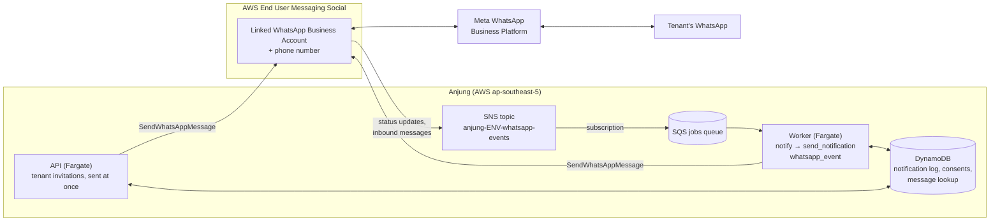
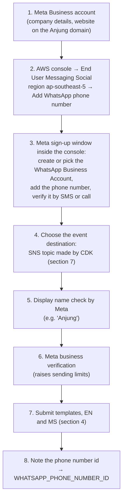
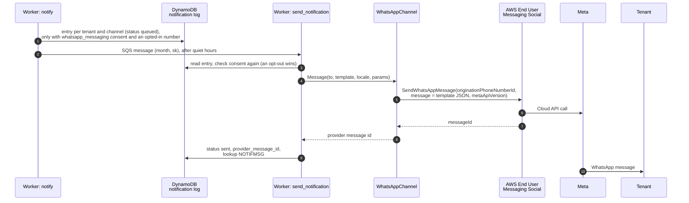
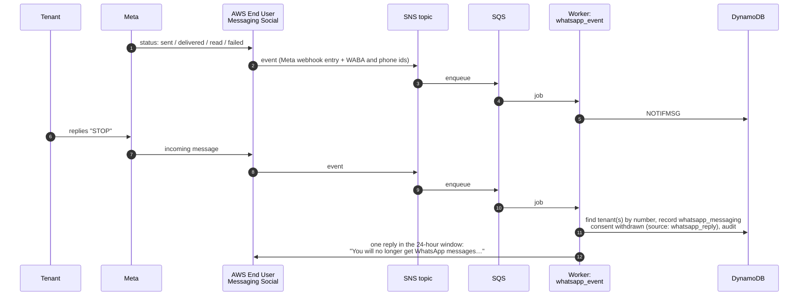
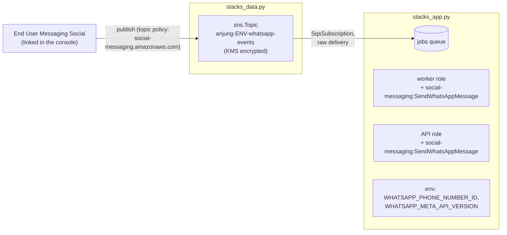

# WhatsApp through AWS End User Messaging Social

**Status:** proposal for decision D3 (plan item P4-05). Nothing here is built yet. Today the `whatsapp` channel is a
stand-in (`FakeChannel`) outside production, and staff share set-password links from their own WhatsApp (A-10).

This document describes how Anjung would send and receive WhatsApp messages through **AWS End User Messaging Social**
(API namespace `socialmessaging`, IAM prefix `social-messaging`), the AWS service that connects an AWS account to
Meta's WhatsApp Business Platform.

## 1. Why this route

| | AWS End User Messaging Social | A WhatsApp provider (BSP) |
|---|---|---|
| Region | Available in Asia Pacific (Malaysia), `ap-southeast-5`: the same region as the rest of Anjung | Depends on the provider |
| Credentials | IAM roles, as for SES. No outside API key to store or rotate | An API key in Secrets Manager |
| Events | SNS or EventBridge, into the existing SQS worker | A public webhook to build, sign-check and rate-limit |
| Billing | One AWS bill: Meta's fee plus an AWS fee per message, no monthly fee | Meta's fee plus the provider's markup or plan |
| Help with Meta | Guided sign-up in the AWS console; templates in the console or API | Usually more hands-on support |

What it does **not** change: messages still pass through Meta's WhatsApp platform, which is outside Malaysia, and
every business-started message still needs a template that Meta has approved.

## 2. Overview



- **Outbound:** the notification service decides who gets what (consent, preferences, quiet hours) exactly as today.
  Only the delivery step changes: a real `WhatsAppChannel` replaces `FakeChannel("whatsapp")`.
- **Inbound and status:** AWS publishes each WhatsApp event (sent, delivered, read, failed, an incoming message) to
  an SNS topic. The topic feeds the existing SQS queue, and a new `whatsapp_event` job updates the notification log
  and handles opt-outs. Anjung needs no public webhook.

## 3. One-time setup

These steps involve Meta and cannot all be automated. Do them first: business verification and template approval
take the longest.



- The phone number must be dedicated to Anjung. A number that is in use on the WhatsApp app has to be removed from it
  first.
- One number per environment is simplest: a test number (Meta provides one) for dev and staging, the real number in
  prod.
- New accounts start with a daily limit on how many people they can message, raised as the account builds a good
  record and after business verification. The pilot stays well under the starting limit.

## 4. Templates

Every message Anjung starts is a **template message**. Free-form text is only allowed within 24 hours of the tenant's
last message, and Anjung does not rely on that.

Anjung's templates (`backend/app/domains/notifications/templates/`) map to Meta templates one to one, in English
(`en`) and Malay (`ms`). All are category **utility**: transactional, with no promotion, offers or marketing
wording. Meta may reclassify a template as marketing, which costs about six times as much, so keep the wording plain.

| Anjung template | Meta template | Body variables, in order | Button |
|---|---|---|---|
| `payment_reminder` | `anjung_payment_reminder` | 1 brand, 2 invoice number, 3 amount, 4 due date | URL: pay link |
| `invoice_overdue` | `anjung_invoice_overdue` | 1 brand, 2 invoice number, 3 amount, 4 due date | URL: pay link |
| `invoice_issued` | `anjung_invoice_issued` | 1 brand, 2 invoice number, 3 amount, 4 due date | URL: invoice |
| `payment_received` | `anjung_payment_received` | 1 brand, 2 amount, 3 invoice number | URL: receipt |
| `maintenance_update` | `anjung_maintenance_update` | 1 brand, 2 request title, 3 new status | URL: request |
| `lease_agreement_sent` | `anjung_lease_agreement` | 1 brand, 2 unit | URL: lease |
| `lease_activated` | `anjung_lease_activated` | 1 brand, 2 unit, 3 start date | URL: lease |
| `lease_terminated` | `anjung_lease_terminated` | 1 brand, 2 unit, 3 end date | URL: lease |
| `tenant_invite` | `anjung_tenant_invite` | 1 brand, 2 tenant name, 3 expiry date | URL: set-password link |

Staff emails (`invite_staff`, `plan_ending`) and `privacy_request_update` stay email only.

Example, `anjung_payment_reminder` in Malay:

```
{{1}}: Peringatan, invois {{2}} sebanyak {{3}} perlu dibayar pada {{4}}.
[ Bayar sekarang ]  → https://app.anjung.my/pay/{{1}}
```

- **Brand as a variable (A-B8):** the company's own name goes in variable 1, so one approved template serves every
  company. Meta's display name above the chat stays "Anjung".
- **Links in buttons:** a URL button has a fixed base (the app's domain) and one variable suffix. That keeps links
  short and lets Meta approve the domain once. The base differs per environment, so each environment's templates are
  submitted separately.
- **Versioning:** a Meta template cannot be edited freely once approved. A wording change is a new template
  (`anjung_payment_reminder_v2`), mapped in code when approved.
- Templates can be created with the `CreateWhatsAppMessageTemplate` API or in the console. Keep their definitions in
  the repo (for example `backend/app/domains/notifications/whatsapp_templates.json`) and submit them with a small
  script, so EN and MS stay in step with the email texts.

## 5. Sending

### 5.1 Flow



Everything up to the channel call exists today (`domains/notifications/service.py`, `send`). The provider message id
lookup (`message_lookup_put`) also exists already, for SES; WhatsApp status events reuse it.

### 5.2 The channel

New class in `backend/app/integrations/channels.py`, beside `SesChannel`:

```python
class WhatsAppChannel:
    """AWS End User Messaging Social. Status and inbound messages come back through SNS to the
    `whatsapp_event` job."""

    name = "whatsapp"

    def __init__(self, client: Any, phone_number_id: str, meta_api_version: str) -> None:
        self._c, self._from, self._v = client, phone_number_id, meta_api_version

    def send(self, msg: Message) -> str:
        spec = WHATSAPP_TEMPLATES[msg.template]          # Meta name, variable order, button param
        body = {
            "messaging_product": "whatsapp",
            "to": msg.to,                                 # E.164, e.g. +60123456789
            "type": "template",
            "template": {
                "name": spec.name,
                "language": {"code": msg.locale},         # "en" or "ms"
                "components": spec.components(msg.params, brand=msg.from_name),
            },
        }
        try:
            r = self._c.send_whatsapp_message(
                originationPhoneNumberId=self._from,
                message=json.dumps(body).encode(),
                metaApiVersion=self._v,
            )
        except self._c.exceptions.ThrottledRequestException as e:
            raise TransientError(str(e)) from None
        return str(r["messageId"])
```

Changes around it:

1. **`Message` gets `params`.** Email sends rendered text; WhatsApp sends the template name and its variables, and
   Meta fills them in. `send` in `notifications/service.py` already holds `entry["params"]`, so it passes them on.
   The rendered `text` stays for the fake channel's log.
2. **Template map** (`WHATSAPP_TEMPLATES`): Anjung template → Meta name and variable order. A template with no entry
   is not offered on WhatsApp, and `channels_for` skips the channel for it, so the tenant still gets the email.
3. **Settings** (`core/config.py`): `whatsapp_phone_number_id` and `whatsapp_meta_api_version`. In
   `container.py`, register `WhatsAppChannel` when the phone number id is set, keep `FakeChannel` otherwise outside
   prod, and register nothing in prod without it (the invitation option then answers 409, as today).
4. **Errors:** throttling raises `TransientError`, so the SQS message is retried with backoff and then goes to the
   DLQ. Validation errors (bad number, template not approved) mark the entry `failed` at once, as for email.
5. **Phone numbers** are stored in E.164 (`+60…`); the preferences screen already requires a number before WhatsApp
   can be turned on.

### 5.3 Set-password invitations

The `whatsapp` invitation channel (LLD 11.2) is sent by the **API** at once, not queued, so the link never sits in a
queue. It uses the same `WhatsAppChannel` with `anjung_tenant_invite`; the link goes in the URL button, and the
notification log keeps the send with the link removed (already the case). It still needs a number and recorded
`whatsapp_messaging` consent. Once live, set `VITE_WHATSAPP_SENDING=true` so the SPA shows "Send by WhatsApp".

## 6. Status updates and incoming messages



Each SNS event carries the Meta webhook entry as a JSON string (the field is `whatsAppWebhookEntry`; check the exact
shape against the service's event documentation when building). The `whatsapp_event` job:

| Event | Action |
|---|---|
| `statuses[].status = sent` | Nothing new (already `sent` when the API answered) |
| `delivered` | Log entry → `delivered` |
| `read` | Log entry → `read` |
| `failed` | Log entry → `failed`, with Meta's error code. Code for "not a WhatsApp user" or a blocked number: turn the tenant's WhatsApp preference off, so later messages go by email |
| Incoming text equal to `STOP`, `BERHENTI` or `UNSUBSCRIBE` (any case) | Withdraw `whatsapp_messaging` consent for every tenant with that number, audit, send one confirmation |
| Other incoming text | Log the fact (not the text) and reply once: "This number only sends notices. Please use the Anjung app or contact your landlord." No conversation is kept |
| Unknown message id | Ignore (`unknown_message`), as for SES |

- **Statuses only move forward** (`sent` → `delivered` → `read`). Events can arrive out of order or twice; an
  older status never overwrites a newer one.
- **Opt-out is immediate:** `send` already rechecks consent just before delivery, so a message queued before the
  "STOP" is suppressed.
- **Inbound content** is personal data. Store only what is needed: the number, the time, and whether it was an
  opt-out. Message bodies and media are not stored.
- The notification log's status list gains `delivered` and `read` (contract change: the `status` enum of the
  notification log entry).

## 7. Infrastructure (CDK)

Additions to `infra/anjung_infra/`:



- **SNS topic** with a resource policy that lets the `social-messaging.amazonaws.com` service publish, limited to
  this account (`aws:SourceAccount`). Subscribe the jobs queue (or a small dedicated queue if volumes grow).
- **IAM:** `social-messaging:SendWhatsAppMessage` on the phone number's ARN only, for the worker (notifications) and
  the API (invitations, sent at once). Template management stays with people in the console or the submit script,
  not the running app.
- **Config per environment** (`config.py`): the phone number id and the Meta API version. The phone number id is not
  secret but differs per environment.
- **Alarms** (`stacks_observability.py`): failed WhatsApp sends above a threshold, and the DLQ, as for email.
- The account link itself (WhatsApp Business Account, phone number, event destination) is made in the console
  (section 3), then recorded in the runbook.

## 8. Testing

| Where | How |
|---|---|
| Unit tests | `WhatsAppChannel` against a botocore `Stubber`: request shape per template and locale, throttling → `TransientError`, other errors → failed |
| Unit tests | `whatsapp_event`: status order, duplicate events, unknown ids, STOP in English and Malay, a number shared by two tenants |
| Contract | A template map test: every Anjung template offered on WhatsApp has a Meta name and the same variables as its email text, in both languages |
| Local stack and NAS demo | Unchanged: `FakeChannel` writes messages to the API log |
| Dev on AWS | Meta's test number and a few registered test phones: send each template, reply STOP, check the log and consent |
| Before go-live | Real number, approved templates, one pilot company |

## 9. Cost

Charged per delivered template message: Meta's fee for Malaysia and the category, plus the AWS fee. No setup or
monthly fee. Figures to confirm against AWS's pricing page and Meta's rate card before committing:

- Meta, Malaysia, utility: about RM0.056 a message (about USD 0.014). Marketing is about RM0.35, which is why the
  templates must stay utility.
- AWS: about USD 0.005 per outbound and USD 0.001 per inbound message.

Example: a company with 200 tenants, each receiving about 4 WhatsApp messages a month (a reminder, a receipt, an
overdue notice, a maintenance update), sends 800 messages: about **RM65 a month**. Email stays the free default;
WhatsApp is opt-in per tenant, and a company could later get it only on higher plans.

## 10. Privacy

- **Consent:** WhatsApp is used only with recorded `whatsapp_messaging` consent and an opted-in number (already
  enforced). Opt-out works in the app and by replying STOP.
- **Cross-border:** AWS processes the request in `ap-southeast-5`, but Meta delivers the message from its own
  platform outside Malaysia. The counsel brief (question 6) should name Meta as a recipient. The privacy notice must
  mention WhatsApp.
- **Minimum content:** templates carry what a tenant needs to act (invoice number, amount, date, a link). No IC
  numbers, no balances beyond the invoice, no document contents. Everything else is behind sign-in.
- **Invitations:** the set-password link goes only to the tenant's own number and is never logged (LLD 11.2).

## 11. Work plan

| Step | Who | Effort |
|---|---|---|
| Meta Business account, dedicated number, display name, business verification | Owner | Days to weeks (Meta) |
| Template texts, EN and MS, and a native Malay check | Engineering + reviewer | 0.5 d |
| Link the account in the AWS console, submit templates | Owner + engineering | 0.5 d, then Meta's review |
| CDK: topic, subscription, permissions, config, alarms | Engineering | 0.5 d |
| `WhatsAppChannel`, template map, `Message.params`, container wiring | Engineering | 1 d |
| `whatsapp_event` job: statuses, STOP, failures | Engineering | 1 d |
| Contract (notification statuses), docs, SPA flag | Engineering | 0.5 d |
| Test in dev with Meta's test number | Engineering | 0.5 d |

About 4 days of engineering, in line with P4-05. The lead time is Meta's verification and template approval, so start
those first.

## 12. Open points

1. Confirm the AWS and Meta prices for Malaysia, and whether utility templates sent inside the 24-hour window are
   charged.
2. Counsel: Meta as a cross-border recipient; whether staff may record WhatsApp consent on a tenant's behalf before
   the tenant has an account (brief, question 15b).
3. Check the exact SNS event shape and the Meta error codes for "not on WhatsApp" and "blocked" when building.
4. Whether WhatsApp becomes a plan feature (cost passed on) or is included for every company.
